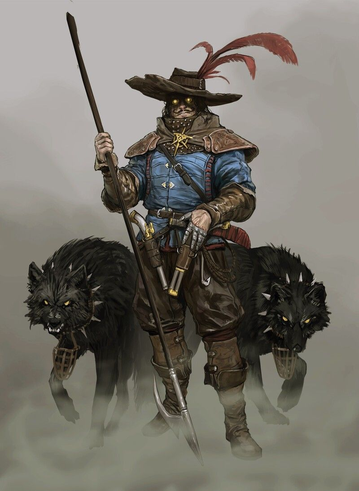

%%
[[Vihri]]
[[Odric Pizak]]
[[Rodomyr]]
[[Keyzal 21]]
[[Jan of Kolglade]]
%%

    <h4 class="wiki-header">Ormir Pizak</h4>
    

        <strong>Occupation</strong>
        Kennelmaster & Enforcer
    

    

        <strong>Culture</strong>
        <a href="Vihri" class="internal-link">Grachi</a> <a href="Human" class="internal-link">Human</a>
    

    

        <strong>Born</strong>
        899PA, near Soludha
	    

    

        <strong>Died</strong>
        927PA, Sargov
    

    

        <strong>Cause of Death</strong>
        slain by Jan of Kolglade, aged 29
    

    

    

        <strong>Allegiance</strong>
        Boyar Ulyanov, <a href="Rodomyr" class="internal-link">Grigory Rodomyr</a> 
    

    

	 

Ormir Pizak was a grachi Kennelmaster and men at arms who, alongside his brother <a href="Odric Pizak" class="internal-link">Odric Pizak</a>, led a band of hardened and cutthroat  mercenaries in northern Grachy. For the past year the brothers were hired on by <a href="Rodomyr" class="internal-link">Grigory Rodomyr</a> in the name of the Ulyanov family of Soludha and eventually moved alongside their main operation further east to the Lenkov Estate. Ormir wielded a pair of expertly crafted <a href="Keyzal 21" class="internal-link">Keyzal Mk. 21 Osmiumthrowers</a> that he had acquired under mysterious circumstances and was never seen without his two loyal wolfhounds: Claw & Fang.

In service to the desires of the Ulyanovs and their Priest, Father <a href="Leonyd Krunliv" class="internal-link">Leonyd Krunliv</a>, Ormir was tasked with finding a druid of the land to help conduct their occult ritual for immortality, after his brother Odric had only managed to find the Aeldwood. He eventually made it to a small grove build around an old Monolith in the central Grachwoods near the village of Varny and took the Warden of the woods, a druid by the name of Kristel, captive under threat of her sons Linas's life. He brought them back to the Lenkov Estate were they would await the day of the ritual. While Kristel did not survive the ordeal, a group of heroes, the Druid Havu, the young noble <a href="Jan of Kolglade" class="internal-link">Jan</a>, the Archer Danusz, the Knight Hildegard and the Warrior Marianna, were able to take vengeance and save Linas life.

Before this fateful encounter however, Ormir and his own crew, various hardened men and woman of the sword, alongside the pyromantic Diabolist Lorsky, made their way to Sargov, a small village near Lenkov Estate, where a young boy named Andre had been telling tales of their capture of Kristel. While there their efforts to take the Boy by force were averted, first just by lonely Marianna who took a stance in front of the abandoned abbey where she had kept Anders safe, and later by the other four aforementioned adventurers. His Dogs, his men and his guns proved at the end no match for justice and his heart was pierced by the Rapier of Jan of Kolglade, Ormir Pizak falling dead into the rainy mud of Sargov.
