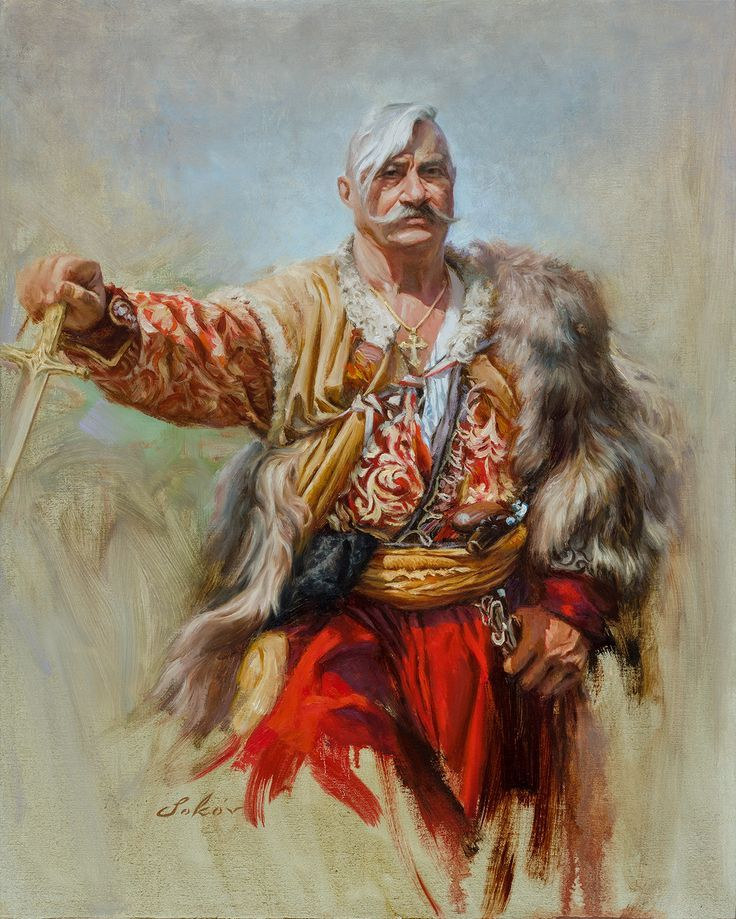

%%
[[Vihri]]
[[Beryl Lenkov]]
[[Odric Pizak]]
[[Ranni Grevil]]
[[Jan of Kolglade]]
[[Ormir Pizak]]
%%

    <h4 class="wiki-header">Grigory Rodomyr</h4>
    

        <strong>Epithet</strong>
        The Boar
    

    

        <strong>Occupation</strong>
        Headman
    

    

        <strong>Culture</strong>
        <a href="Vihri" class="internal-link">Grachi</a> <a href="Human" class="internal-link">Human</a>
    

    

        <strong>Born</strong>
        877PA, Soludha
	    

    

        <strong>Died</strong>
        927PA, Lenkov Estate
    

    

        <strong>Cause of Death</strong>
        slain by <a href="Jan of Kolglade" class="internal-link">Jan of Kolglade</a>, aged 50
    

    

    

        <strong>Allegiance</strong>
        The Ulyanov Family
    

    

	 

Grigory Rodomyr was the sworn protector and Headsman of the Ulyanov Family of Boyars, serving two generations first under Andre Ulyanov and then later young Katerina Ulyanov, before his own death he saw both of his liege lords die before his eyes. He cared for Katerina like a daughter of his own and followed her into the same mad pursuit for immortality that had consumed old Boyar Ulyanov beforehand, a fire churned on by the whispers and prophecies of Father <a href="Leonyd Krunliv" class="internal-link">Leonyd Krunliv</a>, who had become the spiritual advisor of the Ulyanovs in recent years. 

Following the death of Andre Ulyanov, Rodomyr went through still with the plans of Ulyanov and his vihri collegue Moreslav zi Perliav on the wishes of Katerina, who had found a first victim in the Boyar Lenkov, drowning in debts with lands near various druidic groves and an estate isolated enough. Rodomyr hired the two Pizak brothers, <a href="Ormir Pizak" class="internal-link">Ormir</a> & <a href="Odric Pizak" class="internal-link">Odric</a>, as well as the travelling knight Errand <a href="Ranni Grevil" class="internal-link">Ranni Grevil</a>, the latter tasked to keep an eye on the jovial Lenkov.

During the fateful events of the Storming of Lenkov Castle by the group surrounding the druid Havu on the morning of the 34th of May 927PA, Rodomyr the Boar saw the ritual old Ulyanov had died for succeed, only to witness the death of his ward Katerina seconds later. Distraught and lost in anger and self-hatred, Rodomyr would die in the same Courtyard the Ulyanov line ended, at the hands of <a href="Jan of Kolglade" class="internal-link">Jan of Kolglades</a> righteous <a href="Seafoam Piercer" class="internal-link">Rapier</a>.
