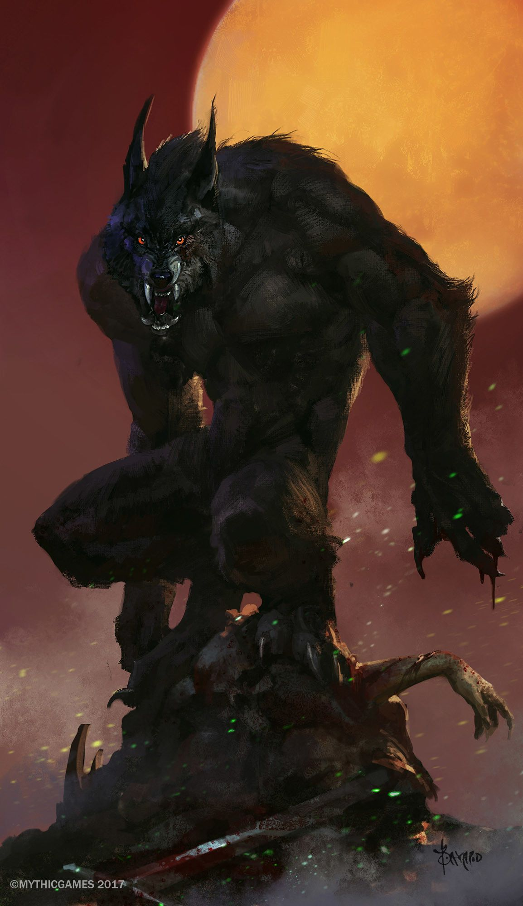

%%
[[Lycanthropy]]
[[Zurán Barbeshvili]]
[[Aratz Otxoa]]
[[Darian Amouzgar]]
%%

    <h4 class="wiki-header">Vargul</h4>
    

        <strong>Occupation</strong>
        Packleader of the Trinwoods
    

    

        <strong>Culture</strong>
        <a href="Lycanthropy" class="internal-link">Werewulf</a>
    

    

        <strong>Born</strong>
        894PA, Schipwig
	    

    

        <strong>Died</strong>
        923PA, Trinwoods
    

    

        <strong>Cause of Death</strong>
        Slain by Marianna Kaminski 33 years of Age
    

    

	 

The creature better known as Vargul, was born as Filip of House Vanderley in Schipwig, one of the largest ports of the <a href="Blijgrat" class="internal-link">League of Blijgrat</a>, a human line of nobility that had made a good fortune in the world of the textile trades and commanded a sizeable fleet of cogs and merchantmen, sailing the ports of the Torn Sea, Filip was the thirdborn son of a rich dynasty. He was known as an uncomfortable, angry and undesirable man, envying the positions of his two elder brothers, looking down on the servants and growing distant from his father, the Lord Vanderley himself.

In the year 913PA, Filip was exiled by his family, after causing the death of various servants, he was send on the road with nothing but a pouch of coin to his name, in a desperate attempt by his father to save his families legacy Vargul left Blijgrat forever. Filip found a new calling however, roaming the lawless wilds and unguarded roads of Ur, he became a murderer and bandit, eventually leading his own pack of killers and making a questionable name for himself, now known as Vargul, Terror of many a merchant in the central Kingdoms. By 920PA, him and his band had grown confident enough to prey on the larger kinds of prey: even assaulting guarded caravans and homesteads, until by winter of 920, a group of adventurers from the <a href="Trifflands" class="internal-link">Trifflands</a> set out to put an end to their crimes. Vargul barely escaped the slaughter with his own hide, fleeing south to the Trinvale and then the kerlaen Wilderness south of the Trinmo. It was here were an unfortunate merchant, draped in heavy, foreign silks made the unfortunate mistake of inviting him to his campsite at night. The foreigner boasted over wine of his recent expeditions to the cursed ruins of ancient Tarsus, a ruin in the northern <a href="Wasteland of Rakh" class="internal-link">rakhi Wastes</a>, where he saw step-tiered temples, serpentine idols and pulled a weapon from the dust of forgotten gods. The traveller, with no means to him then, was granted his wish for riches by the strange dagger, and found himself clad in the finest silks, his pockets full of precious tones and heavy gold, it was too late for the man already by the time he looked into Varguls eyes, and saw the weary stranger he had invited to his fire had turned into a creature of greed and murder. When Vargul stepped over the body of the man, and took the dagger into his own hands, he only asked for one thing as the voice in his head asked what he wanted: Dominion.

For the next years Vargul haunted the Trinvales woods, no longer a man, but a beast and ruler of mortal lifes. Transformed into a werewulf and given the powers to mark and turn his victims to his delight, he founded a second pack: this time a more literal interpretation of the term. Until the summer of 923PA, Vargul ruled as the King of the western Trinwoods, when a group of heroes, bearing a strange chest, came across his path. His rites and runes were not strong enough to best the magicks of the mage <a href="Darian Amouzgar" class="internal-link">Darian</a> and the Cleric <a href="Aratz Otxoa" class="internal-link">Aratz</a>; his claws could not match the ferocity brought by the blades of the goblin Perzuk and <a href="Zurán Barbeshvili" class="internal-link">Zuran the Inquisitor</a> and his head did not survive the fearsome arrows of Danusz the Mercenary or the righteous blade of the Knight Marianna.
