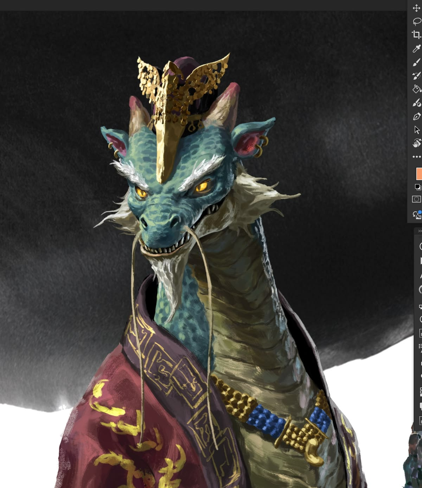

%%  
[[Bihra]] [[Steppe Bihra]] [[Durbihra]]  
[[Vas Ira]] [[Karaluk]] [[Kareli Hierarchy]]  
[[Vol]] [[Ekkam]] [[Az]] [[Bihra Rules]]  
%%  

    
<small><i>An Azbihra of eastern Nirydia</i></small>  

  
<small><i> This race has a unique rule set for play in Pathfinder 1e, see <a href="Bihra Rules" class="internal-link">Bihra Rules</a></i></small>  

The Azbihra are the <a href="Bihra" class="internal-link">Bihra</a> of eastern and southern <a href="Nirydia" class="internal-link">Nirydia</a> and make up the majority of all Bihra in the world. Smaller than the <a href="Steppe Bihra" class="internal-link">Steppe Bihra</a> and far less prone to great mutation, they are a communal people of traders, farmers and city builders whose realms have stood on the southern coasts since the earliest ages of Bihra history. The Steppe Bihra count them among the Zibihra, the failed Bihra, and for much of their history large parts of the Azbihra have lived under the rule of the Khans.
  
<h2>Physiology</h2>  

Most Azbihra stand between 1.4 and 1.8 metres tall and have powerful jaws for creatures of their size and noticeable claws on their hands and feet. Their scales are stronger than those of their western cousins and come in a wide range of striking colours, and their mutations are much tamer than those of the steppe, so that many Azbihra are visually and physically similar to one another. A true mutation is rare among them and is often taken as the sign of a future shaman.
  
<h2>Distribution</h2>  

The Azbihra live across eastern and southern Nirydia. They are the majority of the <a href="Kareli Hierarchy" class="internal-link">Kareli Hierarchy</a> and of <a href="Paqor" class="internal-link">Paqor</a>, and together with humans make up the Ganoans of the <a href="Ganoa Valley" class="internal-link">Ganoa Valley</a>. Further east they live in the valleys and higher ranges of the Limsul Peaks, among them the Rhagi of <a href="Rha-Gis" class="internal-link">Rha-Gis</a>, and on the island of Sgar off the coast of <a href="Gorat" class="internal-link">Gorat</a>. Within the <a href="Niryd Steppe" class="internal-link">Niryd Steppe</a> itself large Azbihra communities farm rice in the river cities of the Agav as tributaries and often slaves of the Khaganates, and many of the Inive of the Forbidden Lands are Azbihra.
  
<h2>History</h2>  

The earliest evidence for upright Bihra comes from southern Nirydia, and from at least the 12th century BA the Azbihra built the cities of the era of Anator-Bihr, the era of living water. Around the 5th century BA these were united by Volys the Spiritdrinker into the Empire of <a href="Vol" class="internal-link">Vol</a>, whose capital Uzra stood on the site of modern Halad. After Vol fell to the Khatrym of <a href="Azuvke" class="internal-link">Azuvke</a> in 238PA the Bihra founded the realms of <a href="Az" class="internal-link">Az</a> and <a href="Ekkam" class="internal-link">Ekkam</a>, which ruled the shores of the Citrine and Jade Seas until the <a href="Luchun Khaganate" class="internal-link">Luchun Khaganate</a> subjugated them in 551PA and 578PA. When <a href="Gaden" class="internal-link">Gaden</a> of Drizan broke the Luchun at Verivale in 671PA the southern ports passed to his protectorate, which became the Kareli Hierarchy in 752PA, while in 582PA the Bihra of the Limsul Peaks had formed the High Temple of Rha-Gis.
  
<h2>Society and faith</h2>  

The Azbihra are known for their love of trade, and Bihra families run ferries, markets and merchant houses across the south, while their realms, called omna in Lihbare, have long been among the great maritime powers of the Citrine and Jade Seas. Most speak Lihbare and its dialects, such as Ganoan Lihbare, while the Rhagi speak Rhakob. Many follow the <a href="Vas Ira" class="internal-link">Vas Ira</a> and its denominations, above all the <a href="Karaluk" class="internal-link">Karaluk</a>, <a href="Iratism" class="internal-link">Iratism</a> and <a href="Noorism" class="internal-link">Noorism</a>, while some have turned to the faith in the Sun God <a href="Zuhurism" class="internal-link">Pen-Zuhur</a>.
  
