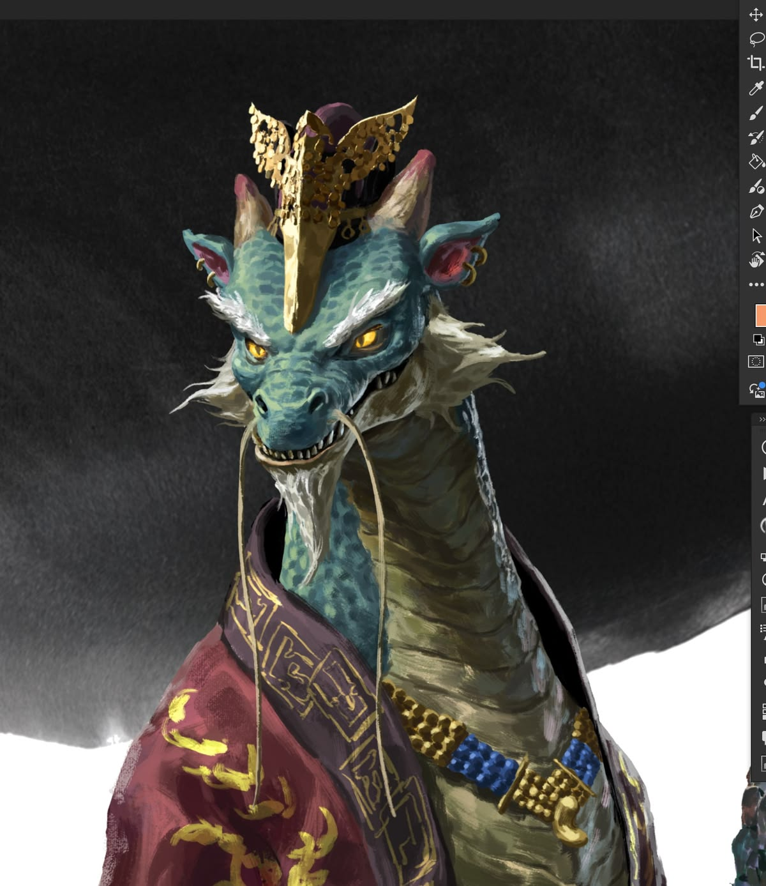

%%  
[[Nirydia]]  
[[Steppe Bihra]] [[Azbihra]] [[Durbihra]]  
[[Vas Ira]] [[Bihra Shamanism]]  
[[Bihra Rules]]  
%%  

    
<small><i>A Bihra of eastern Nirydia</i></small>  

  
<small><i> This race has a unique rule set for play in Pathfinder 1e, see <a href="Bihra Rules" class="internal-link">Bihra Rules</a></i></small>  

The Bihra, known to the humans of Kher and much of Ilrakhan as the Kobolds, are bipedal, scaled reptilian humanoids native to the continent of <a href="Nirydia" class="internal-link">Nirydia</a>. Together they are among the most numerous peoples of the continent, though whether they outnumber the <a href="Shirin" class="internal-link">Shirin</a> or even the <a href="Human" class="internal-link">Humans</a> is impossible to say, as the Bihra are spread across thousands of islands and every part of Nirydia while the Shirin live in their millions within a single realm, and they show great variance in size, head and tail shape and the tint of their scales depending on their region of origin. The Bihra are divided into three great peoples: the <a href="Steppe Bihra" class="internal-link">Steppe Bihra</a> of the <a href="Niryd Steppe" class="internal-link">Niryd Steppe</a>, the <a href="Azbihra" class="internal-link">Azbihra</a> of eastern and southern Nirydia and the <a href="Durbihra" class="internal-link">Durbihra</a> of the island of Durennis.
  

The Bihra claim kinship with <a href="Dragon" class="internal-link">Dragonkind</a> in many of their myths, but there is no evidence outside of the mythological that the two are related.
  
<h2>Peoples</h2>  

The Steppe Bihra are the largest and most warlike of the three, standing up to 2 metres tall and abnormally prone to mutation, which they revere both religiously and culturally. They consider themselves the only true Bihra and look upon all others as underdeveloped and failed Bihra, whom they call the Zibihra. To many in Ilrakhan the word Kobold refers above all to the Steppe Bihra, which has given the race as a whole a monstrous reputation in the west.
  

The Azbihra are the Bihra of eastern and southern Nirydia and make up the majority of all Bihra in the world. They stand between 1.4 and 1.8 metres tall, their mutations are much tamer than those of the steppe, and they are a communal people of traders, farmers and city builders, from the ports of the <a href="Kareli Hierarchy" class="internal-link">Kareli Hierarchy</a> to the valleys of the Limsul Peaks. The Durbihra of Durennis are the smallest of the three, rarely taller than 1.1 metres, and live mostly in the monsoon jungles of northern Durennis and on the Pepper Islands, where they grow the spices of the <a href="Vanpur Pepper Trade" class="internal-link">Vanpur Pepper Trade</a>.
  
<h2>Faith</h2>  

The Bihra are the origin of the <a href="Vas Ira" class="internal-link">Vas Ira</a>, whose many traditions grew from the ancient practices of <a href="Bihra Shamanism" class="internal-link">Bihra Shamanism</a>. The Steppe Bihra still follow the old shamanic traditions, while most Azbihra hold to denominations such as the <a href="Karaluk" class="internal-link">Karaluk</a>, <a href="Iratism" class="internal-link">Iratism</a> and <a href="Noorism" class="internal-link">Noorism</a>, and the Durbihra to the <a href="Rayadan" class="internal-link">Rayadan</a>. Some Bihra of the east and of the Pepper Islands have turned to the faith in the Sun God <a href="Zuhurism" class="internal-link">Pen-Zuhur</a>.
  
