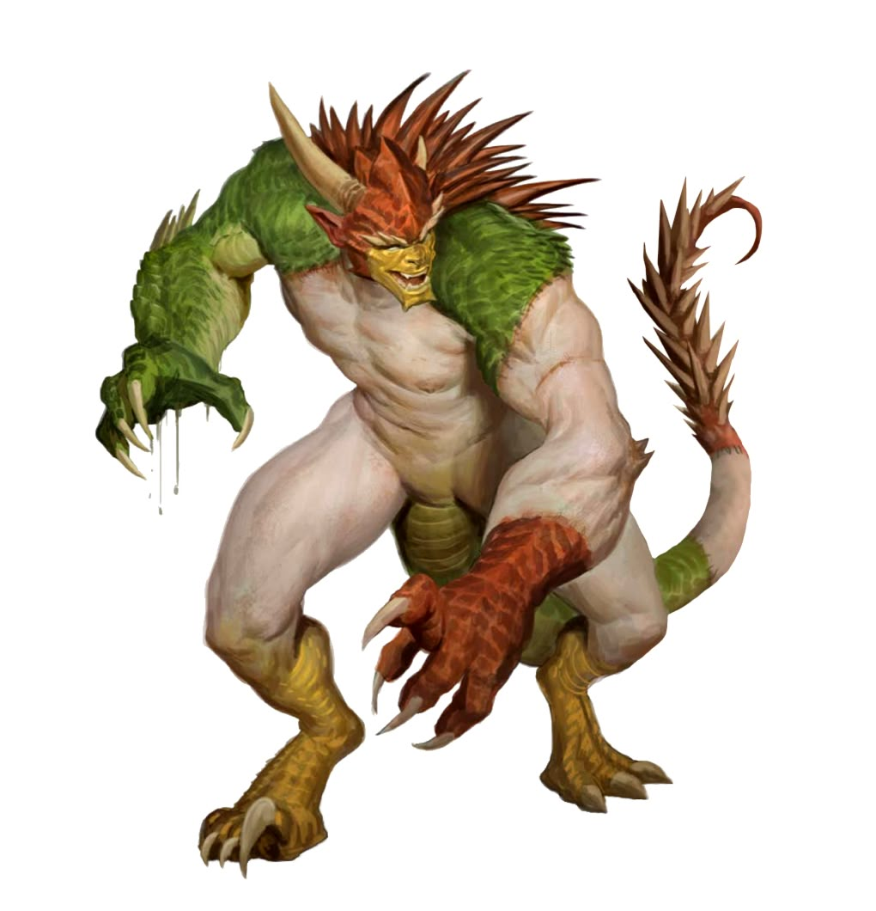

%%  
[[Bihra]] [[Azbihra]] [[Durbihra]]  
[[Niryd Steppe]] [[Great Khaganates of the Steppe]]  
[[Bihra Shamanism]] [[Bihra Rules]]  
%%  

    
<small><i>A mutated Steppe Bihra</i></small>  

  
<small><i> This race has a unique rule set for play in Pathfinder 1e, see <a href="Bihra Rules" class="internal-link">Bihra Rules</a></i></small>  

The Steppe Bihra are the <a href="Bihra" class="internal-link">Bihra</a> of the <a href="Niryd Steppe" class="internal-link">Niryd Steppe</a>, a people of nomadic warriors, herders and shamans who are abnormally prone to mutation and worship the stronger and more exotic among them religiously and culturally. Known to the humans of Kher as the Kobolds, they have ruled the steppe through their Khaganates for as long as records exist, and at the height of the <a href="Great Khaganates of the Steppe" class="internal-link">Great Khaganates</a> their Khans held vast lands beyond it. They consider themselves the only true Bihra and call all others, the <a href="Azbihra" class="internal-link">Azbihra</a> and <a href="Durbihra" class="internal-link">Durbihra</a>, the Zibihra, the failed Bihra.
  
<h2>Physiology</h2>  

The Steppe Bihra are the largest of the Bihra, standing up to 2 metres tall and often far heavier than their eastern kin. Many have evolved extremely durable hides covering their entire body, which allow them to endure the razor-edged Aspira bladegrass of the central steppe. Mutation is common among them and takes many forms, from horned crests, heavy tails and extra eyes to venomous bites and second hearts, and in its extremes it produces Bihra of almost 9 metres in height or with two or even three heads. Few Steppe Bihra live beyond 70 years, though the span of a life depends greatly on the nature of their mutations.
  
<h2>Society</h2>  

The culture of the Steppe Bihra rests on the triumph of the physical, the belief that spiritual superiority is proven through strength, mutation and victory. The most mutated among them are honoured as leaders and shamans, and the greatest Khans have often been those whose bodies set them apart. Quarrels in the camps are commonly settled by wrestling bouts, and in the past single combat between Khans could decide who ruled the whole steppe.
  

Most Steppe Bihra are nomadic, following their herds of <a href="Auroch" class="internal-link">Aurochs</a> and migrating between the sacred sites of their shamans and the lands of their tributaries. Their largest communities are the walking cities, whole camps carried across the steppe on the backs of the oldest Gnarlskin Salamanders, the great fire-breathing reptiles that also serve as the mounts of their warriors. Each Khaganate holds tributaries of its own, above all the rice farming river cities of the Agav, which are largely populated by Azbihra together with humans and goblins, many of them slaves.
  
<h2>Faith</h2>  

The Steppe Bihra follow the ancient traditions of <a href="Bihra Shamanism" class="internal-link">Bihra Shamanism</a>, loosely related to the overarching teachings of the <a href="Vas Ira" class="internal-link">Vas Ira</a>. Their shamans are usually born with physical anomalies such as a surplus of arms, legs, eyes or heads, and lead their communities in weather rites, fortune-telling and spirit journeys. A rider and their salamander are believed to share a soul. The Khans of the steppe hunted the practitioners of the <a href="Soulbond" class="internal-link">Art of the Soulbond</a>, whose theft of the spirit they saw as a perverse destruction of the physical.
  
<h2>Politics</h2>  

The Steppe Bihra are divided into larger and lesser Khaganates and tribes. Since the fall of the last Great Khan in 794PA none has ruled the whole steppe, and in the modern day four great Khaganates contend for the inheritance of the Jigallor: the <a href="Duol Khaganate" class="internal-link">Duol</a>, the most powerful of them, whose Khan still styles himself the Khan of Khans, the farmer and slaver lords of the <a href="Anatai Khaganate" class="internal-link">Anatai</a>, the shamans and witches of the <a href="Yadu Khaganate" class="internal-link">Yadu</a> and the mercantile <a href="Gökol Khaganate" class="internal-link">Gökol</a>.
  
<h2>Relations with other peoples</h2>  

Few peoples of Nirydia regard the Steppe Bihra with anything but fear. <a href="Kherova" class="internal-link">Kherova</a> has fought them since before the days of the earliest Great Khaganates, the <a href="Twintail Imperium" class="internal-link">Twintail Imperium</a> guards its border against them with the <a href="Red Iron Towers" class="internal-link">Red Iron Towers</a>, and <a href="Roxeria" class="internal-link">Roxeria</a> refuses all trade with them. In the cities of the south they are often despised, and in the <a href="Ganoa Valley" class="internal-link">Ganoa Valley</a> they suffered pogroms in the 9th century and are still called kobolds, scaledogs and khanspawn. Some trade nonetheless crosses the steppe, by the Rainpath to the Ganoa Valley and with the goblin caravans of <a href="Pintrixaz" class="internal-link">Pintrixaz</a> in the north-west, and Steppe Bihra mercenaries are hired across the south.
  
