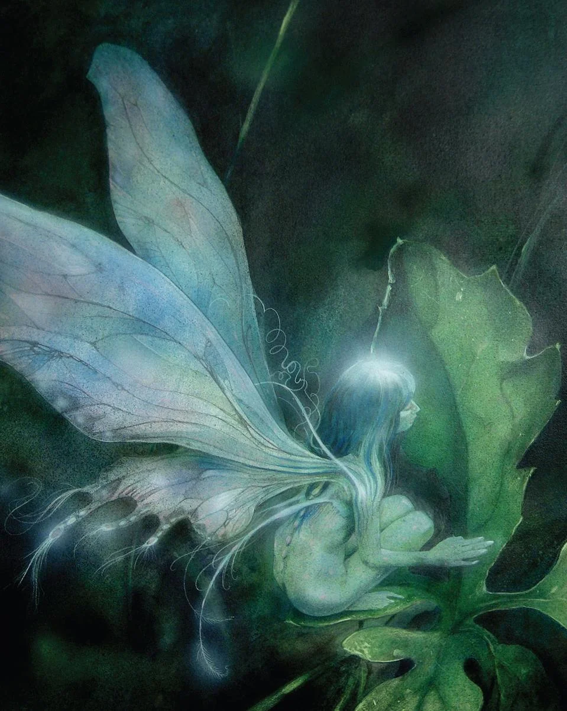

%%  
[[Fey]]  
[[Spiritual Realm]]  
%%  

Sprites are the smallest of the <a href="Fey" class="internal-link">Fey</a>, creatures seldom larger than a child's palm, winged, faintly glowing and each unlike the next. Every sprite is said to belong to some small thing, a spring, a hedge, a mossy stone or the moon's reflection in a still pool, and tales of them are told wherever there are quiet woods, in ilrakhan nowhere more than in <a href="Nostroya" class="internal-link">Nostroya</a> and <a href="Trykkerog" class="internal-link">Trykkerog</a> but their tales are also told in the hills, dells and lost regions of the world at large, where mortal culture and society has kept away from. Where the greater Fey are feared as tricksters and takers, sprites are remembered as curious, vain and playful, quick to take offence and as quick to forget it. Most tales agree that a sprite means little harm. It wants little, lives for the moment it is in, and is more likely to steal a ribbon or tangle a horse's mane than to lead anyone to ruin.
  

    
<small><i>The Sprite of the Moon</i></small>  

  
<h2>Faerie Rings</h2>  

A sprite is said to live in a faerie ring, a rough circle of stones, mushrooms or moss around its place, which glows faintly on certain nights and which a passer-by would overlook by day. Country folk tend the rings they know of, leaving bread, milk, honey or a song on the stones, and say that a ring no one tends goes dark in a few years and its sprite with it. Sprites are tied to their rings far more closely than the greater Fey to any place, and are seldom seen far from them. Yet many tales tell of a sprite seen at one ring and on the same night at another miles away, and sprites call one another siblings, as if all the rings of a wood were rooms of one house. The same tales hold that the way between them only opens in the season it was found: a summer ring and a winter ring do not know each other.
  
<h2>The Rules</h2>  

Many stories in folklore keeps its rules for dealing with the sprites within faerie rings in it, and they agree to a remarkable degree:
  
<ul>  
<li>Bring no metal into the ring. Sprites cannot abide worked metal, iron least of all, and a knife on the stones is the surest way to see one vanish.</li>  
<li>Never give a sprite your true name. Use a nickname, or none at all.</li>  
<li>A sprite cannot lie, and a deal struck with one will be kept to the letter. Keep your own side as carefully.</li>  
<li>Speak to them in rhyme. Sprites cannot rhyme themselves but love to hear it, and children's rhyming questions are the oldest way of asking a sprite anything.</li>  
<li>Ask only of what is near. A sprite knows its own wood, the weather, the beasts and the people who pass through, and usually little of anything beyond it.</li>  
<li>Never ask a sprite about true love. "Ask a sprite of love," the saying goes, "and it will tell you who owns you."</li>  
</ul>  

How a sprite is called no one can agree. Some say by moonlight, some by rhyme, some by offerings left three nights running, and many hold that sprites come most readily to children, who believe in them without trying.
  
