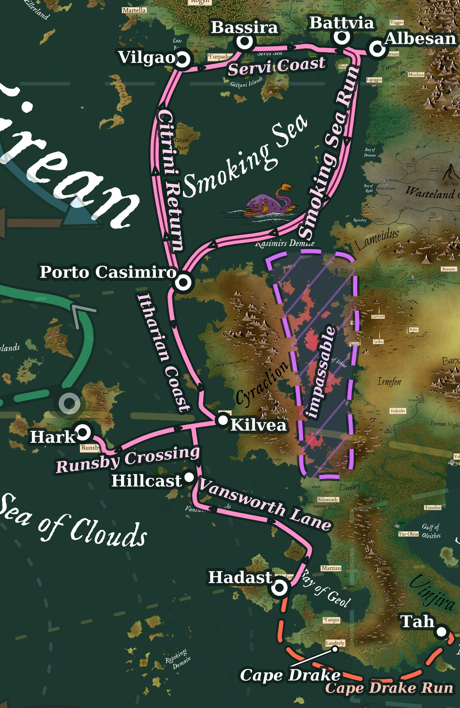

%%
[[Cevolia]]
[[Battvia]]
[[Porto Casimiro]]
[[Itharia]]
[[Kasimir]]
[[Runsby]]
[[Nir Hadast]]
[[Winds and Currents]]
[[Ziflis Trade]]
%%

 
<small><i>The lanes of the Smoking Sea Trade</i></small>

 <h4 class="wiki-header">The Smoking Sea Trade</h4>
 

 <strong>Home ports</strong>
 <a href="Battvia" class="internal-link">Battvia</a>, Albesan, Bassira, Vilgao
 

 

 <strong>Gateway</strong>
 <a href="Porto Casimiro" class="internal-link">Porto Casimiro</a>
 

 

 <strong>Southern ports</strong>
 Kilvea, Hark, Hillcast, Hadast
 

 

 <strong>Waters</strong>
 Servi Sea, Smoking Sea, Sea of Clouds, Bay of Geol
 

 

 <strong>Sailing season</strong>
 South in summer, north in winter
 

The Smoking Sea Trade is the network of sea lanes that links the rich ports of <a href="Cevolia" class="internal-link">Cevolia</a>, north-east of the Smoking Sea, with <a href="Runsby" class="internal-link">Runsby</a>, the Vansworth Islands and the lands of the Bay of Geol, and through them with the rest of Ilrakhan. Its gateway is <a href="Porto Casimiro" class="internal-link">Porto Casimiro</a>, the fortified outpost on the north-western tip of <a href="Itharia" class="internal-link">Itharia</a>, and every ship that passes between the Smoking Sea and the Sea of Clouds sails by it.

Four great trading cities stand on the Cevolian coast: <a href="Battvia" class="internal-link">Battvia</a> and Albesan on the Bay of Butera, Bassira on the Servi Sea and Vilgao on Cats Bay. They are rivals in all things, the southern trade among them. Battvia holds the lead in the south, for Porto Casimiro is its outpost.

<h2>Porto Casimiro</h2>

Porto Casimiro is a small fortified outpost of about five thousand people on the western shores of Itharia, governed for the Crown of Battvia by Conte Niccolo di Simeo. It was founded by Cevoli settlers in a daring mission by the Crown of Battvia to open trade between the ports of the Smoking Sea and the rich ports of southern Behera, and it is the first and so far only human settlement on the island.

The port is named for Saint <a href="Kasimir" class="internal-link">Kasimir</a> the Martyr, who was killed in ritual sacrifice by the natives of Itharia in 602 PA during his last pilgrimage to its red shores. The waters off the island's north coast still bear the name Kasimirs Demise. The name is a warning to those who would venture into Itharia and Cyraclion, not to those who sail past them, and ships cross those waters freely.

<h2>Why the Trade Goes Round Itharia</h2>

The Smoking Sea is open to the north, but its way south is narrow. The Strait of Ithar, between Cyraclion and Itharia and the mainland, cannot be sailed, and every ship bound from the Smoking Sea to the Sea of Clouds must round the west coast of Itharia instead. Before Porto Casimiro was founded there was no safe harbour anywhere along that coast.

The eastern shore of the Smoking Sea offers no shelter either. The ruined lands of Rakh are hostile to life and are visited only by the explorers of the Buteran guilds and by adventurers, and the ships of the Trade keep well offshore all the way from the Bay of Butera to Itharia. Further south, Bilsworth and the lands of Danbry belong to the unliving and take no part in the Trade, and the lanes to the Bay of Geol keep clear of their coast.

<h2>The Trade Year</h2>

The Smoking Sea lies in the north-east trade winds, and the year's sailing turns in one great loop. In summer the trade winds reach right up to the Servi Sea, and Battvian ships leave the Bay of Butera on the Smoking Sea Run. They sail south before the wind along the barren Rakh coast and then turn west by Kasimirs Demise to Porto Casimiro, about 3,200 km in 20 to 30 days.

In winter the wind belts shift south, and the westerlies reach down toward Cevolia. Ships return north from Porto Casimiro on the Citrini Return, sailing close to the wind past Citrini Point until the westerlies carry them the last leg into Cats Bay and Vilgao, about 2,000 km in 15 to 25 days. The same winds govern the Servi Coast, Cevolia's home waters. The westerlies of winter carry ships east from Vilgao past Turpador, Bassira and Battvia to Albesan, and the trade winds of summer carry them back west, a coastal voyage of about 2,000 km and 20 to 25 days.

<h2>The Southern Lanes</h2>

From Porto Casimiro the Itharian Coast lane runs south along the west coasts of Itharia and Cyraclion to Kilvea, about 1,500 km in 15 to 20 days. There it meets the Runsby Crossing, which runs from Hark on the south coast of Runsby east to Kilvea, another 1,500 km. Near the equator the doldrums swing back and forth across these waters with the seasons. The north-east trade winds carry ships south and west in winter, while in summer southerly winds and the Equatorial Countercurrent carry them north and east, so the Crossing is sailed east in summer and west in winter.

From the Runsby Crossing the Vansworth Lane runs south through the Vansworth Islands by Hillcast into the Bay of Geol, to Hadast, the capital of <a href="Nir Hadast" class="internal-link">Nir Hadast</a> and the main port of the bay. It is about 2,600 km long, sailed in some 25 to 35 days, south in winter and north in summer.

<h2>Cape Drake</h2>

From the Bay of Geol the Cape Drake Run leads round Cape Drake, at the southern tip of Landerly, and east past Vinjira to Tah and Moons Gate, where it meets the lanes of the <a href="Ziflis Trade" class="internal-link">Ziflis Trade</a>. It is about 2,600 km long and one of the most dangerous lanes in the region, for leviathans haunt the waters south of Vinjira. Yet it is the link Porto Casimiro was founded for: the road that joins the ports of the Smoking Sea to the central trade of Behera.

