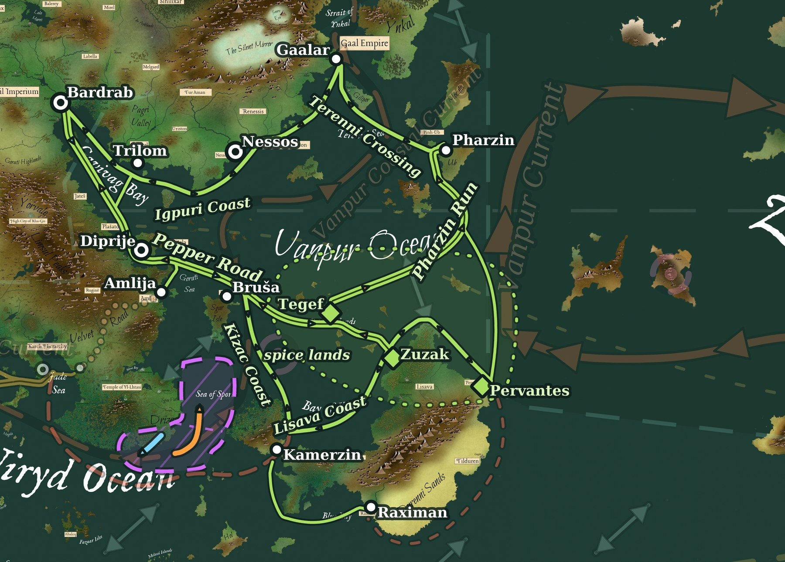

%%
[[Pepper Islands]]
[[Lisava]]
[[Bihra]]
[[Bardrab]]
[[Diprije]]
[[Nessos]]
[[Pharzin]]
[[Winds and Currents]]
[[Ziflis Trade]]
%%

 
<small><i>The lanes of the Vanpur Pepper Trade</i></small>

 <h4 class="wiki-header">The Vanpur Pepper Trade</h4>
 

 <strong>Source</strong>
 The Pepper Islands and northern Lisava
 

 

 <strong>Main markets</strong>
 <a href="Bardrab" class="internal-link">Bardrab</a>, <a href="Diprije" class="internal-link">Diprije</a>, <a href="Nessos" class="internal-link">Nessos</a>
 

 

 <strong>Waters</strong>
 Vanpur Ocean, Gavivag Bay, Terenni Sea, Gorati Sea, Bay of Kizac
 

 

 <strong>Sailing season</strong>
 North in summer, south in winter
 

 

 <strong>Westward link</strong>
 <a href="Ziflis Trade" class="internal-link">Ziflis Trade</a>, by the Velvet Road
 

The Vanpur Pepper Trade is the network of sea lanes that carries the spices of the <a href="Pepper Islands" class="internal-link">Pepper Islands</a> and northern <a href="Lisava" class="internal-link">Lisava</a> to the markets of the Vanpur Ocean and Gavivag Bay. The islands and the northern coasts of Durennis along the Bay of Kizac are among the greatest sources of spice in the world. The spices are grown there by the local <a href="Bihra" class="internal-link">Bihra</a> of Lisava and the islands, who sell them to the ships that come for them each year.

The main markets of the Trade lie in the north: <a href="Bardrab" class="internal-link">Bardrab</a> at the head of Gavivag Bay, <a href="Diprije" class="internal-link">Diprije</a>, the capital of Diseala, and <a href="Nessos" class="internal-link">Nessos</a> on the Igpuri coast. A great part of the Trade's wealth, however, comes from the spices that travel on westward into the <a href="Ziflis Trade" class="internal-link">Ziflis Trade</a>.

<h2>The Pepper Year</h2>

Two monsoons meet over the spice lands. Over the Bay of Kizac the winds blow from the north-east in winter and the south-west in summer, while over the open Vanpur Ocean they blow from the north and north-west in winter and the south and south-east in summer. Different as they are, both carry ships north in summer and south in winter, and the whole Trade follows this one rhythm.

The year is set by the typhoons. They come in from the Zefelli Sea in late summer and autumn, and no captain wants to be caught at sea among the islands when they arrive. The spice fleets therefore sail north as soon as the summer monsoon has settled, and turn for home once the winter monsoon has set in. A ship makes one great round voyage a year, out with the summer and back with the winter.

The Vanpur Current runs north along the outside of the island chain all year, fast and warm. It is the quickest road north, but it never runs the other way, and every ship that comes south must keep inside the islands and wait for the winter monsoon.

<h2>The Northern Circuit</h2>

Ships bound north from the spice lands can take the long eastern road. From Tegef and Pervantes they sail north-east out of the islands into the Vanpur Current and ride it north with the summer monsoon to Pharzin, the capital of Pinh-Ub, on the Pharzin Run of about 2,600 km and 15 to 20 days. From Pharzin they cross the Terenni Sea north-west past Racktin to Gaalar and the markets of the Gaali, then follow the Igpuri coast west past Nessos and round to Trilom and Bardrab at the head of Gavivag Bay. From the islands to Bardrab the whole circuit takes some 60 to 90 days, with a call at every market of the north along the way.

Gavivag Bay is a difficult anchorage in summer. The summer monsoon blows onshore and drives ships toward its coasts, and its harbours must be well sheltered.

<h2>The Pepper Road</h2>

The inner road runs between the bay and the islands. From Bardrab the Pepper Road runs down Gavivag Bay past Plašato, through the Strait of Zelarvo by Diprije, and across the Gorati Sea to Bruša on Sgar Isle. From Bruša it passes through the Pepper Islands by Tegef to Zuzak on the west coast of Lisava. The whole road is about 4,700 km, sailed in some 25 to 40 days. It is the usual way home for the spice fleets in winter, and in summer it is also sailed north by those who want the inner markets of Diseala and the bay first. A short link crosses the bay from Trilom to Plašato, joining the Pepper Road to the northern circuit.

<h2>The Southern Coasts</h2>

From Bruša the Kizac Coast lane runs south past the Living Coast, keeping clear of the Sea of Spores, to Kamerzin and its channel, about 1,500 km in 15 to 20 days. From Kamerzin the Lisava Coast lane runs east along the north shore of Durennis and up the west coast of Lisava to Zuzak, then round the northern cape of Lisava and down to Pervantes, about 3,000 km in 30 to 40 days. It is sailed east and north in summer and back in winter. A short lane also runs south from Kamerzin through the channel to Raximan in Blue Bay.

<h2>The Road West</h2>

Spices bound for the west leave the Pepper Road at Bruša for Amlija on the coast of Gorat. There they are taken up by the caravans of the Velvet Road, which carry them overland to Nzhun and Aznyr, where they enter the Ziflis Trade. By sea the only westward routes are dangerous. The Kizac Coast leads to Kamerzin and the Kamerzin Passage, west past the south of Drizan where the monsoon carries the spores of the Sea of Spores. The long way round the south coast of Durennis, from Pervantes to Raximan, is harsh and thinly settled and is rarely sailed.

