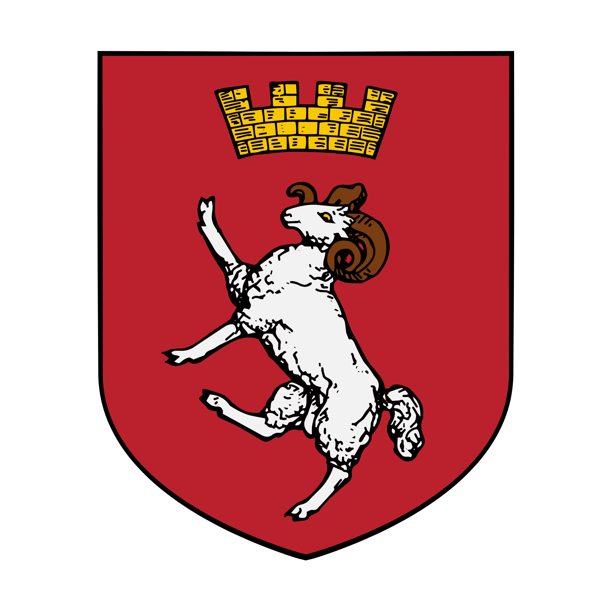

%%
[[Gethricism]]
[[Kherova]]
[[Dalniz]]
[[Turvik Paganism]]
%%

    <h4 class="wiki-header">Rascy zi Leok</h4>
    

        <strong>Government</strong>
        Hereditary Monarchy
    

    

        <strong>Head of State</strong>
        N/A
    

    

        <strong>Capital</strong>
        Palzar
    

    

        <strong>Heraldic Symbol</strong>
        Crowned Ram on Red
    

    

    

        <strong>Primary Religion</strong>
        <a href="Gethricism" class="internal-link">Gethricism</a>
    

    

        <strong>Primary Culture</strong>
        <a href="Vihri" class="internal-link">Sarloni</a> <a href="Human" class="internal-link">Human</a>
    

    

        <strong>Official Language</strong>
         Old Sarloni Vihri
    

    

    

        <strong>Preceded by</strong>
        Sarloni Tribes
    

    

        <strong>Formed</strong>
        133PA
    

    

        <strong>Disbanded</strong>
        625PA
    

    

The Rascy zi Leok was a realm of the Sarloni Vihrmen, situated in modern day Dalniz south of the Ravenleaf Forest. During the period of Great Sarloni Migration, thousands of sarloni moved from the Vihri Expanse and the lands of the northern Pilv and Opuzna south into the territories north of the Yellow Moor and up to the Yevan River. There they sacked and conquered ancient <a href="Kheri" class="internal-link">Kheri</a> cities and sacked many towns of the <a href="Kherova" class="internal-link">Khatrym</a>, before settling in their spoils of war. The Rascy zi Leok would establish itself as a powerful rival to Kherova, <a href="Rean" class="internal-link">Rean</a> and later <a href="Grevenna" class="internal-link">Grevenna</a> as well as <a href="Vihr" class="internal-link">Vihr</a> itself, maintaining autonomy and establishing itself as the home for the south Sarloni culture.
 
The Realms power broke in the 1st Vihri-Leoki War (430PA - 434PA), when its host was defeated at the Battle of the Dim Shades by the Vihri knights under Stanisław zi Usily, the Var of Opuzna, called the Rambreaker, and Volazc and the northern lands of the realm were lost to Vihr, after which it was too weak, economically and militarily, to oppose either Vihr or Kherova, and it stayed neutral during the Kethric Schism of the 5th century while remaining solidly High Gethric. In the 2nd Great Vihri-Leoki War, from 619PA to 625PA, Vihr took more of its northern lands, and the Vihri lords and knights who conquered the rest of the realm kept it for themselves. The Rascy was disbanded and reformed as the successor nation, the <a href="Dalniz" class="internal-link">Rascy zi Dalniz</a>, which represented a shift in rulership from Sarloni lords to lords of Vihri blood and a change in its political situation, rather than any change in the cultural or administrative make up of the country, whose people remained Sarloni.
