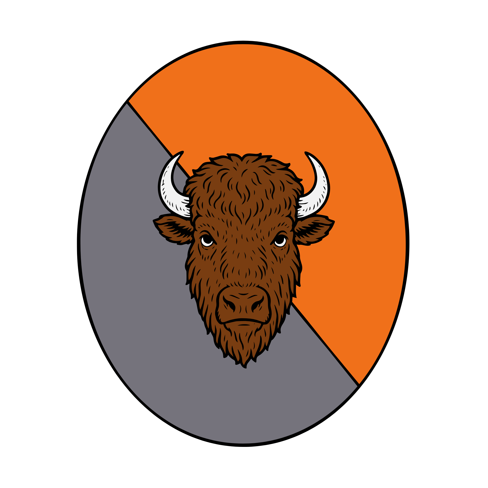

%%  
[[Bihra]]  
[[Karaluk]]  
[[Vol]]  
[[Ekkam]]  
[[Luchun Khaganate]]  
[[Kareli Hierarchy]]  
[[Velvet Caravan]]  
[[Auroch]]  
[[Mogyr]]  
%%  

  
 <h4 class="wiki-header">Omna of Az</h4>  
 
  
 <strong>Government</strong>  
 Bihra Omna  
 
  
 
  
 <strong>Head of State</strong>  
 N/A  
 
  
 
  
 <strong>Capital</strong>  
 Aznyr  
 
  
 
  
 <strong>Heraldic Symbol</strong>  
 <a href="Auroch" class="internal-link">Auroch</a> Head on Grey &amp; Orange  
 
  
 
  
 
  
 <strong>Primary Religion</strong>  
 <a href="Karaluk" class="internal-link">Karaluk</a>  
 
  
 
  
 <strong>Primary Culture</strong>  
 <a href="Bihra" class="internal-link">Bihra</a>  
 
  
 
  
 <strong>Official Language</strong>  
 Lihbare  
 
  
 
  
 
  
 <strong>Preceded by</strong>  
 <a href="Vol" class="internal-link">Empire of Vol</a>  
 
  
 
  
 <strong>Formed</strong>  
 ca. 3rd century PA  
 
  
 
  
 <strong>Disbanded</strong>  
 578PA  
 
  
   

  

The Omna of Az was a <a href="Bihra" class="internal-link">Bihra</a> realm whose capital was the city of Aznyr, at the southern tip of the peninsula that today forms the heart of the <a href="Kareli Hierarchy" class="internal-link">Kareli Hierarchy</a>. Founded after the fall of the <a href="Vol" class="internal-link">Empire of Vol</a>, it outlived its neighbour the <a href="Ekkam" class="internal-link">Omna of Ekkam</a> and at its height ruled the shores of the Jade Sea and most of the <a href="Velvet Caravan" class="internal-link">Velvet Road</a>, which brought it into repeated conflict with the Gorati peoples further east and the <a href="Mogyr" class="internal-link">Mogyri</a> of Drizan. Its independence ended in 578PA, when the <a href="Luchun Khaganate" class="internal-link">Luchun Khaganate</a> defeated its armies at the devastating battle of Shaltrees in the Shal woods north of Shilmak and made the realm subject to the Khans of the Steppe. After the fall of Luchun in 671PA its former heartland became the core of the Kareli Hierarchy.

