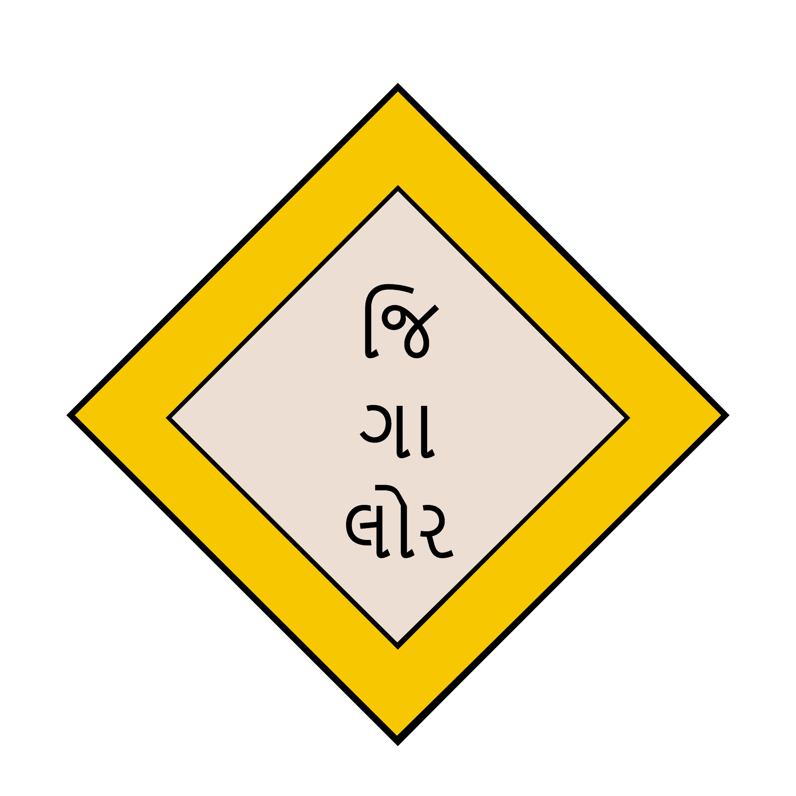

%%  
[[Steppe Bihra]]  
[[Bihra Shamanism]]  
[[Kherova]]  
[[Niryd Steppe]] [[Great Khaganates of the Steppe]]  
[[Luchun Khaganate]]  
[[Wars of Elbae Aggression]] [[Rulers of Kherova]]  
[[Hainach]] [[Grevenna]]  
[[Duol Khaganate]] [[Anatai Khaganate]] [[Yadu Khaganate]] [[Gökol Khaganate]]  
%%  

  
 <h4 class="wiki-header">Jigallor Khaganate</h4>  
 
  
 <strong>Government</strong>  
 Bihra Khaganate  
 
  
 
  
 <strong>Head of State</strong>  
 Great Khan  
 
  
 
  
 <strong>Capital</strong>  
 none  
 
  
 
  
 <strong>Heraldic Symbol</strong>  
 Rune of Jigallor  
 
  
 
  
 
  
 <strong>Primary Religion</strong>  
 <a href="Bihra Shamanism" class="internal-link">Bihra Shamanism</a>  
 
  
 
  
 <strong>Primary Culture</strong>  
 <a href="Steppe Bihra" class="internal-link">Steppe Bihra</a>  
 
  
 
  
 <strong>Official Language</strong>  
 Lihbare  
 
  
 
  
 
  
 <strong>Preceded by</strong>  
 <a href="Luchun Khaganate" class="internal-link">Luchun Khaganate</a>  
 
  
 
  
 <strong>Succeeded by</strong>  
 <a href="Duol Khaganate" class="internal-link">Duol Khaganate</a>,  <a href="Anatai Khaganate" class="internal-link">Anatai Khaganate</a>,  <a href="Yadu Khaganate" class="internal-link">Yadu Khaganate</a>,  <a href="Gökol Khaganate" class="internal-link">Gökol Khaganate</a>  
 
  
 
  
 <strong>Formed</strong>  
 ca. 685PA  
 
  
 
  
 <strong>Disbanded</strong>  
 794PA  
 
  
   

  

The Great Khaganate of Jigallor was the last of the <a href="Great Khaganates of the Steppe" class="internal-link">Great Khaganates of the Steppe</a> and ruled the <a href="Steppe Bihra" class="internal-link">Steppe Bihra</a> of <a href="Nirydia" class="internal-link">Nirydia</a> from 685PA until 794PA. Its Khans held the whole of the <a href="Niryd Steppe" class="internal-link">Niryd Steppe</a> and many lands beyond it, most of them through tributaries, and every one of them bore the name Jigallor and was of the founder's blood. The Khaganate is most infamously remembered for its great assault on <a href="Kherova" class="internal-link">Kherova</a> in 782PA amidst the <a href="Wars of Elbae Aggression" class="internal-link">2nd War of Elbae Aggression</a>, in which its horde destroyed the fortress cities of Adsal and Iblis and laid siege to Erbil, and which drove Kherova out of the war against the Elbae Sultanate.
  

When the last Jigallor fell at the Battle of Adsal in 794PA the Khaganate rapidly broke apart into smaller states of would be rulers, as is custom in the history of the steppe. All four great Khaganates of the modern day, the <a href="Duol Khaganate" class="internal-link">Duol</a>, <a href="Anatai Khaganate" class="internal-link">Anatai</a>, <a href="Yadu Khaganate" class="internal-link">Yadu</a> and <a href="Gökol Khaganate" class="internal-link">Gökol</a>, claim descent from the Blood of the Jigallor, and none of them has since been able to rule the steppe as the Jigallor did.
  
<h2>History</h2>  
<h3>Rise</h3>  

After the Great Khan Luchun was slain by <a href="Gaden" class="internal-link">Gaden</a> of Drizan at the Battle of Verivale in 671PA, the <a href="Luchun Khaganate" class="internal-link">Luchun Khaganate</a> collapsed, its southern ports passed to the protectorate of Gaden and the lesser Khans of the steppe fought among themselves for fourteen years. Khan Jigallor rose in 685PA and, by conquest, by the strength of his body and with the acclamation of the shamans of <a href="Bihra Shamanism" class="internal-link">Bihra Shamanism</a>, brought the lesser Khans back under the rule of a single Great Khan. Where the Luchun had ruled from a permanent seat at Merasa, the Jigallor kept no fixed capital, and the court of the Great Khan travelled with his horde across the steppe.
  
<h3>The line of Jigallor</h3>  

The Khaganate passed from father to son, and every Khan of the line bore the name of its founder. In Lihbare each was known as Jigallor who is of the Blood of the Jigallor, a title commonly translated as Jigallor son of Jigallor, and the foreign chroniclers of the time, who rarely knew one Khan from the next, often wrote of the Khans of the line as a single Jigallor. The custom bound the lesser Khans to the blood of the founder rather than to the person of any one Khan, and the Khaganate passed from one Great Khan to the next without breaking apart until the fall of the last of them at Adsal.
  
<h3>Tributaries</h3>  

At its height the Jigallor Khaganate ruled the whole of the steppe and many lands beyond it, most of them through tributaries. The river cities of the Agav, the <a href="Inive" class="internal-link">Inive</a> of the Forbidden Lands and the scattered communities beyond the Kherovan frontier paid tribute to the Great Khan, and lesser Khans who served him held tributaries of their own. The Jigallor never retook the southern ports lost at Verivale, but raided far beyond the borders of the steppe and drew tribute from those who would rather pay than face the horde.
  
<h3>Attack on Kherova</h3>  

In 782PA, while the armies of Kherova were fighting in the west alongside the Reani Coalition during the 2nd War of Elbae Aggression, the reigning Jigallor struck the eastern Kherovan cities. His horde destroyed the fortress cities of Adsal and Iblis, laid waste to Dalkil and laid siege to Erbil, one of the three jewels of Kherova. The attack came as the Treeplague reached Kherova, and the Khat Arsen II died of the disease in the same year, leaving his successor Giorat II, later called the Defender, to inherit the throne and the invasion at once.
  

Kherova recalled its forces from the west, and the siege of Erbil was relieved at the Battle of Erbil. The Khan himself escaped onto the steppe, but his horde was driven out of Kherova. The sudden withdrawal of the Kherovan forces from the coalition, however, enabled the two theatre campaign of the Elbae Sultanate that ended with the subjugation of <a href="Hainach" class="internal-link">Hainach</a> and contributed greatly to the defeat of <a href="Grevenna" class="internal-link">Grevenna</a>, leading to an enmity between Grevenna and Kherova that lasts to this day. The timing of the attack has never been explained, and in Hainach conspiracy theories that the Khan had been paid or prompted by the Sultanate still circulate in the modern day.
  
<h3>Battle of Adsal and collapse</h3>  

Twelve years later, in 794PA, the last Jigallor fell at the Battle of Adsal on the Kherovan frontier, and the Khaganate broke apart in a moment, as the Luchun had at Verivale. The heirs of the Jigallor divided the horde between them, and within a decade the Anatai, the Yadu and the Gökol had founded Khaganates of their own in the west, centre and north-west of the steppe, while the line that would become the Duol held the south. The steppe has not been united since. The Duol rose to primacy in 851PA and their Khan still styles himself the Khan of Khans, but the other Khaganates have long refused him service, and most scholars count the Jigallor as the last of the Great Khaganates.
  
<h2>Legacy</h2>  

The Jigallor are remembered on the steppe as the last Khans who truly ruled it, and the Blood of the Jigallor remains the foundation of every claim to rule over the whole steppe. In Kherova they are remembered for the devastation of 782PA, and the destroyed fortress cities of the eastern frontier were raised again as a wall against the steppe. In the lands of the Reani Coalition the attack is remembered as the moment the 2nd War of Elbae Aggression was lost.
  
