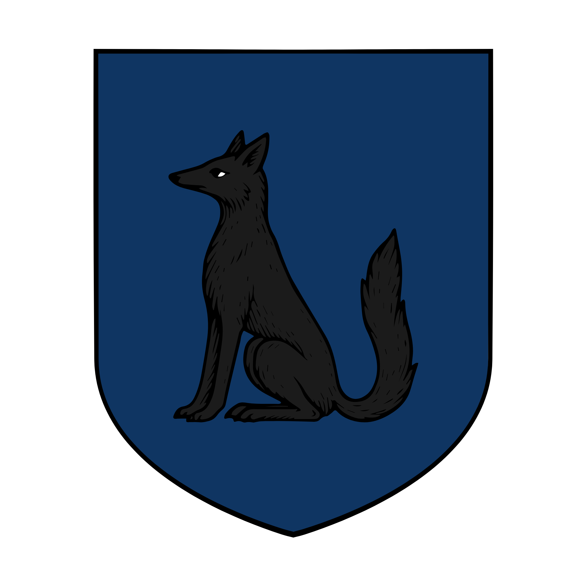

%%
[[Faigin]]
[[Richelet]]
[[Sebera]]
[[Balerey]]
[[Hobgoblin]]
[[Leveli-Shirin Wars]]
%%

    <h4 class="wiki-header">Ervocas a Levelix</h4>
    

        <strong>Government</strong>
        Leveli Ervocas
    

    

        <strong>Head of State</strong>
        N/A
    

    

        <strong>Capital</strong>
        Nastulia
    

    

        <strong>Heraldic Symbol</strong>
        Leveli Black Fox on Blue
    

    

    

        <strong>Primary Religion</strong>
        <a href="Faigin" class="internal-link">Faigin Church</a>
    

    

        <strong>Primary Culture</strong>
        Leveli <a href="Human" class="internal-link">Human</a>, Leveli <a href="Hobgoblin" class="internal-link">Hobgoblin</a>
    

    

        <strong>Official Language</strong>
        Lower Leveli
    

    

    

        <strong>Preceded by</strong>
        Lower Leveli tribes
    

    

        <strong>Formed</strong>
        as Vocas: 255PA 
        as Ervocas: 597PA
    

    

        <strong>Disbanded</strong>
        659PA
    

	

The Ervocas a Levelix was one of the first united realms of the Leveli created following the Era of Patience after the times of Aecelcor the Great. Levelix became the great nation of the united lower Leveli, even conquering vast parts of its eastern rival <a href="Amurez" class="internal-link">Amurez</a> and declaring itself the Vocas a Vocati, or simply the Ervocas of all the Leveli peoples. Before it turned east, its expansion to the south had been checked by the <a href="Twintail Imperium" class="internal-link">Twintail Imperium</a> in the <a href="Leveli-Shirin Wars" class="internal-link">Leveli-Shirin Wars</a> of 399PA to 402PA and 413PA to 416PA, which cost it the Rimagna Valley and much of the southern Leveli Lowlands. At the end of the Leveli Civil War in 572PA the <a href="Richelet" class="internal-link">Vocas a Richelet</a> broke away from the realm, and in 597PA what remained of Levelix declared itself a theocratic Ervocas. Following the end of the line of the Vil-Bautiste, the Ervocas fell apart in 659PA, and the nations of <a href="Balerey" class="internal-link">Balerey</a> and <a href="Sebera" class="internal-link">Sebera</a> were formed as a result of the ensuing conflict between its Human and Hobgoblin population.
