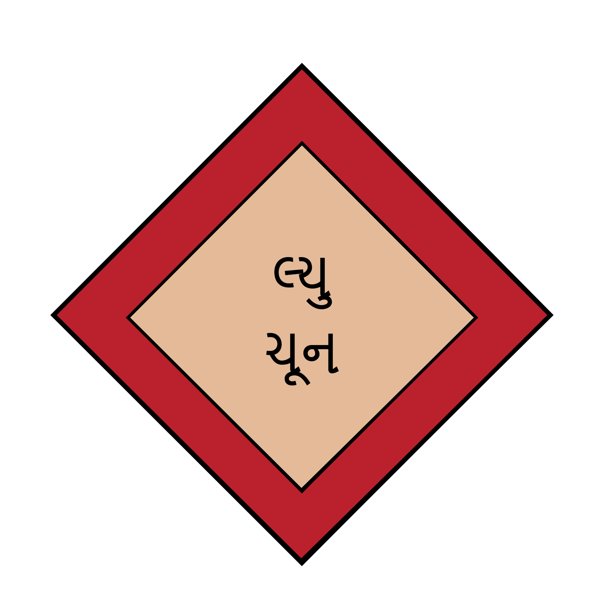

%%  
[[Kareli Hierarchy]]  
[[Gaden]]  
[[Steppe Bihra]]  
[[Bihra Shamanism]]  
[[Niryd Steppe]] [[Great Khaganates of the Steppe]]  
[[Ekkam]] [[Az]] [[Azbihra]]  
[[Ganoa Valley]] [[Jink]]  
[[Soulbond]] [[Mogyr]]  
[[Jigallor Khaganate]]  
%%  

  
 <h4 class="wiki-header">Luchun Khaganate</h4>  
 
  
 <strong>Government</strong>  
 Bihra Khaganate  
 
  
 
  
 <strong>Head of State</strong>  
 Great Khan  
 
  
 
  
 <strong>Capital</strong>  
 Merasa  
 
  
 
  
 <strong>Heraldic Symbol</strong>  
 Rune of Luchun  
 
  
 
  
 
  
 <strong>Primary Religion</strong>  
 <a href="Bihra Shamanism" class="internal-link">Bihra Shamanism</a>  
 
  
 
  
 <strong>Primary Culture</strong>  
 <a href="Steppe Bihra" class="internal-link">Steppe Bihra</a>  
 
  
 
  
 <strong>Official Language</strong>  
 Lihbare  
 
  
 
  
 
  
 <strong>Preceded by</strong>  
 Odovo Khaganate,  Genbela Khaganate  
 
  
 
  
 <strong>Succeeded by</strong>  
 <a href="Jigallor Khaganate" class="internal-link">Jigallor Khaganate</a>,  Protectorate of Gaden  
 
  
 
  
 <strong>Formed</strong>  
 ca. 536PA  
 
  
 
  
 <strong>Disbanded</strong>  
 671PA  
 
  
   

  

The Great Luchun Khaganate of the Steppe was the largest Khaganate of the <a href="Steppe Bihra" class="internal-link">Steppe Bihra</a> ever assembled and ruled vast stretches of southern <a href="Nirydia" class="internal-link">Nirydia</a> during the 6th and 7th century PA. Founded by Khan Luchun in 536PA, it united the <a href="Niryd Steppe" class="internal-link">Niryd Steppe</a> after the fall of the Genbela and Odovo Khaganates and carried the rule of the Khans further south than any realm before or since, subduing the Bihra realms of <a href="Ekkam" class="internal-link">Ekkam</a> in 551PA and <a href="Az" class="internal-link">Az</a> in 578PA after the Battle of Shaltrees. For well over a century the harvests of the Ganoa Valley and the trade of the southern ports flowed to its Khans as tribute.
  

Led by the line of Luchun, the Khaganate dominated the south until the Battle of Verivale in 671PA, when <a href="Gaden" class="internal-link">Gaden Hericium</a>, the golden Shogun of Drizan, slew the Great Khan Luchun himself in personal combat on the field of battle, breaking his armies, mythos and realm in a moment. Its southern ports passed to Gaden as a protectorate and later became the <a href="Kareli Hierarchy" class="internal-link">Kareli Hierarchy</a>, while the steppe itself fell apart into rival Khans until the rise of the <a href="Jigallor Khaganate" class="internal-link">Jigallor Khaganate</a> in 685PA. It is counted among the <a href="Great Khaganates of the Steppe" class="internal-link">Great Khaganates of the Steppe</a>.
  
<h2>History</h2>  
<h3>Rise</h3>  

The Genbela and Odovo Khaganates, which had divided the steppe between them for a century, both came to an end with the Duel of the Great Khans in 513PA, and for more than two decades no Khan was able to claim the whole steppe. Khan Luchun rose from among the lesser Khans in 536PA and, through conquest and the acclamation of the shamans of <a href="Bihra Shamanism" class="internal-link">Bihra Shamanism</a>, brought the tribes and Khaganates of the steppe under his rule. Unlike most Khans before and after him he raised a permanent seat at Merasa, from which his line would rule for more than a century.
  
<h3>Conquest of the south</h3>  

Having united the steppe, the Luchun turned south against the old Bihra realms of the coasts, which had ruled the shores of the Citrine and Jade Seas since the fall of <a href="Vol" class="internal-link">Vol</a>. Ekkam was the first to fall, conquered and made subject in 551PA, and with it the <a href="Ganoa Valley" class="internal-link">Ganoa Valley</a> and the city of <a href="Jink" class="internal-link">Jink</a>, which Ekkam had founded in 433PA, passed to the Khans of the Steppe. Twenty-seven years later the longer lived Omna of Az met the same fate, when the Luchun defeated its armies at the devastating Battle of Shaltrees in the Shal woods north of Shilmak in 578PA and made the realm subject to the Khans. With Az the Luchun gained the ports of the southern coast, among them Aznyr, the old capital of the Omna and the western gate of the Velvet Road.
  
<h3>Height</h3>  

At its height the Luchun Khaganate held the whole of the Niryd Steppe and the lands between it and the southern seas. Its Great Khans ruled the steppe through the lesser Khans who owed them service in war and a share of their herds and plunder, and the conquered south through tributaries. The <a href="Azbihra" class="internal-link">Azbihra</a> of Ekkam and Az kept their cities and much of their own administration, but paid tribute to Merasa and sent levies to the Khans when called, and the Ganoans of the lake valley gave their harvests to the Khans for over a century.
  

The Khans hunted the practitioners of the <a href="Soulbond" class="internal-link">Art of the Soulbond</a> throughout their southern lands. Where the Steppe Bihra sought to prove spiritual superiority through the triumph of the physical, the Soulbond was seen as a perverse destruction of the physical through theft of the spiritual, and many of its practitioners were put to death under Luchun rule.
  
<h3>Battle of Verivale</h3>  

The Khaganate ended in 671PA at the Battle of Verivale, where the hosts of the Great Khan met the armies of Gaden Hericium, the first Shogun of Drizan. Gaden slew the Great Khan Luchun in personal combat on the field of battle, and the death of the Khan broke his armies at once. Since the power of a Great Khan rested on his own strength and on the faith of the lesser Khans in it, his fall at the hands of a foreign warrior shattered the mythos of the line as much as its armies, and the lesser Khans abandoned the cause of Merasa in the months that followed.
  
<h3>Aftermath</h3>  

Gaden took the southern ports of the fallen Khaganate as a protectorate and held them for the rest of his life, reinforcing the ancient taboo on the Soulbond throughout the region. After his execution in 743PA the protectorate broke away in the turmoil that followed and became the independent Kareli Hierarchy in 752PA. Jink regained its independence at once and became the centre of the Ganoa Valley, and the victory at Verivale became the figurehead of the Mogyri Golden Age. On the steppe the lesser Khans fought among themselves for fourteen years, until Khan Jigallor rose in 685PA and founded the last of the Great Khaganates.
  
<h2>Government</h2>  

Every Great Khan of the line took the name of its founder upon his acclamation, so that the Khan who fell at Verivale was known as Luchun as well. A Great Khan was raised by a mixture of conquest, the strength and mutation of his body and the acclamation of the shamans, and the lesser Khans who accepted him owed him service and tribute in turn. Merasa set the Luchun apart from the other Great Khaganates. While most Khans moved with their hordes and kept no fixed capital, the Luchun ruled from a permanent seat, where the tribute of the south was gathered and from which the levies of the steppe were called.
  
<h2>Legacy</h2>  

The Luchun Khaganate remains the largest realm the Steppe Bihra have ever built, and it is remembered with pride on the steppe and with bitterness on the southern coasts, where the century of Luchun rule is held to be the time when the Azbihra lived under the heel of the Khans. In the Kareli Hierarchy, which grew out of its southern ports, and among the Mogyri of Drizan, the Battle of Verivale is remembered as the moment the south was freed, while on the steppe the death of the Great Khan in single combat is taken as proof that the strength of his line had failed.
  
