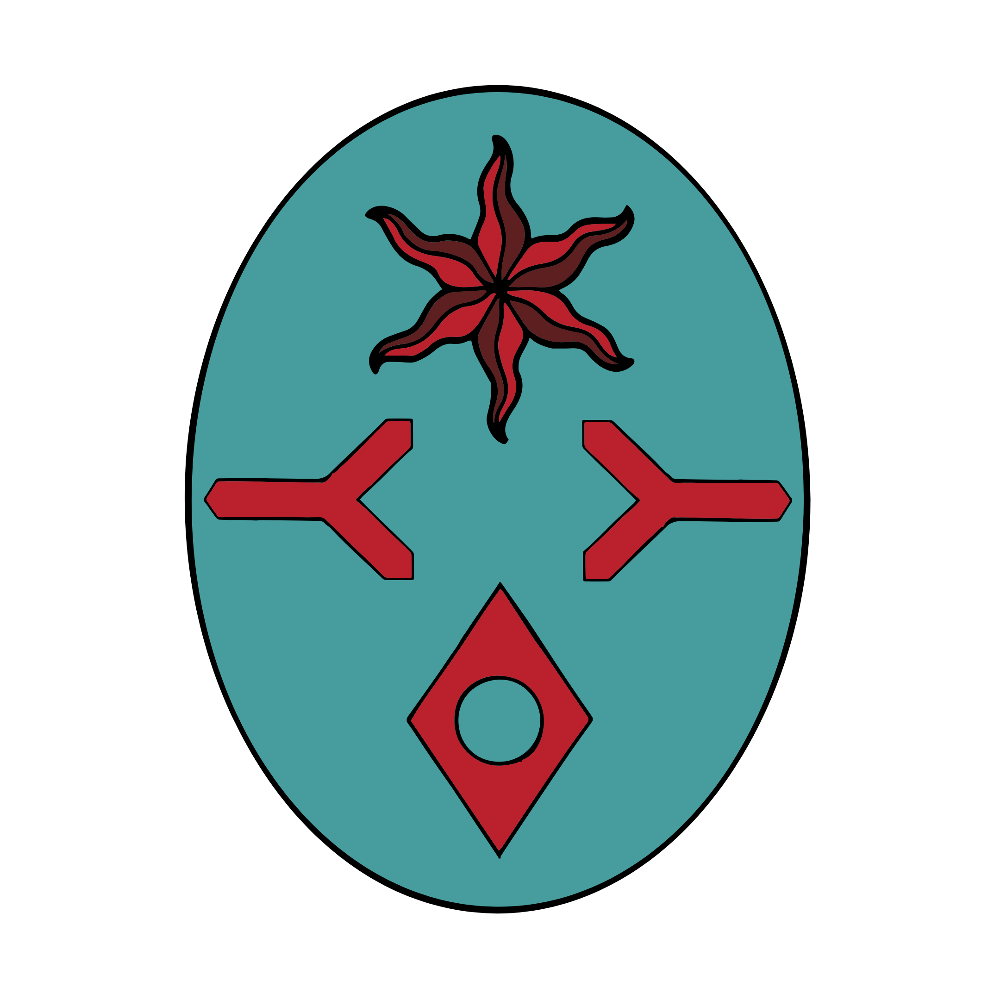

%%  
[[Bihra]]  
[[Bihra Shamanism]]  
[[Azuvke]]  
[[Roxeria]]  
[[Ekkam]]  
[[Az]]  
%%  

  
 <h4 class="wiki-header">Empire of Vol</h4>  
 
  
 <strong>Government</strong>  
 Bihra Empire  
 
  
 
  
 <strong>Head of State</strong>  
 N/A  
 
  
 
  
 <strong>Capital</strong>  
 Uzra Vol  
 
  
 
  
 <strong>Heraldic Symbol</strong>  
 Red Star &amp; Signs on Teal  
 
  
 
  
 
  
 <strong>Primary Religion</strong>  
 <a href="Bihra Shamanism" class="internal-link">Bihra Shamanism</a>  
 
  
 
  
 <strong>Primary Culture</strong>  
 <a href="Bihra" class="internal-link">Bihra</a>  
 
  
 
  
 <strong>Official Language</strong>  
 Lihbare  
 
  
 
  
 
  
 <strong>Preceded by</strong>  
 Cities of Anator-Bihr  
 
  
 
  
 <strong>Formed</strong>  
 ca. 5th century BA  
 
  
 
  
 <strong>Disbanded</strong>  
 ca. 3rd century PA  
 
  
   

  

The Empire of Vol was the oldest known realm of the <a href="Bihra" class="internal-link">Bihra</a> in southern Nirydia. It was united around the 5th century BA under Volys the Spiritdrinker, who brought together the Bihra cities that had risen during the era of Anator-Bihr, the era of living water, a period of city building that reaches back to at least the 12th century BA. Its capital was Uzra, later known as Uzra Vol, on the site of modern day Halad on the Lemey Isthmus. Vol was destroyed during the Azuvken Golden Age of the 2nd and 3rd centuries PA, when the <a href="Azuvke" class="internal-link">Khatrym of Azuvke</a> conquered the lands of modern day <a href="Roxeria" class="internal-link">Roxeria</a> and extended its borders as far east as the River Tax. In the lands it left behind the Bihra founded two new realms, the <a href="Ekkam" class="internal-link">Omna of Ekkam</a> and the <a href="Az" class="internal-link">Omna of Az</a>.

