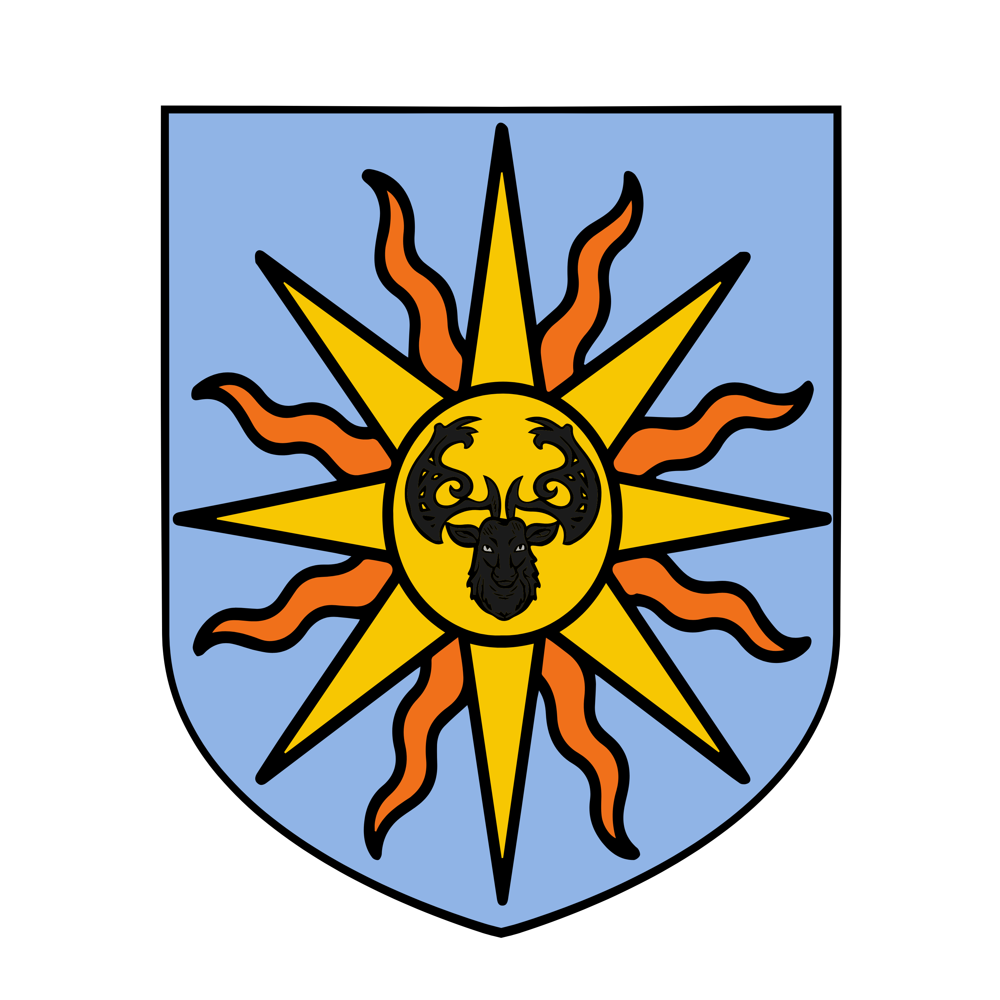

%%  
[[Zuhurism]]   
[[Ruginë]]  
[[Amlija]]  
[[Dišela]]  
[[Jateš]]  
[[Plašato]]  
[[Gorat]]  
[[Gorati]]  
[[Suzana Dragović]]  
[[Rian]]  
[[Organius of Aviv]]  
[[Zuhuri Holy Wars]]  
[[Umo]]  
[[Twintail Imperium]]  
%%  

  
 <h4 class="wiki-header">Zeprian Empire</h4>  
 
  
 <strong>Government</strong>  
 Dynastic Empire  
 
  
 
  
 <strong>Head of State</strong>  
 <a href="Suzana Dragović" class="internal-link">Suzana Dragović</a> (first), Radov the Silver (last)  
 
  
 
  
 <strong>Capital</strong>  
 Plavigrad  
 
  
 
  
 <strong>Heraldic Symbol</strong>  
 Black Stags head in front of the Sun  
 
  
 
  
 
  
 <strong>Primary Religion</strong>  
 <a href="Zuhurism" class="internal-link">Zuhurism</a>  
 
  
 
  
 <strong>Primary Culture</strong>  
 Gorati <a href="Human" class="internal-link">Human</a>  
 
  
 
  
 <strong>Official Language</strong>  
 Yezepri  
 
  
 
  
 
  
 <strong>Preceded by</strong>  
 Gorati Petty Princes  
 
  
 
  
 <strong>Succeeded by</strong>  
 <a href="Plašato" class="internal-link">Plašato</a>, <a href="Amlija" class="internal-link">Amlija</a>, <a href="Dišela" class="internal-link">Dišela</a>, <a href="Jateš" class="internal-link">Jateš</a>  
 
  
 
  
 <strong>Formed</strong>  
 491PA  
 
  
 
  
 <strong>Disbanded</strong>  
 767PA  
 
  
   

  

The Zeprian Empire, also known as the United Lands of Gorat, was a Gorati state that emerged from the Kingdom of Zepria. It was established in 491PA by <a href="Suzana Dragović" class="internal-link">Suzana the Cruel</a>, who significantly expanded the Kingdom and was crowned Sun Empress in Aviv. During the reign of Suzana and her immediate heirs Zepria became one of the most powerful nations in Nirydia, stretching from the northern Drizan Peninsula to the Shirin of the <a href="Twintail Imperium" class="internal-link">Twintail</a>. It is the only state ever to have united the <a href="Gorati" class="internal-link">Gorati</a>, and its collapse almost three centuries later, in 767PA, led to the formation of the modern Gorati nation states.
  
<h2>History</h2>  
<h3>Kingdom of Zepria</h3>  

Before the Empire, Zepria was a small kingdom among the many petty realms of <a href="Gorat" class="internal-link">Gorat</a>, ruled from Plavigrad by the House Dragović. Its rise began under King Morac, who subjugated the Malvic League, an alliance of merchant cities that controlled the trade through the Strait of Zelarvo from its two greatest cities, Malvic on the mainland and Kroz on the island of Zelarvo. Morac was killed by an assassin at a feast in 479PA, and his daughter Suzana succeeded him.
  
<h3>Founding</h3>  

Over the following twelve years Suzana conquered most of the Gorati lands and brought Bihra Khans and Shirin generals under her rule. Her conquests ended with a journey north to Aviv, where in 491PA she was crowned Sun Empress by the Oracle of the Organius (see <a href="Organius of Aviv" class="internal-link">Organius of Aviv</a>) and proclaimed the Empire. The coronation at Aviv was repeated by five of the Emperors who followed her. Ruginë was never truly conquered, as the Opmani hero Dritan defeated the armies of Suzana and of three later emperors in its mountain valleys, and Jateš passed between Zeprian and Shirin rule several times over the history of the Empire.
  
<h3>Golden Age</h3>  

The period from the founding of the Empire to 588PA is known to later historians as the Zeprian Golden Age. Many of the great works of the Empire that persist into the modern day were created during this time. Chief among them is the <a href="Rian" class="internal-link">Rian</a>, the imperial coin first struck under Suzana, which became the common currency of Gorat and today is the most important currency on the Nirydian continent. Others include the great aqueduct that carries water from Lake Višine to Plavigrad, together with the fortress of Višine nad Plavigradom that guards the lake, both of which still stand today, and the Pur Imperia, the imperial road from Rashice to Basnik that bound the lands of Zepria together in trade. At the height of its power the Empire also held parts of the northern shore of the Gavivag Bay and of the Pagri lands beyond, where it founded the city of Trilom, named after the three great gates in its walls. It was at Trilom that the early emperors landed on their journeys north to Aviv, and the island of <a href="Gavivag Isle" class="internal-link">Gavivag Isle</a> and its <a href="Eye of Zuhur" class="internal-link">Eye of Zuhur</a> just to the south came under Zeprian rule as well.

<h3>Decline</h3>  

Historians date the end of the Golden Age to 588PA and the accession of Emperor Jožek, who is remembered unfavourably for many reasons, above all the terrible harvests and the Nighmilk Plague that struck Gorat hard between 591PA and 594PA. Jožek was followed by his heir and then by Empress Nataša, crowned in 624PA, the last Zeprian ruler to travel north to Aviv for her coronation. In the early Holy Wars, beginning with the First in 620PA, the Empire was inarguably the main force of the faithful, and Trilom served as the staging ground for its armies.  After her reign relations between the Empire and the Pagri realms to the north worsened. When the Second <a href="Zuhuri Holy Wars" class="internal-link">Holy War</a> against the heresy of <a href="Umo" class="internal-link">Umo</a> began in 645PA, Zepria joined the war in what became known as the Pagri Campaigns of the 650s, but the alliance was strained by quarrels with its Pagri allies over the conduct of the war, and in 657PA the imperial army suffered a heavy defeat against the undead of the witch king Zologos at the Battle of Brina. In 667PA, a century before the fall of the Empire, Trilom and the Eye of Zuhur were lost to <a href="Cirinzel" class="internal-link">Cirinzel</a>, which has made the city its capital. Zepria nonetheless continued to fight alongside the Pagri realms in the Holy Wars up to the Fourth, which began in 751PA.
  
<h3>Loss of Control</h3>  

In the century after Brina the Empire slowly lost its hold over the provinces. A turning point came with the Buzinci Delegation Incident of 724PA, when imperial tax collectors were slaughtered on the roads of southern Gorat. A delegation of imperial lawmen and mages was sent from Plavigrad to find the perpetrators and the thousands of Rian of the yearly taxes that had been lost, but Lord Branimir of Rashice accused the envoys of having "behaved most base and as deviants of the night sky" and had them arrested for four months. The imperial mage Hrado Mitel was found dead in the dungeon of Rashice, having, as Branimir later reported, "passed away from an upset stomach", and it was said in jest that the delicate body of a northerner could not handle a proper Buzinci meal. The taxes were never recovered, and the incident is regarded as an open declaration of the weakness of Plavigrad. By 758PA the Opmani and the Buzinci had all but abandoned imperial rule, seeing Plavigrad as too weak to enforce its laws in the south and in the mountains.
  

In 764PA the old feud between the Mustari house of Rizev and the Kraguvci house of Ohodrev, two noble families in the lands of modern <a href="Jateš" class="internal-link">Jateš</a>, broke out again. Where imperial peacekeepers and the Emperor's law had once kept such feuds from engulfing whole regions, the Crown Prince Matjar, who marched north in support of the Ohodrev, was all but ignored. The Rizev treated him as no more than another part of the Ohodrev host and met him in open battle several times, and his efforts to negotiate a peace, or even to be treated as a figure of authority by the Ohodrev he had come to support, were met with laughter and indifference. By the middle of the 760s economic ruin and disloyal nobles had made the Empire a farce and a power in name only.
  
<h3>Fall</h3>  

The Empire came to an end in 767PA under its last Emperor, Radov the Silver, who sought to raise "an army of silver wardens, to bring the snakes of the realm to their knees once again". In a failed invocation of great magic in the palace of Plavigrad he turned himself and nearly three dozen members of his family and court into pure silver. Historians regard the attempt as the product of a mage's madness and the last flailing of a dynasty that had in practice lost its crown decades before. From its ruins rose the kingdoms of <a href="Plašato" class="internal-link">Plašato</a> and <a href="Amlija" class="internal-link">Amlija</a>, the Republic of <a href="Dišela" class="internal-link">Dišela</a> and an independent <a href="Jateš" class="internal-link">Jateš</a>. Plašato, the heartland of the old Empire, still regards itself as the rightful ruler of all Gorat.
  
