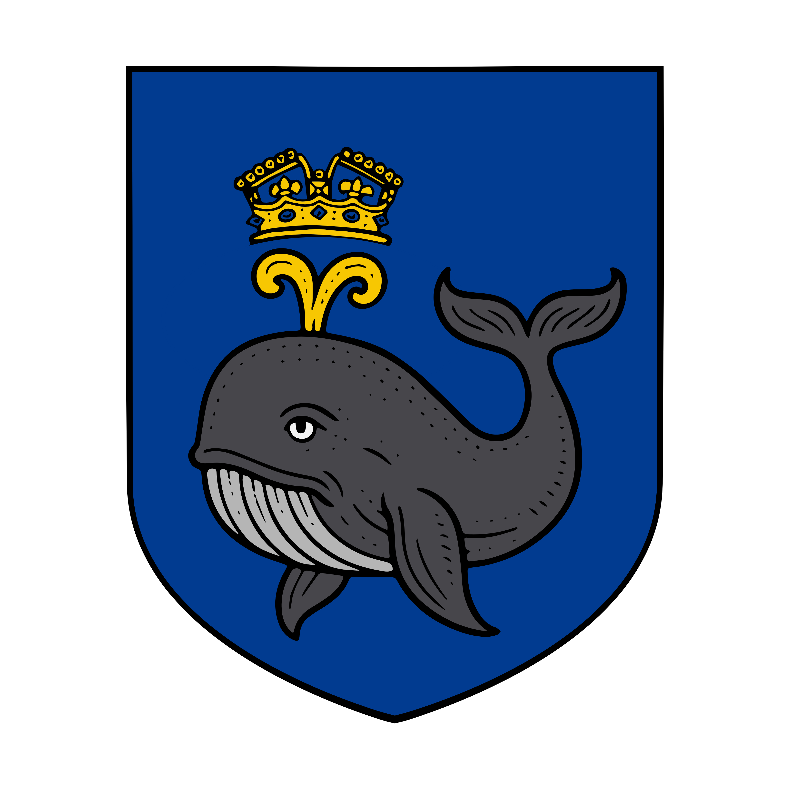

%%
[[Gethricism]]
[[Juelfluk]]
[[Vignasoya]]
[[Baeling Empire]]
[[Varald I]]
[[Jallbreg]]
[[Melmer]]
%%

    <h4 class="wiki-header">Baeling Kingdom</h4> 

        <strong>Government</strong>
        Absolute Monarchy
    

    

        <strong>Head of State</strong>
        King <a href="Varald I" class="internal-link">Varald I</a>
    

    

        <strong>Capital</strong>
        Alsebyn
    

    

        <strong>Heraldic Symbol</strong>
        Crowned Whale
    

    

    

        <strong>Primary Religion</strong>
           <a href="Gethricism" class="internal-link">Gethricism</a>    
    

    

        <strong>Primary Culture</strong>
        <a href="Bykmåli" class="internal-link">Olbellinge</a> <a href="Human" class="internal-link">Human</a>
    

    

        <strong>Official Language</strong>
        Lower Bykmål
    

    

    

        <strong>Preceded by</strong>
        <a href="Baeling Empire">Baeling Empire</a>
    

    

        <strong>Formed</strong>
        
    

    

 The Baeling Kingdom derives its name from the near mythical House of Baeling that ruled the Baeling Empire since the 5th century. Although in constantly dispute and conflict with the neighbouring powers of <a href="Trykkerog" class="internal-link">Trykkerog</a>, such as <a href="Wars of Baeling Succession" class="internal-link">the Wars of Baeling Succession</a> with the Kings and Queens of <a href="Juelfluk" class="internal-link">Juelfluk</a>, it is nevertheless the undisputed strongest power on the northern Continent stretching even across the Bay to the City of <a href="Jallbreg" class="internal-link">Jallbreg</a>. 

The Kingdom is centred around Melmers Bay, named after the Gethric Saint <a href="Melmer" class="internal-link">Melmer</a>, whose voyages in the later 4th century began the conversion of the northern lands to the faith of the Prophet, and mainly populated by the Olbellinge peoples of the larger bykmål culture group. The largest city on the entire island is the Port of <a href="Sallesand" class="internal-link">Sallesand</a>, which is nominally under the Baeling crown but so powerful and so closely tied to the <a href="Trazlov Consortium" class="internal-link">Trazlov Consortium</a> that it is in practice independent. Within the kingdom proper, the cities of Rillberg, Troese and the capital of Alsebyn are imposing towns by bykmål standards.

<h2>People of Interest</h2>

Varald, first of his Name of House 
	King of Baeling and Lord-Keeper of Jallbreg

Sten Billstrom
	Keeper of Sallesand
