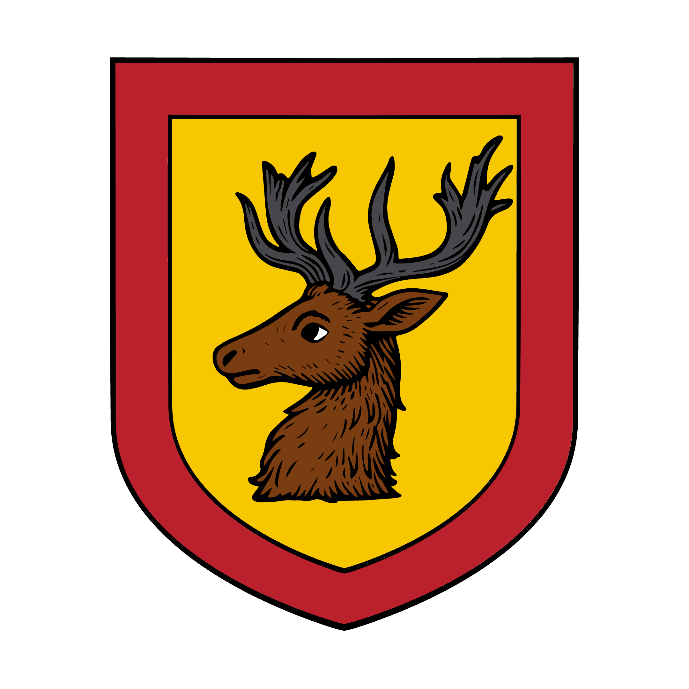

%%
[[Trykkerog]]
%%

    <h4 class="wiki-header"></h4> 

        <strong>Government</strong>
        
    

    

        <strong>Head of State</strong>
        
    

    

        <strong>Capital</strong>
        Rensköldsvik
    

    

        <strong>Heraldic Symbol</strong>
        Reindeer on Gold and Red
    

    

    

        <strong>Primary Religion</strong>
        
    

    

        <strong>Primary Culture</strong>
        <a href="Bykmåli" class="internal-link">Skori</a> <a href="Human" class="internal-link">Human</a>
    

    

        <strong>Official Language</strong>
        Upper Bykmål
    

    

    

        <strong>Preceded by</strong>
        
    

    

        <strong>Formed</strong>
        
    

    

