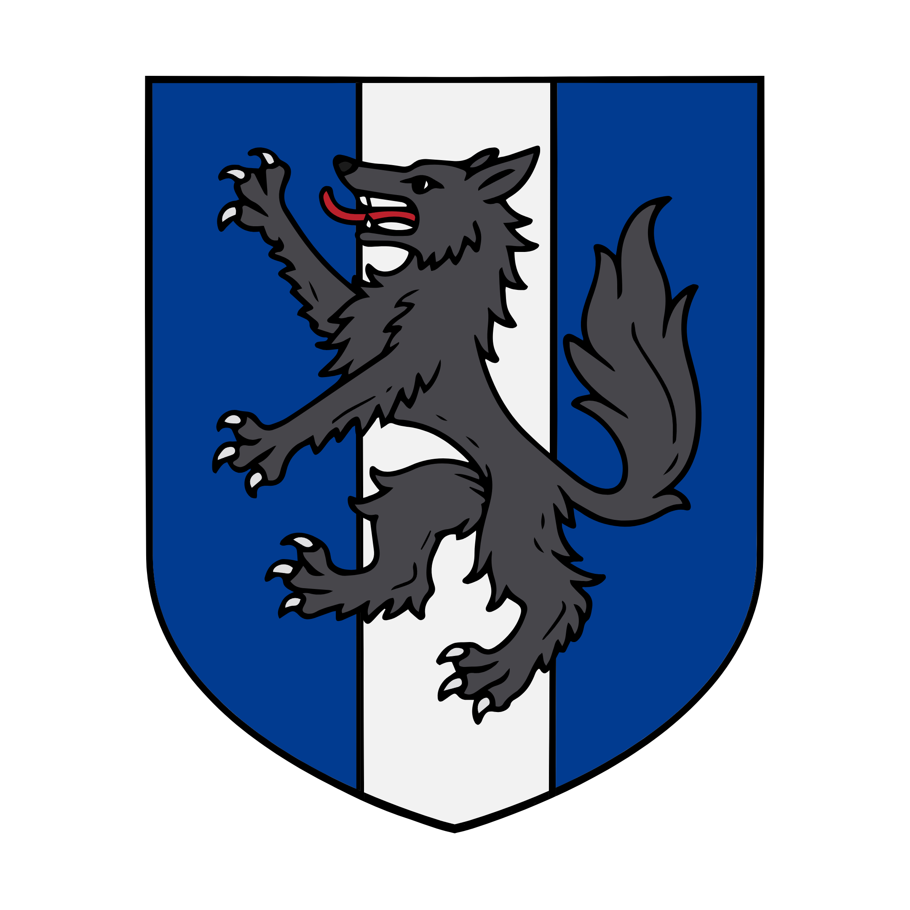

%%
[[Bykmali Paganism]]
[[Trykkerog]]
[[Baeling Empire]]
[[Rulers of Trykkerog]]
[[Droil]]
[[Zeeport]]
[[The Discovery of Aisligos]]
[[Grynborg]]
[[Rensköldsvik]]
[[Melmer]]
[[Egill]]
%%

<h4 class="wiki-header">Korringe of Vignasoya</h4>

<strong>Government</strong>
Feudal Monarchy

<strong>Head of State</strong>
Korre Jassvr V

<strong>Capital</strong>
Mannelik

<strong>Heraldic Symbol</strong>
Wolf on white & blue Ground

<strong>Primary Religion</strong>
<a href="Bykmali Paganism" class="internal-link">Bykmali Paganism</a>

<strong>Primary Culture</strong>
<a href="Bykmåli" class="internal-link">Skori</a> <a href="Human" class="internal-link">Human</a>

<strong>Official Language</strong>
Upper Bykmål

<strong>Preceded by</strong>
N/A

<strong>Formed</strong>
404PA

The oldest of the three great crowns of <a href="Trykkerog" class="internal-link">Trykkerog</a>, Vignasoya is by far the least populous and the least wealthy of the three, a realm of the harsh western lands and fjords of the island. Having resisted the great Gethric conversion that followed the voyages of Saint <a href="Melmer" class="internal-link">Melmer</a>, the Skori of Vignasoya have remained firm in their old traditions. They are proud warriors and seafarers, and their warbands often fight in foreign wars in the lands of <a href="Othirdon" class="internal-link">Othirdon</a>. Once a feared power whose ships ruled coasts far beyond the island, Vignasoya is today more of an idea than a state, and its jarls largely go their own way.

<h2>Land</h2>

Vignasoya holds most of the coasts of the Wolfsbay, from Forik and Mannelik to Wogni, together with the island of Nyllheim in the bay, the town of Faersfur and the lands along the Onje River, which runs from Braki past Onvell to Skeppbirk. The Tergasywoods, the Swamps of Arel and the Stormlands beyond these lands are in practice claimed by no crown, and their scattered villages of Skori and Hevri answer to no one. North of the Onje, around the Gotjebay and the old keeps of Fjorik and Ingeborg, lie the Free Jarldoms, whose petty jarls are Skori like the subjects of the Korre but have long ceased to owe him anything. To the south-west the great jarldom of <a href="Rensköldsvik" class="internal-link">Rensköldsvik</a> on the Rensvik Bay is likewise independent, and to the east the Wolfsbay is shared with the city of <a href="Levangr" class="internal-link">Levangr</a> and the Kingdom of <a href="Baeling" class="internal-link">Baeling</a>.

<h2>Government and Society</h2>

Even within its borders Vignasoya adheres only nominally to a single authority. The Korre is chosen at the Great Thing of the Skori from among the kin of the royal house, and his rule rests on the jarls who acknowledge him there. Powerful nobles such as the Jarl of Braki and the Jarl of Skeppbirk, traditionally styled the Lord Reaver and at present Ulrik Roering, are largely autonomous and have sworn their arms in war to the Korre of Vignasoya through ancient oaths based on religious rites. Their bond to the crown is not comparable to the clearly defined relationships of the southern nobility, or to the firmer grip the monarchs of Baeling and <a href="Juelfluk" class="internal-link">Juelfluk</a> hold on their subjects. The Skori still keep thralls, a custom the Gethric realms of the island have long given up, and service in the warbands that sail abroad remains the surest road to wealth and fame for a young Skori.

The faith of Vignasoya is the old faith of <a href="Bykmali Paganism" class="internal-link">Bykmali Paganism</a>, and much of the Skori sense of self is still defined by their long resistance to the Gethric conversion. The Olbellinge of Melmers Bay have long called them "wolfsmen", a name the Skori have taken up with some pride. The countryside keeps entirely to the old gods, while the towns of the Wolfsbay are mixed, with Gethric communities and a <a href="Trinicism" class="internal-link">Trinicist</a> minority brought by traders from <a href="Blijgrat" class="internal-link">Blijgrat</a> and Meadrath living beside the followers of the old faith.

<h2>History</h2>
<h3>The First Korres</h3>

The Skori of the western fjords were among the most feared raiders of the Bykmåli. Saint Melmer's last voyage in 386PA took him to the shores of the Wolfsbay near Levangr and into the Swamps of Arel, deep in Skori territory, where he was slain. In 404PA the first Korre of Vignasoya was declared, making Vignasoya the oldest of the three crowns of the island, and the Skori kept to their old gods while the faith of the Prophet spread through the rest of Trykkerog.

<h3>Under the Empire</h3>

Vignasoya's rule has not been unbroken. In the 6th century the <a href="Baeling Empire" class="internal-link">Baeling Empire</a> conquered much of its southern coast, among it Faersfur, Wogni, Mannelik and Forik. The Empire never subjected all of the Skori, and the Korringe survived around the Onje River and the Gotjebay, where the Great Thing chose the Jarl of Skeppbirk as Korre and the seat of the crown moved to his town. The Korres of Skeppbirk bent the knee to the Emperors and paid them tribute, but they never gave up their old gods, and Skeppbirk became the centre of the resistance of the wolfsmen against Baeling rule. The lost coast was won back in the risings of the Skori lords before the fall of the Empire in 590PA, and the seat of the Korre returned to Mannelik.

<h3>The Skori Age at Sea</h3>

The century after the fall of the Empire was the height of Skori power. The Skori held the port of <a href="Zeeport" class="internal-link">Zeeport</a>, which they called Brodgard, built the castle known as the Brod there and outlawed the worship of the Gethric candlegods, and in 594PA Vignasoya took over the governance of the island of <a href="Droil" class="internal-link">Droil</a>. In the 7th century the Korre proclaimed the short-lived Great Kingdom of Skorland, which subdued the jarls of the west and for a time held Rensköldsvik, but which broke apart soon after the death of its founder. In 688PA Skori sailors under Lars Gerjodi became the first to cross the North Tirean Ocean and reached the islands now named after him, and in 719PA settlers from Vignasoya, Cimfon and Baeling founded the colony of <a href="Grynborg" class="internal-link">Grynborg</a> there.

<h3>Decline</h3>

The overseas holdings of the Skori were lost one after the other. In 737PA the Weadi of Zeeport rose and freed their city from the Skori, a rebellion organised by the pirate and later Saint <a href="Yahrwick" class="internal-link">Yahrwick</a>, who died a martyr in its nights, and in 772PA the people of Droil rose against their Skori rulers with the help of Ravlander, Tintaroli and Cimfoni ships and freed the island from Vignasoya. The larger realms of Meadrath, Blijgrat and the south soon took over the exploration of Aisligos that the Skori had begun. At home the jarls of the north-west drifted out of the Korre's reach until they formed the Free Jarldoms, and even the jarls who still acknowledge the crown have come to treat the Korre as the first among equals. Under Korre Jassvr V the crown of Vignasoya remains the oldest on Trykkerog and the symbol of the Skori people, but its power hardly reaches beyond the lands around Mannelik.

