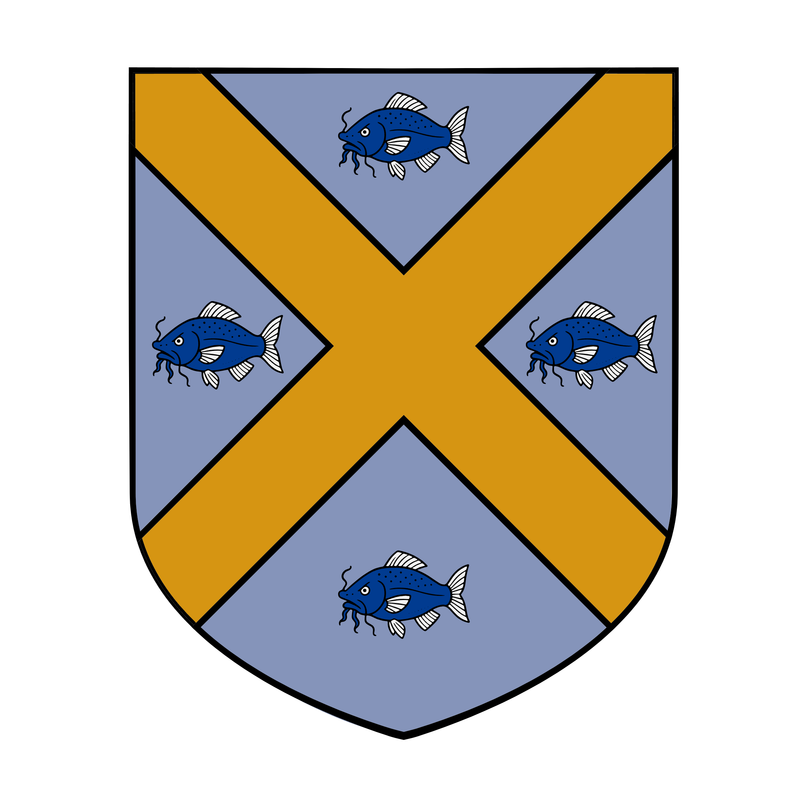

%%
[[Jeledo]]
[[Trinicism]]
[[Cevolia]]
%%

    <h4 class="wiki-header">Contea di Calmona</h4>
    

        <strong>Government</strong>
        Hereditary County
    

    

        <strong>Head of State</strong>
        Conte Ravino Broza
    

    

        <strong>Capital</strong>
        Calmona
    

    

        <strong>Heraldic Symbol</strong>
        Blue Haddocks under Brass Cross
    

    

    

        <strong>Primary Religion</strong>
        <a href="Trinicism" class="internal-link">Trinicism</a>
    

    

        <strong>Primary Culture</strong>
        <a href="Cevoli" class="internal-link">Niardi</a> <a href="Human" class="internal-link">Human</a>
    

    

        <strong>Official Language</strong>
        Cevoli
    

    

    

        <strong>Preceded by</strong>
        
            <a href="Jeledo" class="internal-link">Duchy of Jeledo</a>
        
    

    

        <strong>Formed</strong>
        gained autonomy: 868PA
    

    

The Contea di Calmona is a currently largely independent <a href="Cevoli" class="internal-link">cevoli</a> City State, located on the western coast of the Bay of Jideux north of the Servi Sea. The City of Calmona itself, which makes up the vast majority of the Conteas population, is also known as the "City of Chimes" and was build upon the ruins of ancient Vilum, over two thousand years ago. They are ruled by the line of Broza, that remains the only surviving link to the old royal line of Molina, that ruled Cevolis until the 6th century. It takes its nickname from the old ritual of Vilum, the Summersong, when the people of the city would call out to the Nymphs of the southern Sea with Song and windborne chimes.
 

Following the fall of the <a href="Cevolis" class="internal-link">Kingdom of Cevolis</a>, Calmona was brought under the control of the Dukes of Jeledo. The then ruler of Calmona, Conte Marco, was advised against attempting a bid for the throne himself and endorsed Jeledos military coalition, formed against the upstart Princes from Battvia. 
 
<iframe src="https://editor.garmeley.com/v/inara/?region=calmona&amp;view=flat"
        width="100%" height="480" style="border:0;border-radius:8px;background:transparent"
        loading="lazy" allow="fullscreen" title="calmona (Inara)"></iframe>
<small><i>Map of the Cosmopolitan Area of Calmona, dated 927PA</i></small>