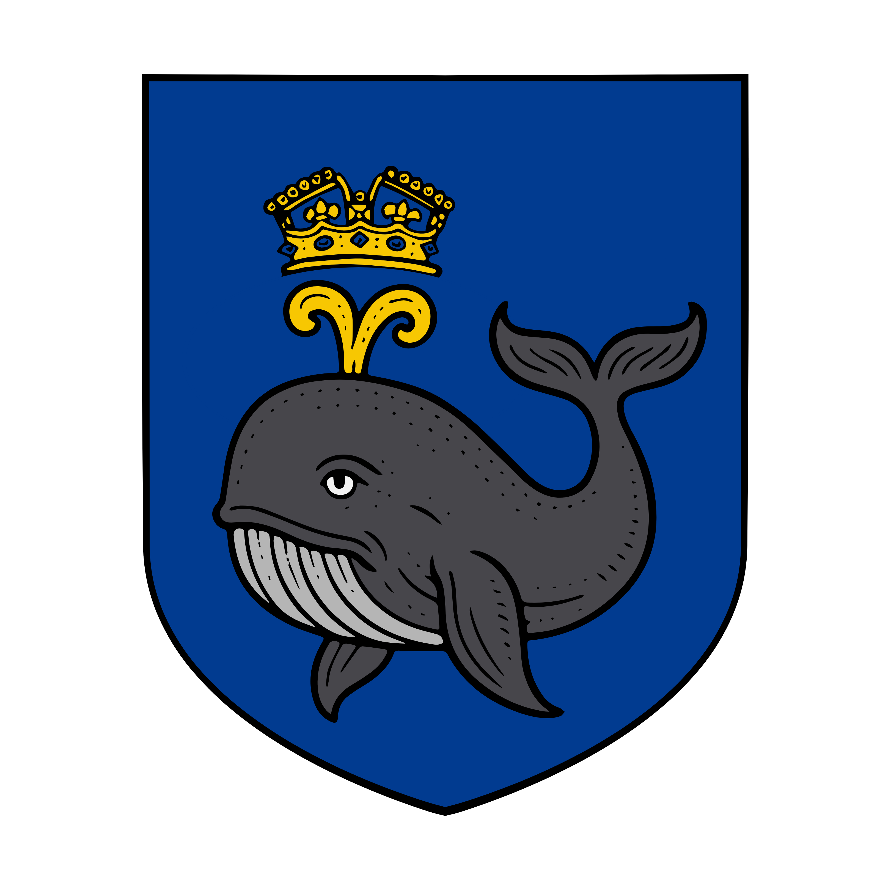

%%
[[Gethricism]]
[[Juelfluk]]
[[Vignasoya]]
[[Baeling Empire]]
[[Rulers of Trykkerog]]
[[Varald I]]
[[Valund Baeling]]
[[Ylva]]
[[Jallbreg]]
[[Sallesand]]
[[Levangr]]
[[Melmer]]
[[Wars of Baeling Succession]]
[[Trazlov Consortium]]
[[Blijgrat]]
%%

<h4 class="wiki-header">Baeling Kingdom</h4>

<strong>Government</strong>
Absolute Monarchy

<strong>Head of State</strong>
King <a href="Varald I" class="internal-link">Varald I</a>

<strong>Capital</strong>
Alsebyn

<strong>Heraldic Symbol</strong>
Crowned Whale

<strong>Primary Religion</strong>
<a href="Gethricism" class="internal-link">Gethricism</a>

<strong>Primary Culture</strong>
<a href="Bykmåli" class="internal-link">Olbellinge</a> <a href="Human" class="internal-link">Human</a>

<strong>Official Language</strong>
Lower Bykmål

<strong>Preceded by</strong>
<a href="Baeling Empire" class="internal-link">Baeling Empire</a>

<strong>Formed</strong>
684PA

The Baeling Kingdom derives its name from the near mythical House of Baeling that ruled the <a href="Baeling Empire" class="internal-link">Baeling Empire</a> in the 5th and 6th centuries. Although in constant dispute and conflict with the neighbouring powers of <a href="Trykkerog" class="internal-link">Trykkerog</a>, above all in the <a href="Wars of Baeling Succession" class="internal-link">Wars of Baeling Succession</a> with the Kings and Queens of <a href="Juelfluk" class="internal-link">Juelfluk</a>, it is nevertheless the strongest power on the island, and its rule stretches across the Torn Sea to the City of <a href="Jallbreg" class="internal-link">Jallbreg</a>.

The Kingdom is centred around Melmers Bay, named after the Gethric Saint <a href="Melmer" class="internal-link">Melmer</a>, whose voyages in the later 4th century began the conversion of the northern lands to the faith of the Prophet, and it is mainly populated by the Olbellinge peoples of the larger <a href="Bykmåli" class="internal-link">Bykmåli</a> culture group. The largest city on the entire island is the Port of <a href="Sallesand" class="internal-link">Sallesand</a>, which is nominally under the Baeling crown but so powerful and so closely tied to the <a href="Trazlov Consortium" class="internal-link">Trazlov Consortium</a> that it is in practice independent. Within the kingdom proper, the cities of Rillberg, Troese and the capital of Alsebyn are imposing towns by Bykmåli standards.

<h2>Land</h2>

Baeling holds almost all of the shores of Melmers Bay, the largest bay of Trykkerog, which looks south across the Torn Sea towards the Hagshorn. In the west the kingdom takes in the long peninsula between the Wolfsbay and Melmers Bay, with the exception of Sallesand at its southern tip and the small city of <a href="Levangr" class="internal-link">Levangr</a> on the Wolfsbay. North of the bay lies Briland, the broadest stretch of farmland on the island, which rises towards Fagnirs Rest and ends at the passes of Hvirfill. In the east the kingdom reaches past Kastock to the large city of Troese, the easternmost of its strongholds, where its lands meet those of Juelfluk across the contested villages and farmsteads of Seldrland.

Alsebyn, the old seat of the Seal Lords and of the House of Baeling, lies on the northern shore of the bay and has been the capital of every Baeling realm. Rillberg is the second city of the kingdom proper and the birthplace of the present king, Kastock is the seat of the Bishop of Kastock, and Troese is the anchor of the eastern lords and the kingdom's bulwark against Juelfluk. Across the Torn Sea the crown holds the City of Jallbreg and the territories of the Hagshorn, which it won back in 720PA, although the city now strains for its independence.

<iframe src="https://editor.garmeley.com/v/inara/?region=baeling-sallesand-jallbreg&amp;view=globe&amp;label=0"
        width="100%" height="480" style="border:0;border-radius:8px;background:transparent"
        loading="lazy" allow="fullscreen" title="Baeling + Sallesand + Jallbreg (Inara)"></iframe>
<h2>Government</h2>

The King of Baeling rules as an absolute monarch from Alsebyn and claims the name, the inheritance and the lands of the old Baeling Empire, including in principle the whole of Trykkerog. The crown passes to the eldest son of the king. The lands of the kingdom are held by Olbellinge lords who owe the king service in war, while its two great ports overseas and on the Gullsong Sea have governors of their own. Jallbreg is ruled by a Warder appointed from Alsebyn, who is increasingly seen in the city as a foreign tax collector rather than as a lord of its own. Sallesand was once governed in the same way by a royal Keeper, but the office has long since become hereditary in the family of its Jarls, and the crown now does little more than confirm each new Keeper. The lords of the east around Troese and Kastock form the most powerful faction within the kingdom, and their quarrels with the crown have more than once weakened it in war.

The kingdom is firmly Gethric. The Archbishop of Trykkerog sits in the independent city of <a href="Tversby" class="internal-link">Tversby</a>, beyond the reach of the crown, and Baeling has several times proclaimed the Bishop of Kastock head of the Gethric church of Trykkerog in his place. The merchants of the Trazlov Consortium keep a Kontor at Alsebyn and carry much of the kingdom's trade, and the crown holds a lasting grudge against the merchants of the <a href="Blijgrat" class="internal-link">Blijgrat League</a>, who helped Levangr break away in 829PA.

<h2>History</h2>
<h3>The Seal Lords and the Empire</h3>

The House of Baeling traces its origin to the Seal Lords of Alsebyn, who according to the <a href="Fjorisjom Saga" class="internal-link">Fjorisjom Saga</a> descend from <a href="Ylva" class="internal-link">Ylva</a> Feathercall, the heroine who sang the wyrm Fagnir to sleep in 201PA. In 465PA <a href="Valund Baeling" class="internal-link">Valund Baeling</a>, Lord of Alsebyn, defeated King Sweyn of Grelm at the Battle of Assafurd, united the lords of Melmers Bay and declared himself King of the Bay. His successors proclaimed the Baeling Empire in 517PA, and for most of the 6th century it ruled the greater part of Trykkerog together with Weadland, northern Urland, Droil and many coastal cities of the Torn Sea. The Empire ended in 590PA, when the direct line of Valund died out and its realm broke apart.

<h3>The Interregnum of the Runeblades</h3>

The century after the fall of the Empire is remembered on Melmers Bay as the <a href="Interregnum of the Runeblades" class="internal-link">Interregnum of the Runeblades</a>. No single lord held the bay, and its towns were ruled by petty lords, warders who had been left behind by the Empire and the captains of mercenary companies, the most famous of which was the Runeblade Mercenary Company. The raids on the southern coasts of the Torn Sea, which had largely ceased under the Empire, began again. In the east, House Udry made itself master of the Malksbay and in 617PA founded the Kingdom of Juelfluk.

<h3>Sivdil and the Wars of Succession</h3>

In 684PA Sivdil the Tall, the leader of the Runeblade Mercenary Company, claimed to be a direct descendant of Valund and took the name of Baeling. He united the lands of Alsebyn and Sallesand under his new Kingdom of Baeling and announced his claim to all the former lands of the fallen Empire, including the entirety of Trykkerog. The claim led to the long series of Wars of Baeling Succession with Juelfluk, which have been fought nine times since. Under Sivdil's successors the kingdom brought the rest of Melmers Bay under its rule, supported the founding of the colony of Grynborg off Aisligos in 719PA and in 720PA retook the Hagshorn and the City of Jallbreg across the Torn Sea, the first of the Empire's overseas lands to return to the Baeling crown.

<h3>Decline</h3>

The kingdom reached the height of its power in the first half of the 8th century, and has slowly lost ground since. The 6th War of Baeling Succession, fought from 801PA to 806PA, ended with the loss of Tversby, which became an independent city-state under the rule of the Archbishop. The plague quarantine of 820PA cut Grynborg off from its patrons, and Baeling gradually withdrew its interest in the colony. In 829PA Levangr broke away in the Levangr War of Independence with the help of the Blijgrat League, and Sallesand drifted ever further into the debt and influence of the Trazlov Consortium until the crown retained little more than its name there.

The 9th War of Baeling Succession broke out in 911PA under King Håkan V and was fought over the city of Troese. Håkan died in 913PA in the middle of the war, and although the eastern lords withheld their support because of internal strife, his son <a href="Varald I" class="internal-link">Varald I</a> held Troese through its siege against the Jueli army of the crown princess Madeley, the later Queen <a href="Madeley IV" class="internal-link">Madeley IV</a> of Juelfluk, until the war ended in 916PA. Varald has since pursued a more cautious and peaceful policy, but in 927PA he faces the secession movement of Jallbreg, which is supported by the Free City of <a href="Uhl" class="internal-link">Uhl</a> and by Juelfluk, the waning influence of the crown in the free cities of the west, the economic competition of Juelfluk and the gathering of the ogres of Fagnirs Rest.

<h2>People of Interest</h2>

<a href="Varald I" class="internal-link">Varald I</a> King of Baeling and Lord-Keeper of Jallbreg

Håkan Baeling Crown Prince of Baeling

Ingmar av Dalgån Warder of Jallbreg

Sten Billstrom Keeper of Sallesand

