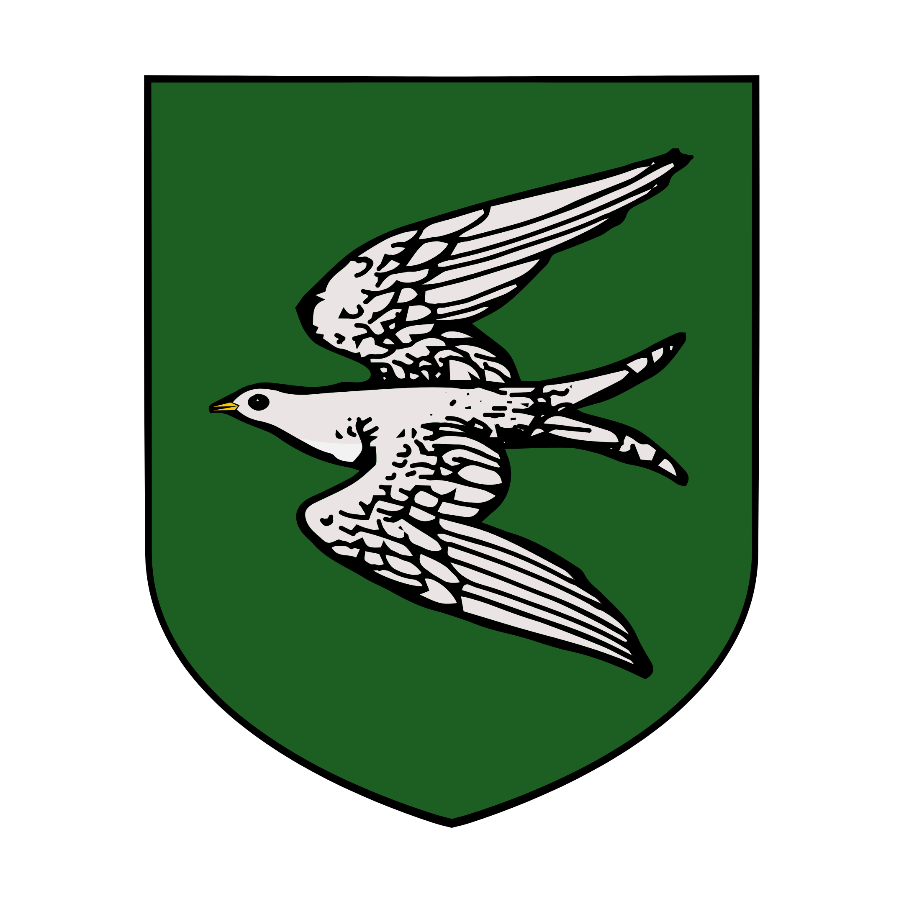

%%
[[Gethricism]]
[[Baeling Empire]]
[[Rulers of Trykkerog]]
[[Nilborg]]
[[Madeley IV]]
[[Toski]]
[[Signa Nylldottr]]
[[Wars of Baeling Succession]]
[[Zren]]
[[Skemfing]]
[[Mørbrig]]
%%

<h4 class="wiki-header">Jueli Kingdom</h4>

<strong>Government</strong>
Feudal Monarchy

<strong>Head of State</strong>
Queen <a href="Madeley IV" class="internal-link">Madeley IV</a>

<strong>Capital</strong>
Juelrup

<strong>Heraldic Symbol</strong>
White Seagull on Green Ground

<strong>Primary Religion</strong>
<a href="Gethricism" class="internal-link">Gethricism</a>

<strong>Primary Culture</strong>
<a href="Bykmåli" class="internal-link">Jueli</a> <a href="Human" class="internal-link">Human</a>

<strong>Official Language</strong>
Jueli Bykmål

<strong>Preceded by</strong>
<a href="Baeling Empire" class="internal-link">Baeling Empire</a>

<strong>Formed</strong>
617PA

The Lords and Ladies of Juelrup Castle have controlled the lands and seas of the Malksbay and the Giants Steps for centuries, and even though they are hemmed in by the Kings of <a href="Baeling" class="internal-link">Baeling</a> to the west and the wilds of <a href="Trykkerog" class="internal-link">Trykkerog</a> to the north, these adventurous sailors have carved a rich nation out of the unforgiving lands of the North. Juelfluk is an industrious nation of sailors, explorers and traders who have even ventured across the cold waters of Henmars Passage to the east, beyond the Waelajokull and into the rough Nilbay of northern <a href="Nirydia" class="internal-link">Nirydia</a>.

Their traders control a sizeable portion of the flow of goods on the Torn Sea and hold a monopoly on the little exchange that is conducted with the <a href="Vannsi" class="internal-link">Vannsi</a> of the <a href="Zren" class="internal-link">Zren</a> and the <a href="Aelf" class="internal-link">Aelfs</a> of <a href="Skemfing" class="internal-link">Skemfing</a>.

<h2>Land</h2>

The heart of the kingdom is the Malksbay in the east of Trykkerog. To the west of the bay lies Malksland, the most fertile land of the Jueli, and beyond it the contested farmland of Seldrland, where Castle Jedir faces the Baeling city of Troese. The Egillsbay on the southern coast of Malksland holds the city of <a href="Tversby" class="internal-link">Tversby</a>, whichhas been an independent city under the Archbishop of Trykkerog since the 6th War of Baeling Succession. East of the Malksbay a rugged peninsula rises into the Furkenheights and the Horn Valley and reaches from Ansvang in the south to Norgud Point in the north. Beyond the Synbay the kingdom holds the Giants Steps, the chain of rocky isles that leads east towards the Waelajokull and <a href="Nostroya" class="internal-link">Nostroya</a>, among which lies the isle of <a href="Mørbrig" class="internal-link">Mørbrig</a>, which belongs to its Chapter of mages and to no crown.

The waters around Juelfluk freeze in hard winters, and the Giants Steps close with ice from the Frozen Sea every year. Henmars Passage, the sea road east to the colony of <a href="Nilborg" class="internal-link">Nilborg</a>, can be sailed for only about three months of the year, and the knowledge of its ice and currents is one of the most closely guarded treasures of the Jueli captains.

<iframe src="https://editor.garmeley.com/v/inara/?region=juelfluk&amp;view=globe&amp;label=0"
        width="100%" height="480" style="border:0;border-radius:8px;background:transparent"
        loading="lazy" allow="fullscreen" title="Juelfluk (Inara)"></iframe>
<h2>Government</h2>

Juelfluk has been ruled since its foundation by House Udry from Juelrup Castle. By old Jueli custom the crown passes to the eldest child of the monarch, whether son or daughter, and the kingdom has had more ruling queens than any other realm of Trykkerog. The great lords of the kingdom hold their lands from the crown, while the colony of Nilborg is governed under its own charter by the Lord of Hremny. Life on the coasts is ordered as much by the sea law of the Malksbay as by the crown, an ancient body of custom that governs the shares of ships' crews, salvage, wrecks and the rights of captains, and which Jueli sailors carry with them wherever they go.

The kingdom is Gethric, and the faith is strongest in its coastal towns. Since Tversby, the seat of the Archbishop of Trykkerog, lies within the lands of Juelfluk, the Jueli crown has always stood with the Archbishop against the Bishops of Kastock whom Baeling has proclaimed in his place.

<h2>History</h2>
<h3>Juel and the Lords of Juelrup</h3>

Juelrup Castle, the kingdom and the house that rules it take their name from Juel, the legendary hero of the 2nd century BA known as the Eel of the West, who is said to have built the tower that became Juelrup Keep. House Udry claims descent from <a href="Toski" class="internal-link">Toski</a> Ironhair, one of the heroes of the <a href="Fjorisjom Saga" class="internal-link">Fjorisjom Saga</a>, and through him from Juel himself. The Jueli of the Malksbay were among the first Bykmåli to take up the Gethric faith after the voyages of Saint <a href="Melmer" class="internal-link">Melmer</a>, and the warrior <a href="Signa Nylldottr" class="internal-link">Signa Nylldottr</a>, born on the Malksbay in 382PA, is still remembered in their songs as one of the early heroes of the faith on Trykkerog. Under the <a href="Baeling Empire" class="internal-link">Baeling Empire</a> the Lords of Juelrup held the Malksbay as vassals of the Emperors.

<h3>The Kingdom of Juelfluk</h3>

After the fall of the Empire in 590PA, House Udry made itself master of the Malksbay, and in 617PA Rossgi I of House Udry declared its hegemony over the lands and peoples of the bay and founded the Kingdom of Juelfluk. When Sivdil the Tall claimed the Baeling name and all the former lands of the Empire in 684PA, Juelfluk became the chief opponent of the new Kingdom of Baeling, and the two crowns have fought nine <a href="Wars of Baeling Succession" class="internal-link">Wars of Baeling Succession</a> since. The 6th War, which ended in 806PA, left Tversby an independent city under its Archbishop, and the 9th War was fought from 911PA to 916PA over the Baeling city of Troese, which the Jueli army under the crown princess Madeley, the later Queen <a href="Madeley IV" class="internal-link">Madeley IV</a>, besieged without success.

Juelfluk's own colonial venture across the passage to the east has meanwhile grown roots. In 845PA King Munja II of House Udry granted the colony of Nilborg its Charter of rights, and with it the first Lord of Hremny became its leader. Today Nilborg has grown into a sizeable enterprise and represents the growing hope of the Jueli people in the east. Its unique position as the only Ilrakhani colony in northern Nirydia gives the Jueli merchants a monopoly on various luxury goods, and the trade through the northern passages has made Juelfluk the economic rival of Baeling.

<h3>The Present Day</h3>

In the modern day, under the rule of the much beloved Queen <a href="Madeley IV" class="internal-link">Madeley IV</a>, fourth of her Name of House Udry, Juelfluk is looking to profit from the instability of its neighbours. The civil unrest in Baeling and the conflict between Baeling and <a href="Jallbreg" class="internal-link">Jallbreg</a> are in the Jueli interest, and Juelfluk supports the secession movement of the city. So are the eternal wars between the decentralised Boyars of <a href="Grachy" class="internal-link">Grachy</a> and the entrenched Pheki of <a href="Ukiolla" class="internal-link">Ukiolla</a> within <a href="Nostroya" class="internal-link">Nostroya</a>, where Jueli traders are welcome guests in the port of Hakkepenki.

