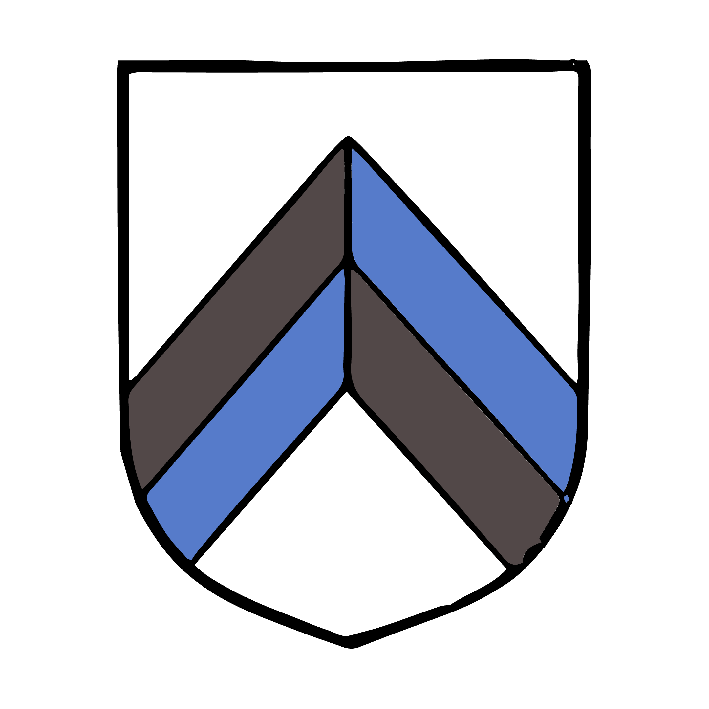

%%
[[Trykkerog]]
[[Blijgrat]]
[[Baeling]]
[[Vignasoya]]
[[Melmer]]
%%

<h4 class="wiki-header">Free City of Levangr</h4>

<strong>Government</strong>
Free City, member of the <a href="Blijgrat" class="internal-link">Blijgrat League</a>

<strong>Head of State</strong>
Lawspeaker Ingrid Vallmo

<strong>Capital</strong>
Levangr

<strong>Heraldic Symbol</strong>
Blue & Black Rise on White

<strong>Primary Religion</strong>
<a href="Gethricism" class="internal-link">Gethricism</a>

<strong>Primary Culture</strong>
<a href="Bykmåli" class="internal-link">Skori & Olbellinge</a> <a href="Human" class="internal-link">Human</a>

<strong>Official Language</strong>
Lower Bykmål

<strong>Preceded by</strong>
<a href="Baeling" class="internal-link">Kingdom of Baeling</a>

<strong>Formed</strong>
829PA

Levangr is a free city on the eastern shore of the Wolfsbay in western <a href="Trykkerog" class="internal-link">Trykkerog</a>, at the meeting point of the Skori lands of <a href="Vignasoya" class="internal-link">Vignasoya</a> and the Olbellinge lands of <a href="Baeling" class="internal-link">Baeling</a>. A small city with a large harbour, it lives from the trade between the Wolfsbay, the Gullsong Sea and the ports of Weadland. Levangr broke away from Baeling in 829PA in the Levangr War of Independence with the help of the <a href="Blijgrat" class="internal-link">Blijgrat League</a>, of which it has been a member ever since, and it is the reason the Kings of Baeling have never forgiven the merchants of Blijgrat.

<h2>Government</h2>

Levangr is governed by the Thing of its burghers, an assembly of the householders, shipowners and guild masters of the city, which elects a Lawspeaker to preside over it and to recite and keep the law of the city. The Lawspeaker serves for three years and may be chosen again, and the present Lawspeaker is Ingrid Vallmo. As a member of the Blijgrat League the city sends a delegate to the Great Hall of Equals at Schipwig, and Weadi ships and companies of the League share in the defence of its harbour. The League's protection is the only real guarantee of Levangr's freedom, and Levangr is in turn one of the League's footholds on Trykkerog.

<h2>People</h2>

The people of Levangr are of mixed Skori and Olbellinge descent, and the city has long been a place where the two meet, trade and marry. Its speech is Lower Bykmål with a strong Skori colouring. Like the rest of the southern coast it is Gethric, but the Weadi merchants of the League keep a <a href="Trinicism" class="internal-link">Trinicist</a> church in the harbour, and many of the Skori who come down from the fjords to trade still keep the old faith.

<iframe src="https://editor.garmeley.com/v/inara/?region=levangr&amp;view=globe&amp;label=0"
        width="100%" height="480" style="border:0;border-radius:8px;background:transparent"
        loading="lazy" allow="fullscreen" title="Levangr (Inara)"></iframe>
<h2>History</h2>

Levangr was already a trading town when Saint <a href="Melmer" class="internal-link">Melmer</a> came to the shores of the Wolfsbay on his last voyage, and it was from Levangr that he set out into the Swamps of Arel, where he was slain in 386PA. The town was ruled by the <a href="Baeling Empire" class="internal-link">Baeling Empire</a> in the 6th century, and after the Interregnum of the Runeblades it was brought under the new Kingdom of Baeling by the successors of Sivdil the Tall.

Under Baeling rule the burghers of Levangr grew rich on the trade with Weadland, but they resented the tolls and levies of the crown, which fell ever more heavily on them as the kingdom paid for its wars with Juelfluk. In 829PA, in the reign of King Ingvald II, the city rose against its royal officers and allied itself with the Blijgrat League. Weadi ships broke the Baeling blockade of the harbour, and the Levangr War of Independence ended with the crown unable to retake the city. Levangr joined the League soon afterwards, and it was the first of the northern settlements of Trykkerog to do so.

Since its independence the city has remained a small but prosperous free port, wedged between the Wolfsbay and the lands of Baeling. Together with the other free cities of the west it is a constant reminder to the Kings of Baeling of how far their power has slipped, and the waning influence of the crown in these cities is one of the troubles of King <a href="Varald I" class="internal-link">Varald I</a>.

