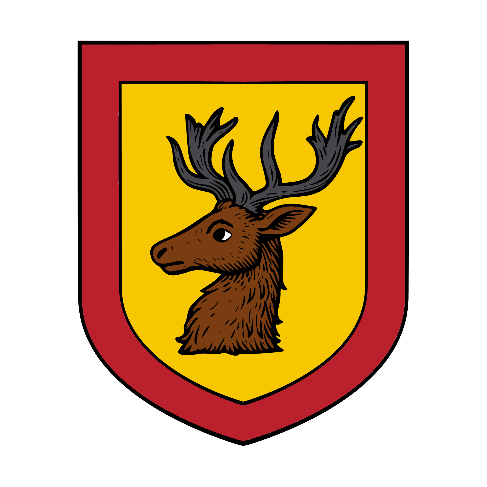

%%
[[Trykkerog]]
[[Vignasoya]]
[[Baeling Empire]]
[[Forrvegur]]
[[Zmalig]]
[[Blijgrat]]
%%

<h4 class="wiki-header">Jarldom of Rensköldsvik</h4>

<strong>Government</strong>
Jarldom

<strong>Head of State</strong>
Jarl Halvard Rensköld

<strong>Capital</strong>
Rensköldsvik

<strong>Heraldic Symbol</strong>
Reindeer on Gold and Red

<strong>Primary Religion</strong>
<a href="Forrvegur" class="internal-link">Forrvegur</a>, <a href="Gethricism" class="internal-link">Gethricism</a>

<strong>Primary Culture</strong>
<a href="Bykmåli" class="internal-link">Skori</a> <a href="Human" class="internal-link">Human</a>

<strong>Official Language</strong>
Upper Bykmål

<strong>Preceded by</strong>
<a href="Baeling Empire" class="internal-link">Baeling Empire</a>

<strong>Formed</strong>
after 590PA, restored 667PA

Rensköldsvik is a great jarldom of the Skori in the far south-west of <a href="Trykkerog" class="internal-link">Trykkerog</a>, on the shores of the Rensvik Bay, which opens onto the Bloody Strait between Trykkerog and Meadland. It holds the town of Rensköldsvik and the harbour of Akshal and the hills behind them, and it is independent of the Korringe of <a href="Vignasoya" class="internal-link">Vignasoya</a>, whose pull it has long resisted. Its people are known around the western seas as traders and above all as mercenaries, and the reindeer of its Jarls can be found on the banners of companies fighting far from the island.

<h2>Name</h2>

The name Rensköldsvik means the bay of Rensköld, the legendary founder of the ruling house, whose name is commonly read as "reindeer shield". According to the tale told in the halls of the jarldom, Rensköld held a ford against raiders with nothing but a shield made from the hide of a white reindeer, and the reindeer has been the arms of his house ever since.

<h2>Government</h2>

The jarldom is ruled by the Jarls of House Rensköld, who hold their title by descent but are acknowledged at the Thing of the Rensvik Bay, where the free landholders and the captains of the jarldom gather. The present Jarl is Halvard Rensköld. Much of the wealth of the jarldom comes from its trade along the Bloody Strait with <a href="Zmalig" class="internal-link">Zmalig</a>, Zeeport, <a href="Blijgrat" class="internal-link">Blijgrat</a> and the ports of Meadrath, and much more from its sons and daughters who serve abroad. The mercenary companies of the Rensvik Bay take service with princes in Meadland, <a href="Othirdon" class="internal-link">Othirdon</a> and beyond, and a share of their pay flows back to the Jarl, who in turn grants the companies his banner and his protection at home.

<iframe src="https://editor.garmeley.com/v/inara/?region=renskoldsvik&amp;view=globe&amp;label=0"
        width="100%" height="480" style="border:0;border-radius:8px;background:transparent"
        loading="lazy" allow="fullscreen" title="Rensköldsvik (Inara)"></iframe>
<h2>People and Faith</h2>

The people of Rensköldsvik are Skori and speak Upper Bykmål, but generations of trade and foreign service have made them the most outward looking of the Skori. The jarldom is divided in faith. The countryside keeps the old gods of <a href="Forrvegur" class="internal-link">Forrvegur</a>,the harbours have Gethric churches, and traders from Blijgrat and Meadrath have brought a <a href="Trinicism" class="internal-link">Trinicist</a> minority. The Jarls have generally kept peace between the three by favouring none of them openly.

<h2>History</h2>

In the 5th century the jarls of the Rensvik Bay were among the Skori lords who swore their arms to the Korre of Vignasoya. The <a href="Baeling Empire" class="internal-link">Baeling Empire</a> brought the bay under its rule in the 6th century, and when the Empire fell in 590PA the Jarls of Rensköldsvik did not return to the Korre, ruling instead as independent lords in the decades that followed. In 641PA Haddr the Great, Korre of Vignasoya, subdued the jarldom and made it part of his <a href="Great Kingdom of Skorland" class="internal-link">Great Kingdom of Skorland</a>, but when Skorland broke apart after his death in 667PA, Rensköldsvik regained its independence. Since then it has remained a jarldom of independent traders and mercenaries around the Rensvik Bay, wary of Vignasoya, friendly with whichever of the southern powers pays best, and too poor in land and too rich in fighting men to be worth anyone's conquest.

