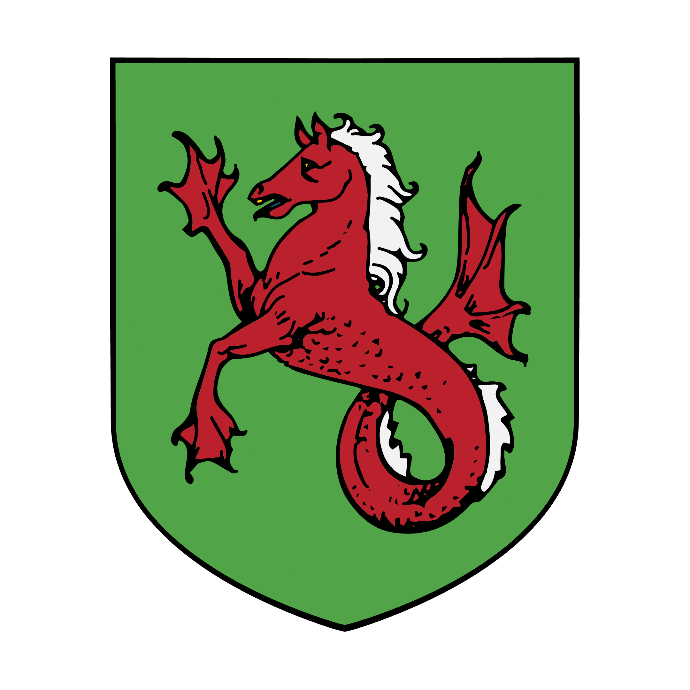

%%
[[Trykkerog]]
[[Baeling]]
[[Trazlov Consortium]]
[[Mørbrig]]
[[Krindor]]
[[Signa Nylldottr]]
[[Orthel II]]
%%

<h4 class="wiki-header">Keepership of Sallesand</h4>

<strong>Government</strong>
Jarldom with Merchant Council, nominally of <a href="Baeling" class="internal-link">Baeling</a>

<strong>Head of State</strong>
Keeper Sten Billstrom

<strong>Capital</strong>
Sallesand

<strong>Heraldic Symbol</strong>
Red Seahorse on Green

<strong>Primary Religion</strong>
<a href="Gethricism" class="internal-link">Gethricism</a>

<strong>Primary Culture</strong>
<a href="Bykmåli" class="internal-link">Olbellinge</a> <a href="Human" class="internal-link">Human</a>

<strong>Official Language</strong>
Lower Bykmål

<strong>Preceded by</strong>
<a href="Baeling Empire" class="internal-link">Baeling Empire</a>

<strong>Formed</strong>
684PA, as part of Baeling

Sallesand is the largest city of <a href="Trykkerog" class="internal-link">Trykkerog</a> and one of the three great ports of the Torn Sea. It lies at the southern tip of the long peninsula between the Wolfsbay and Melmers Bay, where the waters of the Gullsong Sea meet those of the Torn Sea, and almost every ship that passes between the two seas along the Bykmåli coast calls at its harbour. The city is nominally a possession of the Kingdom of <a href="Baeling" class="internal-link">Baeling</a>, but it is so powerful and so closely tied to the <a href="Trazlov Consortium" class="internal-link">Trazlov Consortium</a> that it is independent in all but name, and visitors from the south often describe it as more a Consortium company town than the city of its Jarl.

<h2>Government</h2>

Sallesand is ruled by its Jarl, who bears the title of Keeper of Sallesand. The Keepers were once officers sent from Alsebyn to govern the city for the crown, but as the hold of Baeling weakened the office passed from father to son in the Billstrom family, and the King of Baeling now does little more than confirm each new Keeper. The present Keeper is Sten Billstrom. Beside him sits the Sallesand Council, a body of the great merchant houses, shipowners and guilds of the city, which governs its harbour, its tolls and its coin. The Kontors and creditors of the Trazlov Consortium hold so many seats and so much of the city's debt that little is decided in the Council against their wishes. The Council has also kept a High Weaver of the <a href="Mørbrig" class="internal-link">Mørbrig Chapter</a> as its advisor, a post most famously held by <a href="Krindor" class="internal-link">Modan Krindor</a> in the early 9th century.

The city still pays a tribute to the crown at Alsebyn, and it formally owes Baeling ships and men in war. In practice the tribute has shrunk with every generation, and the Keepers have avoided sending their ships into the Wars of Baeling Succession whenever they could.

<h2>People</h2>

Most of the people of Sallesand are Olbellinge, but it is the most varied city on the island. Jueli and Skori sailors, Weadi and Meadi merchants, Vihri traders of the Consortium, orcs and Qalmyr all live in its harbour quarters, and the city is said to have a tavern for every coast of the Torn Sea. Like the rest of the southern coast it is overwhelmingly Gethric, but it has a small <a href="Trinicism" class="internal-link">Trinicist</a> community of foreign merchants and their families. Erik of Sallesand, the present Archbishop of Trykkerog at <a href="Tversby" class="internal-link">Tversby</a> and a moderate spoken of as a possible successor to the High-Bisop <a href="Orthel II" class="internal-link">Orthel II</a>, was born in the city.

<iframe src="https://editor.garmeley.com/v/inara/?region=sallesand&amp;view=globe&amp;label=0"
        width="100%" height="480" style="border:0;border-radius:8px;background:transparent"
        loading="lazy" allow="fullscreen" title="Sallesand (Inara)"></iframe>
<h2>History</h2>

Sallesand was already a town of note in the 5th century, when the Jueli warrior <a href="Signa Nylldottr" class="internal-link">Signa Nylldottr</a>, one of the Heroes of Sydrow, died there in 459PA. It grew rich under the <a href="Baeling Empire" class="internal-link">Baeling Empire</a> as the gate between Melmers Bay and the western seas, and after the fall of the Empire in 590PA it was held by a succession of lords and mercenary captains during the Interregnum of the Runeblades. In 684PA Sivdil the Tall united Sallesand with Alsebyn under his new Kingdom of Baeling, and for the following century the city was one of the pillars of the Baeling crown.

The merchants of the Trazlov Consortium spread along the coasts of the Torn Sea in the 8th and 9th centuries, and Sallesand became their greatest market in the north. Their loans financed the city's harbour, its fleets and its Keepers, and as the crown weakened after the 6th War of Baeling Succession and the loss of <a href="Levangr" class="internal-link">Levangr</a> in 829PA, the Keepers came to rely ever more on the Consortium and ever less on Alsebyn. In 821PA the High Weaver Modan Krindor was slain by the Gethric paladin Gimmael at an estate in the outskirts of the city, for reasons that were never made clear. Today the King of Baeling counts Sallesand among his possessions, but it is the Council and the Consortium that rule it.

