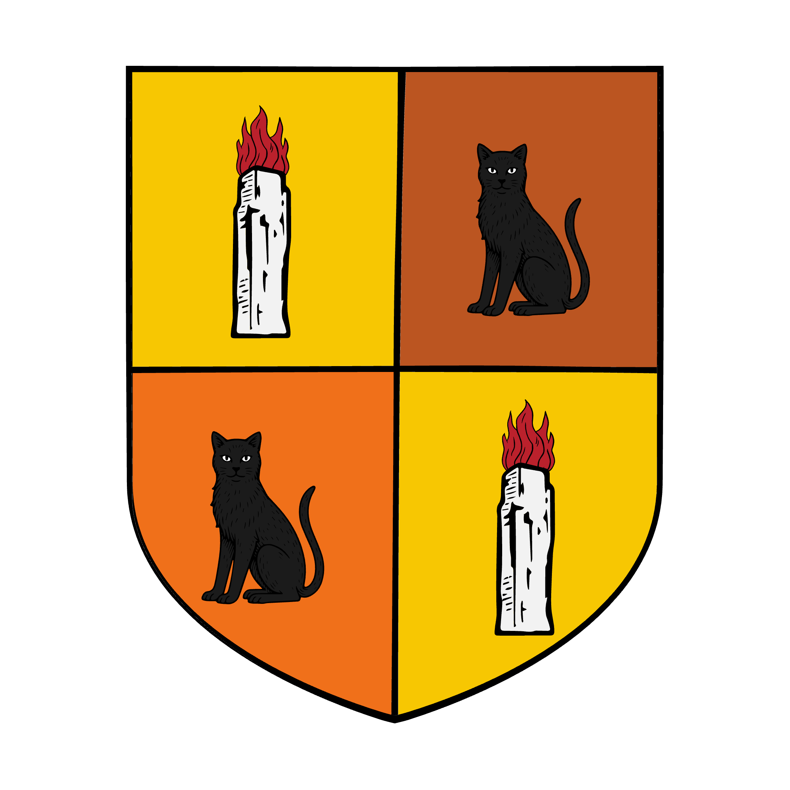

%%
[[Trykkerog]]
[[Melmer]]
[[Gethricism]]
[[Church of Iztaw]]
[[Juelfluk]]
[[Baeling]]
[[Wars of Baeling Succession]]
[[Orthel II]]
[[Trazlov Consortium]]
%%

<h4 class="wiki-header">Archbishopric of Tversby</h4>

<strong>Government</strong>
Ecclesiastical City-State

<strong>Head of State</strong>
Archbishop Erik of Sallesand

<strong>Capital</strong>
Tversby

<strong>Heraldic Symbol</strong>
Quartered Gethric Candle and Black Cat on Orange

<strong>Primary Religion</strong>
High <a href="Gethricism" class="internal-link">Gethricism</a>

<strong>Primary Culture</strong>
<a href="Bykmåli" class="internal-link">Jueli</a> <a href="Human" class="internal-link">Human</a>

<strong>Official Language</strong>
Jueli Bykmål

<strong>Preceded by</strong>
<a href="Juelfluk" class="internal-link">Kingdom of Juelfluk</a>

<strong>Formed</strong>
806PA

    

Tversby is a city on the Egillsbay in eastern <a href="Trykkerog" class="internal-link">Trykkerog</a> and the seat of the Archbishop of Trykkerog, who has ruled it as an independent city-state since the end of the 6th War of Baeling Succession in 806PA. Founded by Saint <a href="Melmer" class="internal-link">Melmer</a> during his voyages in the later 4th century, it is the holiest city of the Bykmåli and the home of Wavewrought Cathedral, where Melmer's trident is kept. The city is surrounded on its landward side by the Kingdom of <a href="Juelfluk" class="internal-link">Juelfluk</a>, and its independence rests on the protection of the church and on the unwillingness of either Juelfluk or <a href="Baeling" class="internal-link">Baeling</a> to see the other hold it.

<h2>Wavewrought Cathedral</h2>

Wavewrought Cathedral is the mother church of Trykkerog and the seat of its Archbishops. It takes its name from the old tale that its first foundations were laid on stones the sea itself had cast up on the shore at Melmer's prayer. The trident of Melmer, the most precious relic of the Bykmåli, is displayed within, and pilgrims from all over the island and the Torn Sea come to see it, above all on the feast of the Saint. Sailors of every Gethric coast of the north leave small votive ships in the cathedral before long voyages, and its walls are hung with them.

<h2>Government</h2>

The Archbishop of Trykkerog is both the spiritual head of the Gethric church of the island and the temporal lord of Tversby. He governs the city with the help of the canons of the cathedral chapter, while a council of burghers manages its harbour, markets and walls. The city keeps a small guard but no army of its own, and its safety rests on the treaty of 806PA, the authority of the <a href="Church of Iztaw" class="internal-link">Church of Iztaw</a> and the fact that its neutrality suits both of the great crowns. The merchants of the <a href="Trazlov Consortium" class="internal-link">Trazlov Consortium</a> keep one of their major Kontors in the city, and much of the trade between Vihr and the Malksbay passes through its harbour. The present Archbishop is Erik of Sallesand, a moderate who is spoken of as a possible successor to the High-Bisop <a href="Orthel II" class="internal-link">Orthel II</a>.

<iframe src="https://editor.garmeley.com/v/inara/?region=tversby&amp;view=globe&amp;label=0"
        width="100%" height="480" style="border:0;border-radius:8px;background:transparent"
        loading="lazy" allow="fullscreen" title="Tversby (Inara)"></iframe>

<h2>The Archbishopric</h2>

The Archbishopric of Trykkerog is one of the main Archbishoprics of the Church of Iztaw, beside those of Grachy, Ur, Vihr, Pilvia and Rean. Its Archbishop is responsible for the bishops of the whole island, including Baeling and Juelfluk, and he holds one of the weighty votes in the election of the High-Bisop. The see has long been caught up in the rivalry of the two crowns. Since Tversby passed out of the reach of Baeling, the Kings of Baeling have several times proclaimed the Bishop of Kastock head of the Gethric church of Trykkerog in the Archbishop's place, but Iztaw has never acknowledged these claims.

<h2>History</h2>

Melmer founded Tversby on the Egillsbay during his voyages to Trykkerog between 372PA and 386PA, and the city became the first centre of the Gethric faith on the island. After his death and his canonisation in 410PA it grew into a place of pilgrimage, and it became the seat of the Archbishops of Trykkerog as the conversion of the island spread from the halls of the jarls into the countryside. Under the <a href="Baeling Empire" class="internal-link">Baeling Empire</a> the Archbishops were close allies of the Emperors, who completed the conversion of the island outside Vignasoya in 517PA. After the fall of the Empire the city fell within the lands of House Udry, and from 617PA it belonged to the Kingdom of Juelfluk.

In the <a href="Wars of Baeling Succession" class="internal-link">6th War of Baeling Succession</a>, fought from 801PA to 806PA, Baeling forces crossed Melmers Bay and occupied Tversby in the hope of bringing the Archbishop and the see under the Baeling crown. Neither side could hold the city for long, and the peace of 806PA, unable to settle it between the two crowns, left Tversby to its Archbishop as an independent city under the protection of the church. Baeling has never fully accepted the loss and has since raised the Bishop of Kastock against the Archbishops, while Juelfluk, which surrounds the city, has been its most reliable friend. In the conclave of 915PA, which was bitterly divided between the bishops of Vihr and the Archbishops of the lands abroad, the Archbishop of Trykkerog was one of the voices of the foreign sees.

