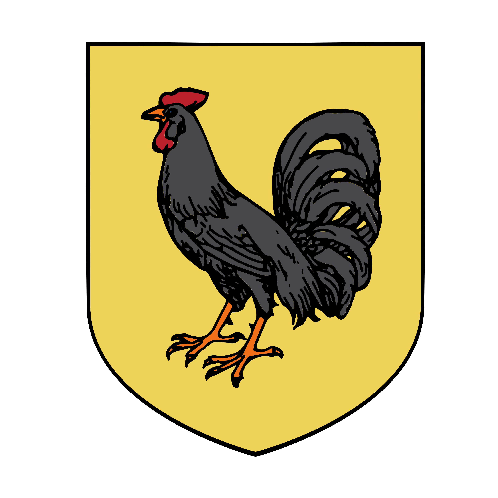

%%
[[Gethricism]]
[[Vihr]]
[[Andre]]
[[Trydlew]]
%%

    <h4 class="wiki-header">Vadcy zi Breza</h4>
    

        <strong>Government</strong>
        Vihri Vadcy
    

    

        <strong>Head of State</strong>
        Varina Milva
    

    

        <strong>Capital</strong>
        <a href="Trydlew" class="internal-link">Trydlew</a>
    

    

        <strong>Heraldic Symbol</strong>
        Black Rooster on Yellow Ground
    

    

    

        <strong>Primary Religion</strong>
        <a href="Gethricism" class="internal-link">Gethricism</a>
    

    

        <strong>Primary Culture</strong>
        <a href="Vihri" class="internal-link">Sarloni</a> <a href="Human" class="internal-link">Human</a>
    

    

        <strong>Official Language</strong>
        High Vihri
    

    

    

        <strong>Preceded by</strong>
        <a href="Vihrmen Federation" class="internal-link">Vihrmen Federation</a>
    

    

        <strong>Formed</strong>
        377PA
    

    

 Breza, often known as "Golden Breza" or as the "Breadbasket of Vihr" for its fields of grain, is one of the major Vadcy within Vihr, it holds parts of the northern Expanse and the lands of the central Tryd River. Home to Trydlew, the old capital of the Vihrmen, it is a cultural and historically very important region within Vihr and home to the famous Knights of the Unicorn. 

<h2>Geography</h2>

Breza lies in the middle of the Vihri Expanse, along the central course of the Tryd River, south-east of Zavlech and south-west of Szievek. West of the capital the Royal Woods stand between the Tryd country and the Tlok Valley, and the lands of <a href="Tloky" class="internal-link">Tloky</a> begin on the far side of them. <a href="Szievek" class="internal-link">Szievek</a> lies to the north, <a href="Levazci" class="internal-link">Levazci</a> to the north-east and <a href="Selbia" class="internal-link">Selbia</a> to the south. The uplands known as the Breza hills lie within the Vadcy.

<h2>History</h2>

Long before there was a Vihr, Trydlew was one of the three places, with Trazlov and Tlokyemy, where the seasonal gatherings of the Vihrmen hardened into permanent towns. It was the home of the Ullkustone, the monument of Ollku, the god of river and sea, which drew pilgrims from across the Vihri world. The Horn Lords of the <a href="Vihrmen Federation" class="internal-link">Federation</a> deliberated at Tlokyemy, but the most solemn pacts between them were sworn at Trydlew, before the Stone, and the Vihrmen remember it as their old capital. When Viago of the Zav proclaimed the kingdom in 241PA the political centre moved to Zavlech, but Trydlew kept its place in the memory of the Vihri, and the Ullkustone was not destroyed.

Breza was one of the eight lordships that marched on Zavlech in 377PA and became hereditary Vadcy in the settlement that followed. Some of the ground that Breza holds today then belonged to the greater Szievek, granted to Breza only after the Vihri War of Succession, when Zawis gave the lands of the beaten Szinmo to the lords who had backed him. The lords of Breza were not always secure at home. In 503PA the old Sarloni lords of Breza, the zi Brediv, backed the Kisras <a href="Boris Szinmo" class="internal-link">Boris</a> in his rising against his father, Ras <a href="Kasimir I" class="internal-link">Kasimir I</a>. The Ras broke the Boris Uprising, made the zi Brediv merely the Gri of Tansaw, and gave Breza and Trydlew to House Dibrevi. The realm stayed out of the war of the Pilvians against Rean from 519PA to 530PA, but knights of Breza and Selbia went south to fight on the side of what would become Grevenna. In 529PA, in the reign of Kasimir II, a violent and bloody revolt of the people of the Expanse against their northern overlords in Breza, Opuzna and Selbia was put down, and is today remembered as the Sarloni Uprising.

The War of Horn and Fang brought Breza both its darkest years and its greatest. In 854PA, with the Dance of Husks in its villages, the crown requisitioned the harvest of the Expanse for the armies in the west, and the Sarloni rose against it in the Grain Rising of 854. Their cry was "Why are we sending our grain and our young people north to a war, while a plague is in the south and we have not enough to eat?", and the black unicorn flew over the burning granaries. Farmers and landless petty nobles set their feuds aside, and the rebels, known as the Grainers, burned granaries and fell on the grain convoys. The first to bear the brunt of the rising were the men of the Varina, Katrina Dibrevi. Ras Jerziv I sent a royal judge with agents of the <a href="Vaergriff" class="internal-link">Vaergriff</a>, and later invited the <a href="Kherovan Inquisition" class="internal-link">Kherovan Inquisition</a>, whose High Inquisitor <a href="Teron Maz" class="internal-link">Teron Maz</a>, Iron Maz, burned dozens of small villages in his hunt for partisans, rebels and occult elements. The rising was broken in 855PA, and the weeks of trials at Atej that followed are known as the Judgements. At the Great Judgement nine hundred ringleaders were put to death on a single day, and Urilla, a peasant girl and healer whom the Inquisition called the Witch, was burned alive at Atej after a public judgement. It was never proven that she possessed an ounce of magical power, and the Sarloni mourn her as an innocent victim to this day. They keep a day of mourning for the Judgements and sing of the nine hundred, and among them "Atej" is still used as a curse. Andre, the Gri of Trydlew, took part in the Judgements and was rewarded with Atej for it, and while the Church tells of his mercy and justice in them, the Sarloni of Breza remember them otherwise.
  

Its great age came in the last years of the <a href="War of Horn and Fang" class="internal-link">War of Horn and Fang</a>. Andre, the Gri of Trydlew, became the greatest commander that Vihr produced in the war, and at the Battle of Gadly Bridge in 865PA he killed the Meadi sorceress <a href="Muriel von Gloss" class="internal-link">Muriel von Gloss</a> on his lance. In 869PA, three years after the <a href="Treaty of Uhl" class="internal-link">Treaty of Uhl</a>, he founded the <a href="Knights of the Unicorn" class="internal-link">Knights of the Unicorn</a>. He died in 874PA in unknown circumstances, and poisoning was suspected. In 876PA he was canonised at a Conclave that the Trinic bishops widely protested, and <a href="Andre" class="internal-link">Saint Andre</a> is still the last saint that the Gethric canon has admitted. The <a href="Honoured Assembly" class="internal-link">Honoured Assembly</a> took care that Vihr should remember him as the last great knight of a terrible war, and not as the man who lost Uhl.

<h2>Ruling House and Politics</h2>

The Vadcy is held by House Dibrevi, which has held it since 503PA, and whose present head is Varina Milva, one of the three women among the nine Var, together with the Varinas of Szievek and Levazci. The Dibrevi are not Sarloni by culture, though most of their subjects are, and the house has come to stand for the rule of the northern lords over the Sarloni of the Expanse. That arrangement has bred discontent among the Sarloni, at least in the past. As one of the eight ancient lordships, Breza has sat in the Honoured Assembly since the beginning. The Varina keeps her seat at Trydlew. Saint Andre was the Gri of Trydlew in his day, and his line survives: Robar, his direct descendant, is the Gri of Atej, a county south of Trydlew that the crown granted to Andre's line as a reward for his part in the Judgements of 855PA, and Andre is the only saint of the Gethric canon whose line is confirmed to survive. As a Gri he stands beneath the Varina in the order of the realm.

The Knights of the Unicorn keep their headquarters on the outskirts of Trydlew, at the Fortress of Madzar, a paramilitary base of its own. In the years after Andre's death in 874PA the Fortress was granted a royal charter by which it answers to the Ras alone. Nobody objected, since it was seen as part of the will of the new Saint, and as an honour to him and his knights. The Order's current Kurzęk is Dorman of the White Sea. Prince <a href="Jakub Ralpia" class="internal-link">Jakub</a>, second in line to the throne, is a prominent member, and at his call the Knights committed their substantial finances and elite forces to the <a href="Garmish Succession Crisis" class="internal-link">Garmish Civil War</a>, which caused a large uproar. With the Order's headquarters on its ground, Breza is the Vadcy where such decisions matter most.

<h2>Society and Culture</h2>

The people of Breza are mostly Sarloni, and Gethric. Among the other Vihri the Sarloni of the Expanse have a surprisingly good name as hardworking men, and an equally lasting one for occult paganism and the old gods of <a href="Turvik Paganism" class="internal-link">Turv</a>, for little practical reason, since the vast majority of them are simply Gethric. In Breza that reputation has some roots in history. After the Federation was gone, the old faith lived on quietly in the Sarloni communities of the Breza hills, long after the council of the Horn Lords had passed from living memory, and small communities there keep to the old gods to this day.
  

The Sarloni of Breza are known for the old blood feuds within their communities, some of them going back generations, and above all among the many petty and landless nobles of the Vadcy, who often have little more than a name, a horse and a sword to their honour. They are known too as great lovers and dancers. Their most famous dance is the Sarzok, in which men and women dance in a circle, faster and faster, until only the last man whose legs have not given out is left standing, and no wedding or harvest feast in the Vadcy ends without one. Most of them have lived under lords who are not Sarloni since the fall of the zi Brediv in 503PA, and the bitterness that broke out in the Sarloni Uprising of 529PA, and again in the Grain Rising of 854, has never quite gone away.

Two saints of the Gethric canon came out of the country around Trydlew: Andre, who was its Gri, and <a href="Tytus" class="internal-link">Tytus the Unbound</a>, who was born in 514PA at Pinopki, near the city. The unicorn, the national animal of Vihr and the emblem of the Order, is native to the Expanse and was revered by the Vihrmen long before the kingdom. The arms of the Vadcy show a black rooster on a yellow ground.

<h2>Economy</h2>

Breza is fundamentally agricultural, like the Expanse around it, and its golden fields of grain, which have earned it the name of the breadbasket of Vihr, feed much of the realm, the capital Zavlech above all. The Order brings its own wealth to the Vadcy, and since the majority of its knights ride unicorns, the keeping of the animals is a business of its own around Trydlew. The old capital and the shrines of its saints draw pilgrims, who bring trade with them.

<h2>Places of Note</h2>

Trydlew, on the Tryd River, is the capital of the Vadcy, the old capital of the Vihrmen, and the seat of the Varina, one of the greatest cities in Vihr. The Fortress of Madzar stands on the outskirts of the city as the current headquarters of the Knights of the Unicorn. Pinopki is the town near Trydlew where Saint Tytus was born, famed for its bakers. Tienov, in the east of the Vadcy south of Pretko, is the home of the Festival of the Falcon, held every year, where poets from all the lands gather and compete for the royal prize that the crown has given since <a href="Viago V" class="internal-link">Viago V</a> "the Merry" first sponsored it. Atej lies south of the capital and is the county of the Gri Robar. It was at Atej that the Great Judgement was held in 855PA, when nine hundred Sarloni ringleaders were judged and put to death on a single day. <a href="Pretko" class="internal-link">Pretko</a>, just beyond the eastern tip of the Vadcy, is one of the cities that the early Zav kings founded or enlarged. It is a free city that answers directly to the Ras and belongs neither to the royal domain nor to any Vadcy. The Royal Woods, a great forest west of the capital, separate the Tryd country from the Tlok Valley. The forest is the subject of many mysteries and rumours, but it is largely free of monsters.

<h2>People of Interest</h2>

Milva of House Dibrevi, Varina of Breza Karril zi Dibrevi, "Bloodlance", cousin of the Varina and Hetman of the <a href="Selbia Brigade" class="internal-link">Selbia Brigade</a> Robar, Gri of Atej, descendant of Saint Andre <a href="Andre" class="internal-link">Andre of Trydlew</a>, Saint and Gri of Trydlew, founder of the Knights of the Unicorn Dorman of the White Sea, Kurzęk of the Knights of the Unicorn <a href="Jakub Ralpia" class="internal-link">Jakub of House Ralpia</a>, Kis of Vihr, Knight of the Order of the Unicorn <a href="Tytus" class="internal-link">Tytus the Unbound</a>, Saint, born at Pinopki
