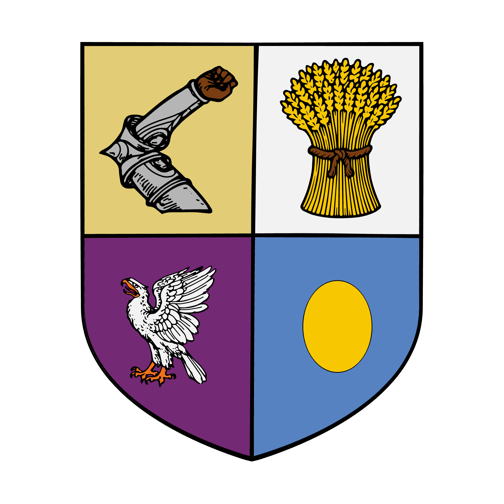

%%  
[[Vihr]]  
[[Szievek]]  
[[Breza]]  
[[Levazci]]  
[[Zawis I]]  
[[Viago I]]  
[[Honoured Assembly]]  
[[Knights of the Unicorn]]  
[[Trazlov Consortium]]  
[[Szulbod]]  
%%  

  
 <h4 class="wiki-header">Pretko</h4>  
 
  
 <strong>Country</strong>  
 <a href="Vihr" class="internal-link">Rascy zi Vihr</a>, Free City  
 
  
 
  
 <strong>Government</strong>  
 Free City of the Crown, ruled by the Wojt and the Rada  
 
   
 
  
 <strong>Heraldic Symbol</strong>  
 Quartered: an Armoured Fist, a Sheaf, a White Falcon and a Golden Coin  
 
  
 
  
 
  
 <strong>Primary Religion</strong>  
   <a href="Gethricism" class="internal-link">Gethricism</a>    
 
  
 
  
 <strong>Primary Culture</strong>  
 <a href="Vihri" class="internal-link">Low Vihri</a> <a href="Human" class="internal-link">Human</a>  
 
  
 
  
 <strong>Official Language</strong>  
 High Vihri  
 
  
 
  
 <strong>Free City since:</strong>  
 562PA  
 
    

  

Pretko is a free city of Vihr in the northern Vihri Expanse, a walled market town of some 15,000 people that answers to the Ras alone and belongs neither to the royal domain nor to any Vadcy. It has held that status since 562PA, when <a href="Zawis I" class="internal-link">Zawis I</a> rewarded its burghers for holding out against the Szinmo in the Vihri War of Succession. Pretko is the home of the Pretko Fair, the greatest market for unicorns and horses in the realm, and of a burgher class that governs itself through its own mayor and council.
  
<h2>Geography</h2>  

Pretko lies on a small river in the open farmland of the northern Expanse, with <a href="Szievek" class="internal-link">Szievek</a> to the north, <a href="Breza" class="internal-link">Breza</a> and its capital <a href="Trydlew" class="internal-link">Trydlew</a> to the west and <a href="Levazci" class="internal-link">Levazci</a> to the east. The road from Trydlew to Orzebachi and the Hyllpass runs through its gates, and so does the drovers' road that brings the herds of the southern Expanse north. The town of Tienov lies a short way to the south-west. The country around the city is flat, and the Charter Tower, the tallest building in Pretko, can be seen from a day's ride away.
  
<h2>History</h2>  

Pretko was one of the towns that <a href="Viago I" class="internal-link">Viago I</a> founded or enlarged after the Unification Wars, together with Szievek and Perliav, planted on the roads of the Expanse as an instrument of the crown and of the Church. When the eight great lordships became hereditary Vadcy in 377PA, Pretko lay within the lands of Szievek, which in those days took in large parts of what are now Breza and Levazci.
  

In the Vihri War of Succession Szievek became the stronghold of the Szinmo claimant Dobrov, but the burghers of Pretko declared for Zawis of Nediv and shut their gates on Dobrov's tax collectors. In 559PA Dobrov laid siege to the city with his own levies and the mages he had gathered in breach of the <a href="Wermian Accords" class="internal-link">Wermian Accords</a>. The walls held for five months, and the townsmen dug tunnels under them to raid the siege lines by night, until the host of Zawis relieved the city in the spring of 560PA. When the war ended in 562PA and Szievek was cut down by two thirds, Zawis gave Pretko to no lord. The Charter of Pretko made it a free city of the crown: it pays the Ras a fixed yearly sum, the Charter Silver, sends a city company to the royal host when the realm goes to war, and governs itself in all other things.
  

In the centuries since, the city grew rich on its market. The Pretko Fair became the meeting place of the herders of the south and the buyers of the north, and after <a href="Andre" class="internal-link">Andre of Trydlew</a> founded the <a href="Knights of the Unicorn" class="internal-link">Knights of the Unicorn</a> at Madzar in 869PA, the Order bought its mounts there. The Wolfsplague of the early 910s, which thinned the peasantry and strengthened the burghers across Vihr, made the guilds of Pretko bolder still, and the roads of <a href="Vormil III" class="internal-link">Vormil III</a> have brought more trade to its gates than ever before.
  
<h2>Government and Politics</h2>  

Pretko is governed by the Rada, a council of twelve masters chosen by the guilds of the city, and by the Wojt, the mayor, whom the Rada elects from among its members for three years at a time. The crown keeps no governor in the city.Its only officer there is one of the <a href="Royal Judges of Vihr" class="internal-link">royal judges</a>, who hears the Crown Pleas of blood and treason, and the Charter of Pretko is renewed by each new ruler on coming to the throne.
  

The city has no seat in the <a href="Honoured Assembly" class="internal-link">Honoured Assembly</a>, and it has asked for one more than once. The Var have refused every time, for a seat for Pretko would be a seat for every town that can buy a charter. Varina Katerina of Szievek has never forgotten that Pretko was once her house's, and Breza and Levazci, which both border the city, would each take it if the crown let them. The Kisras <a href="Waśko Ralpia" class="internal-link">Waśko</a> sees the free cities as the natural allies of the throne against the Var, and courts the Rada openly.
  
<h2>Society and Culture</h2>  

The people of Pretko are Low Vihri and Gethric, a city of guildsmen, carters, innkeepers and horse dealers. In fair week the city fills with Wyt from the hills and Sarloni drovers from the Expanse, with knights of the Order and their squires, and with buyers from Grachy who come over the Hyllpass. The city company, raised from the guilds, is known as the Fists, after the armoured fist in the arms of the city. The arms are quartered, and show an armoured fist, a sheaf of wheat, a white falcon and a golden coin.
  
<h2>Economy</h2>  

The Pretko Fair is held every midsummer outside the walls and lasts two weeks. Unicorn herders from the grasslands of <a href="Opuzna" class="internal-link">Opuzna</a> and Levazci bring their animals north to it, together with horses, cattle and the wool of the Expanse, and no other market in Vihr sells as many unicorns. The rest of the year Pretko lives on the grain of the surrounding farmland and on the road. Its charter gives the city a staple right: merchants who pass along the road must offer their goods in its market for three days before they may carry them on. The <a href="Trazlov Consortium" class="internal-link">Consortium</a>, whose guilds dominate inland trade everywhere else in Vihr, has fought the staple right for two centuries without breaking it.
  
<h2>Places of Note</h2>  

The Charter Tower stands in the market square, where the Charter of Pretko is kept and the city bell hangs. The Rada meets in the Guildhall beside it. The Fairfield, outside the southern gate, holds the pens and paddocks of the fair. Under the walls run the tunnels that the burghers dug during the siege of 559PA, most of them sealed, some of them not.
  
<h2>People of Interest</h2>  

Hanka Sobierad, Wojt of Pretko Dawid Krzemień, royal judge at Pretko <a href="Zawis I" class="internal-link">Zawis I "Silverbeard"</a>, Ras of Vihr, who granted the Charter of Pretko
  
