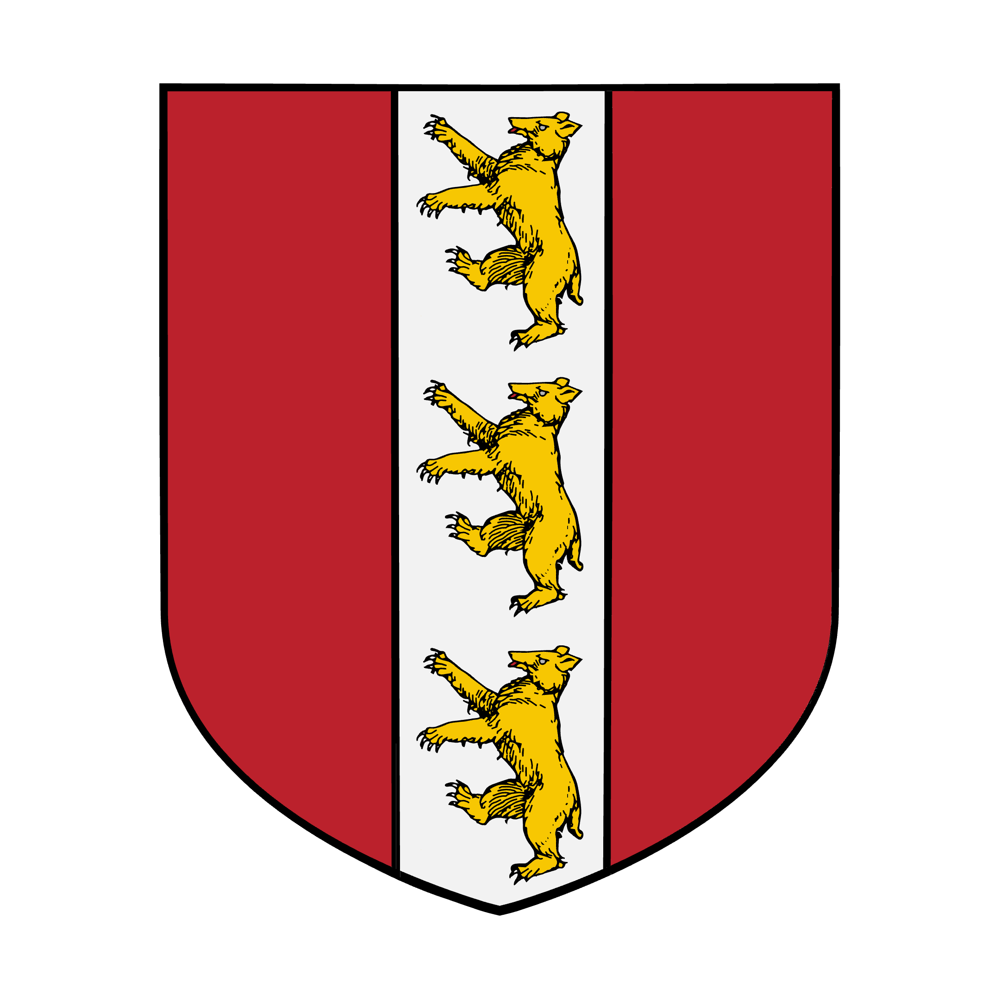

%%  
[[Vihr]]  
[[Zavlech]]  
[[Gethric Pogroms]]  
[[Silver Towns of Gleamig]]  
[[Vrieman Bank of Uhl]]  
[[Vaergriff]]  
[[Honoured Assembly]]  
[[Trinicism]]  
[[Pretko]]  
%%  

  
 <h4 class="wiki-header">Szulbod</h4>  
 
  
 <strong>Country</strong>  
 <a href="Vihr" class="internal-link">Rascy zi Vihr</a>, Free City  
 
  
 
  
 <strong>Government</strong>  
 Free City of the Crown, ruled by the Royal Starost and the Council of Guests  
 
   
 
  
 <strong>Heraldic Symbol</strong>  
 Three Golden Bears on a White Pale, on red ground  
 
  
 
  
 
  
 <strong>Primary Religion</strong>  
 <a href="Gethricism" class="internal-link">Gethricism</a>  
 
  
 
  
 <strong>Primary Culture</strong>  
 <a href="Vihri" class="internal-link">Low Vihri</a> <a href="Human" class="internal-link">Human</a>  
 
  
 
  
 <strong>Official Language</strong>  
 High Vihri  
 
  
 
  
 <strong>Free City since:</strong>  
 778PA  
 
    

  

Szulbod is a free city of Vihr east of the capital <a href="Zavlech" class="internal-link">Zavlech</a>, and the seat of the Royal Mint, which strikes the coin of the realm. It owes its freedom to the Guest Charter that Ras Orian I granted it in 778PA, when he ended the <a href="Gethric Pogroms" class="internal-link">Gethric Pogroms</a>. Under that charter only the law of the crown runs within its walls, and any free person under the protection of the Ras may live and trade there, whatever their faith or blood. The same freedom later made it the one place where the Mint could stand without belonging either to the crown's own lands or to any Var, and today Szulbod is known in Vihr above all as the Mint City.
  
<h2>Geography</h2>  

Szulbod stands on a stream that runs east toward the Lehva, half a day's ride east of Zavlech on the road to <a href="Szievek" class="internal-link">Szievek</a>. The crownlands around the capital lie to the west and north of it, and the lands of Szievek to the east. Trydowka lies to the north on the Tryd, and the woods between Szulbod and the Lehva are the nearest cover to the capital for anyone who does not wish to be found.
  
<h2>History</h2>  

Szulbod began as one of the small river towns of the crownlands that fed the capital, and for five centuries nothing set it apart from Myrg or Vzsal. That changed after the Pogroms. In 763PA Ras Miskomir III outlawed elvenkind in Vihr at the urging of the Church, and the persecution that followed, together with the Great Schism of 764PA, drove foreign merchants away from the realm. When Orian I came to the throne in 778PA he ended the Pogroms, but the Church did not repeal the ratification of 763. It only ceased to enforce it, and no foreigner of the wrong faith or blood could be sure that a bishop's court would not take them up again.
  

Orian answered with the Guest Charter. He took Szulbod out of the crownlands and made it a free city in which the bishops' courts have no reach and only royal law applies, and he placed every free person who lives there under his own protection. The charter was meant to bring the merchants back, and it did. Grachi, Wermian and Meadi traders settled in the town, dwarves of Xer-Kol and Tizin-Kol followed, and so did the few half-elven families that had survived the Pogroms in hiding.
  

The Mint followed in 781PA. Under Miskomir III the Royal Mint in the palace at Zavlech had debased the coin of the realm to pay for the Wars of Elbae Aggression, and the Var in the <a href="Honoured Assembly" class="internal-link">Honoured Assembly</a> demanded that the striking of coin be taken out of the crown's own hands. None of them would accept that it be given to another Var, for that would raise one lord above the rest. Szulbod answered both demands. It was not crown land, and it belonged to no Var, and Orian moved the Mint there under a Mint Master who is named by the Ras and swears his oath before the Assembly. Since the Treaty of Uhl of 866PA the Mint has struck its coin to the standard of the <a href="Vrieman Bank of Uhl" class="internal-link">Vrieman Bank</a>, which keeps an office in the city.
  
<h2>Government and Politics</h2>  

The city is governed by a Royal Starost, who is appointed by the Ras and holds the gates, the watch and the high justice, and by the Council of Guests, in which the masters of the town guilds sit beside the elders of the guest communities. The Mint Master of Vihr sits on the Council and is in practice the most powerful man in the city. The <a href="Candleguard" class="internal-link">Candleguard</a> may not enter Szulbod, and the Bishop of Zavlech, Wolod III, preaches against it as the Devil's Inn.
  

Szulbod has friends in high places. The Kisras <a href="Waśko Ralpia" class="internal-link">Waśko</a>, who governs the neighbouring capital and wants a narrower role for the Church in the realm, protects it, and the <a href="Vaergriff" class="internal-link">Vaergriff</a> values it more than any other town in Vihr: every envoy, every foreign merchant and every foreign coin passes through it, and its informers sit in every tavern.
  
<h2>Society and Culture</h2>  

Szulbod is the most mixed town in Vihr. Most of its people are Low Vihri and Gethric, but the guest quarters house Grachi, Wermian and Meadi families, a dwarven street of smiths and assayers, and most of the half-elves who still live in the realm. Foreign envoys to the court at Zavlech often lodge in Szulbod rather than in the capital, where they are more welcome and less watched, or so they believe. A small Trinic chapel stands in the Meadi quarter, the only one tolerated in the Rascy. The arms of the city show three golden bears on a white pale, on a red ground.
  
<h2>Economy</h2>  

The Mint is the heart of the city. The silver of the <a href="Silver Towns of Gleamig" class="internal-link">Silver Towns of Gleamig</a> comes to it under guard, and the coin it strikes goes out to the treasury at Zavlech and to every market of the realm. Around the Mint have grown the trades that serve it, from assayers and engravers to money changers and the strongrooms of foreign merchant houses. The guest merchants trade in everything the Church would rather not see sold in Vihr, from foreign books to Meadi wine.
  
<h2>Places of Note</h2>  

The Royal Mint stands at the centre of the city behind its own wall, with the house of the Mint Master beside it. The Starost holds the old river keep by the eastern gate. The Guest Hall, where the Council of Guests meets and where Orian's charter hangs, faces the market. The Vrieman office, the dwarven street and the Trinic chapel stand in the guest quarters along the stream.
  
<h2>People of Interest</h2>  

Ilja Wrembel, Royal Starost of Szulbod Tomir Zgoda, Mint Master of Vihr Orian I, Ras of Vihr, who granted the Guest Charter
  
