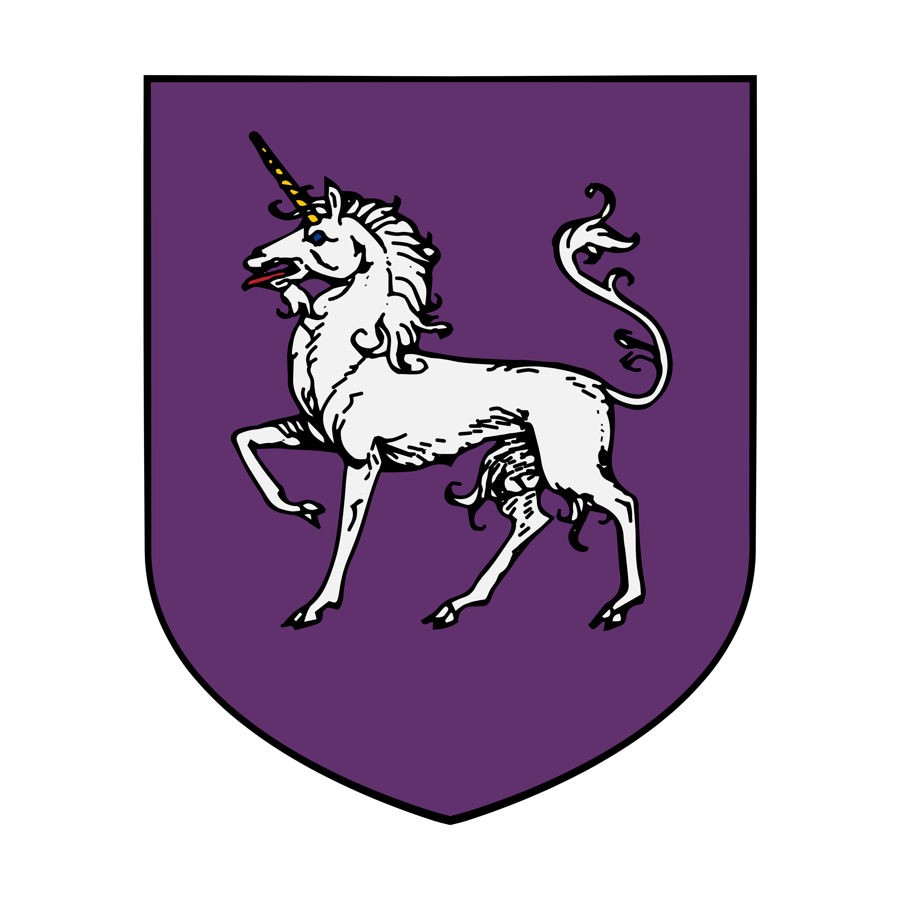

%%
[[Gethricism]]
[[Vihrmen Federation]]
[[The Incursion]]
[[War of Horn and Fang]]
[[Rulers of Vihr]]
[[Taar]]
[[Honoured Assembly]]
[[Zavlech]]
[[Trydlew]]
[[Gethric Pogroms]]
[[Eight Years War]]
[[Ravenleaf Forest]]
[[The Great Schism]]
%%

    <h4 class="wiki-header">Rascy zi Vihr</h4>
    

        <strong>Government</strong>
        Hereditary Monarchy
    

    

        <strong>Head of State</strong>
        <a href="Vormil III" class="internal-link">Ras Vormil III</a>
    

    

        <strong>Capital</strong>
        <a href="Zavlech" class="internal-link">Zavlech</a>
    

    

        <strong>Heraldic Symbol</strong>
        White Unicorn on purple ground
    

    

    

        <strong>Primary Religion</strong>
        <a href="Gethricism" class="internal-link">Gethricism</a>
    

    

        <strong>Primary Culture</strong>
        <a href="Vihri" class="internal-link">Vihri</a> <a href="Human" class="internal-link">Human</a>
    

    

        <strong>Official Language</strong>
        High Vihri
    

    

    

        <strong>Preceded by</strong>
        <a href="Vihrmen Federation" class="internal-link">Vihrmen Federation</a>
    

    

        <strong>Formed</strong>
        241PA
    

    

One of the largest nations in not just <a href="Ilrakhan" class="internal-link">Ilrakhan</a> but all <a href="Inara" class="internal-link">Inara</a>, Vihr lays claim to the lands between <a href="Mistspires" class="internal-link">Mistspires</a> and Grachhyll in the East and the <a href="Trollbacks" class="internal-link">Trollback Mountains</a> in the west while considering the former Lands of <a href="Wermia" class="internal-link">Wermia</a>, although largely uninhabitable, in the North, as well as southern end of the Vihri Expanse up until the Pilv River part of their domain. The capital of Vihr, <a href="Zavlech" class="internal-link">Zavlech</a>, is a great river city on the Tryd with a population of ca 56.000 citizens.

<h2>Etymology</h2>

Rascy zi Vihr, in Old Vihri literally the "Kingdom of the Vihr" or colloquially just Vihr is derived from the tribe of the vihrmen that organized in a greater federation in the Lands of the Lehva and Tryd River, vihrmen meaning literally "men of the horn" likely stemming from the unicorns of their homeland. The Unicorn has long been the national animal of Vihr and finds itself on much of vihri Iconography. In the legends of the Vihri the first man to tame a unicorn and ride it was Wladik, called the White Rider, a hero of the old tribes who lived long before the <a href="Vihrmen Federation" class="internal-link">Federation</a>. He is still a figure of Vihri pride, but since he lived long before the Incursions and the coming of the Gethric faith, the saints have in large part taken his place.

<h2>Geography</h2>

The Climate in Vihr is temperate transitional and varies from oceanic in the north and south to continental in the central regions.

Forests occupy a decent amount of Vihrs land area, the largest of which is the <a href="Ravenleaf Forest" class="internal-link">Ravenleaf Forest</a> in the southeast.

The Plains of the Vihri Expanse, between the three mighty Rivers Lehva, Tryd and Opuzna are flat and temperate, offering rich farmlands and in the southern parts the wide grasslands of the Vihri Unicorn, the national animal of the Kingdom.

The Opuzna River runs south-east from the city of Opuzna at the edge of the Ravenleaf Forest, where unbroken tribesmen and ogres still live. The Tlok River gives its valley its name, and the Royal Woods separate that valley from the Tryd country of Breza. The Ibor River runs through Selbia, whose southern tip at <a href="Fairriver" class="internal-link">Fairriver</a> lies on the Pilv which marks the southern edge of the realm. Beyond it lie the Grevi Mountains, which are ogre country and dangerous to cross. East of Fairriver, north of the Grevi Mountains, stands Edessa Tower, which both Vihr and Grevenna claim and neither holds. In the east the Hyllpass, between Orzebachi and Tuskwatch, is the great road through the Grachhyll to Nostroya.

<iframe src="https://editor.garmeley.com/v/inara/?region=crownlands-combined&amp;view=flat"
        width="100%" height="480" style="border:0;border-radius:8px;background:transparent"
        loading="lazy" allow="fullscreen" title="crownlands-combined (Inara)"></iframe>
<small><i>The Rascy zi Vihr and its dependencies in the year 927PA</i></small>
<h2>Demographics</h2>

Vihr is the largest nation on <a href="Ilrakhan" class="internal-link">Ilrakhan</a>, as far as population is concerned, and primarily made up of a Vihri <a href="Human" class="internal-link">Human</a> Majority, with <a href="Wermia" class="internal-link">Wermian</a>, <a href="Rean" class="internal-link">Reani</a> and <a href="Grachy" class="internal-link">Grachi</a> Human making up sizeable minorities and are higher than usual population of <a href="Deepfolk" class="internal-link">Dwarves</a> within the settlements bordering the friendly Holds of <a href="Tizin-Kol" class="internal-link">Tizin-Kol</a> and <a href="Xer-Kol" class="internal-link">Xer-Kol</a>.

Gnomish and Halfling minorities are present but rare within the country.

<small><i>see the <a href="Vihri" class="internal-link">Vihri</a></i></small>

The Vihri themselves are not one people. The High Vihri of the Oathhills and the western moors hold Rovgi and parts of Torry, and the Low Vihri of the river plains hold Szievek and Trazlova. The Tloky are the people of the Tlok Valley, the Wyt hold the <a href="Wytlands" class="internal-link">Wytlands</a> and the Ravenleaf Forest, and the Sarloni are the people of the Expanse. Breza and Opuzna are mostly Sarloni, with the Wyt in the east of Opuzna, while Selbia is a Tloky country and Levazci a Low Vihri one, and both have large Sarloni minorities.

The minorities have their own corners. Trazlov has large Grachi communities, drawn by the trade with the eastern coast, and the coast of Torry has Wermi families whose forebears came east over the Fera River. The Dibrevi who rule Breza are not themselves Sarloni, though most of their subjects are, and that arrangement has bred discontent among the Sarloni, at least in the past.

There are almost no <a href="Elf" class="internal-link">elven</a> or half-elven citizens present within the Kingdom, largely due to the <a href="Gethric Pogroms" class="internal-link">Gethric Pogroms</a> of the 8th century.

<h2>Economy</h2>

The economy in Vihr is still fundamentally agricultural, institutions such as serfdom were superimposed during the Silver Age on an existing system of open fields and mature, well-established towns involved in international trade, over the following centuries, the vihri economy kept growing but underwent large changes concerning economic dislocation in urban and extraction economies, such as the birth of the Silverslach Trade, which carries the goods of the mountain cities and of the greater hold of <a href="Xer-Kol" class="internal-link">Xer-Kol</a> down into Tloky and on into the rest of Vihr. The town of Silverslach itself, the largest of the <a href="Silver Towns of Gleamig" class="internal-link">Silver Towns of Gleamig</a>, mines a great amount of silver.
By the end of the 7th century Vihr had an economy dominated by rented farms and a thriving community of guilds, merchants and smaller companies controlled by the gentry and burgers.

Nearly all trade between Vihr and inland Nostroya crosses the Hyllpass in <a href="Levazci" class="internal-link">Levazci</a>, where the crown takes its customs and the Varina keeps the tolls, and the goods then go down the Lehva to Trazlov. Illegal goods travel the same roads. The Kirelli Cartel, which grew out of the Velvet Tears mercenaries of the early 900s under <a href="Marosz Kirelli" class="internal-link">Marosz Kirelli</a>, handles almost all of the Zondust and Astafar that come into the realm, through the dwarven hold of <a href="Tizin-Kol" class="internal-link">Tizin-Kol</a> and the southern borders, and the drug ring around Count <a href="Provost Mihun" class="internal-link">Provost zi Mihun</a> of Retsky, across the Dalniz border from Opuzna, was broken up in 918PA.

Trazlov in northern Vihr is home to the Headquarters of the <a href="The Alchemists Guild" class="internal-link">Men of Glass</a>, the international Guild of Alchemists, and one of the "three great Ports" alongside Sallesand and Uhl. With over 120,000 people it is also the largest city in the realm, larger than Zavlech. The <a href="Trazlov Consortium" class="internal-link">Trazlov Consortium</a>, founded there in 639PA as the Table of Trazlov, dominatesmuch of the inland trade of Vihr through its guilds, and the Guild of Alchemy was formed in the city in 691PA. 

A major factor in the rise of the merchant class in Vihr, is the labour shortage caused by the Wolfsplague of the early 910s. The drastic reduction in the peasant population meant that surviving peasants could demand higher wages from nobles and royals. This shift in labour supply and demand dynamics provides more opportunities for merchants and trades in the gethric kingdom to succeed.

As the merchant class in Vihr gains prominence, the wealth gap between different social classes also begins to narrow; this shift reshaped the social and economic landscapes of modern Vihr, allowing for a more dynamic and fluid society. The rise of the burgher class during this period not only changed the way people worked and traded but also had a profound impact on the overall structure of all eastern Ilrakhan.

<h2>Religion</h2>
<small><i>see <a href="Gethricism" class="internal-link">Gethricism</a></i></small>

Intrinsically linked with the origin of the Gethric Faith and its later denominations, Vihr is arguably one of the most religious countries on Inara, where Gethric belief remains a strong part of the national identity and the High-Bishop of Iztaw is often more revered than the King himself. The Institution of the Church has its home within the political division of <a href="Iztaw" class="internal-link">Iztaw</a> itself, governing the city and various smaller holdings. While the High-Bishop is essentially the spiritual leader of the Ras, as a member of the Rascy he is also his worldly subject. Effectively this relationship has led to a great alliance between Church and State and caused numerous problems in the history of both institutions.

Vihr has given the Gethric canon a good share of its saints. <a href="Tytus" class="internal-link">Tytus the Unbound</a>, born at Pinopki near Trydlew in 514PA, broke the undead host in the Tlok Valley and was canonised in 555PA, and the Cathedral of Will in Tlokyemy stands where he gathered his forces. <a href="Andre" class="internal-link">Andre of Trydlew</a>, canonised in 876PA over the protests of the Trinic bishops, is still the last saint the Gethric canon has admitted. <a href="Lyandra" class="internal-link">Lyandra</a> of Fairriver and <a href="Kasimir" class="internal-link">Kasimir the Martyr</a>, for whom the Eye of Kasimir in Szievek is named, are also Vihri saints. Bishops sit at Zavlech, Szievek, Tlokyemy, Orzebachi and Opuzna, and the Bishop of Selbia sits in the holy city of Mesziev. The Archbishop of Vihr is by tradition the Bishop of Wogrov Cathedral in Rovgi.
 
The Kethric Schism also began on Vihri soil. In 458PA Archbishop <a href="Adzul I" class="internal-link">Adzul I</a> of Kherova convened the First Council of Opuzna, which wrote the Doctrine of Dualism, and when Iztaw rejected it the Second Council of Volazc, held in 471PA in the southern marches of Opuzna, issued the Kethric Declaration that made the Patriarchate of Kherova independent. See <a href="Kethricism" class="internal-link">Kethricism</a>.

<h2>Politics</h2>
<small><i>see <a href="Rulers of Vihr" class="internal-link">The Rulers of Vihr</a></i></small>

The Kingdom of Vihr is ruled by the Ras in Zavlech, currently Vormil III of House Ralpia and has been since its founding in the middle of the 3rd century PA.

The Power in Vihr is largely if not entirely in the hands of the <a href="Church of Iztaw" class="internal-link">Church of Iztaw</a> and the Aristocracy who are unified in the <a href="Honoured Assembly" class="internal-link">Honoured Assembly</a>, an old institution with roots in Vihrmen tradition from before the foundation of the Kingdom. The Nobility, or Uzidcy, of Vihr is organized in lesser landholders and raised knights who often swear fealty to the Gris who in turn usually are subject under a Vadcy unified under the Vihri Throne. The Var, who rule the Vadcy and sit all within the Honoured Assembly, hold vast powers within their domains and are largely autonomous.

Periods of Vihri History are often defined by the Kings relationship with the High-Bishop of Iztaw, and the silent power struggle between Iztaw and Zavlech.

In current times the High-Bishop is seen as a figure of influence and importance at the court, but power rests firmly within the Hands of Ras Vormil III.

<h3>The Vadcy</h3>

Vihr is divided into nine Vadcy. Eight of them are the ancient lordships recognised in 377PA, and the ninth, Torry, was created in 870PA. Their lords sit in the <a href="Honoured Assembly" class="internal-link">Honoured Assembly</a>, three of the nine are Varinas, and the Var of Trazlova traditionally serves as its Foreman. The throne's own seat belongs to the Sekretar of Vihr, <a href="Tadeuz Pilsud" class="internal-link">Tadeuz Pilsud</a>, the only member who is not of noble blood.

<small><i>see <a href="Trazlova" class="internal-link">Trazlova</a></i></small>

Trazlova holds the north-eastern coast and Trazlov, the largest city and port of the realm. House Lawchlaw, a cadet branch of the royal house since about 710PA, rules it under Var Osran, but the Consortium and the Men of Glass hold much of the real power. The Vadcy also holds Sydrow Isle in the Torn Sea in name, but the prison on its southern cape, the <a href="Iron Hole" class="internal-link">Iron Hole</a>, belongs to the <a href="Vaergriff" class="internal-link">Vaergriff</a>.

Szievek was once the richest and greatest of the Vadcy, and gave Vihr the Szinmo kings. It lost two thirds of its lands in the War of Succession. House Szinmo still holds it under Varina Katerina, and its University is the largest in the realm.

<small><i>see <a href="Rovgi" class="internal-link">Rovgi</a></i></small>

Rovgi is the hill country of the Oathhills, facing the old Wermian frontier. House Wogrov holds it under Var Zeslav, the brother of the late Gras Maroza, which makes him the uncle of the Ras's four children.

<small><i>see <a href="Opuzna" class="internal-link">Opuzna</a></i></small>

Opuzna is the largest Vadcy by area, a mostly Sarloni country, with the Wyt in its east, that reaches the Ravenleaf Forest and the border of Dalniz. House Terjan, raised after the Usily Plot of about 686PA, holds it under Var Ilia, and the Kethric councils were held here.

<small><i>see <a href="Breza" class="internal-link">Breza</a></i></small>

Breza is the Sarloni heartland of the Expanse, the home of Trydlew, the old capital of the Vihrmen, and of the Knights of the Unicorn at Madzar. House Dibrevi holds it under Varina Milva and is not itself Sarloni, though most of its subjects are. Kasimir I gave it to the Dibrevi in 503PA, after the old lords of Breza, the zi Brediv, had backed the Boris Uprising against him.

<small><i>see <a href="Selbia" class="internal-link">Selbia</a></i></small>

Selbia is the southernmost Vadcy, with a strong military culture and the famous <a href="Selbia Brigade" class="internal-link">Selbia Brigade</a>, whose red shields the Sarloni of the south have feared since 529PA.House Sribo holds it under Var Provim from Ibozka, and <a href="Fairriver" class="internal-link">Fairriver</a>, the abbey town at its southern tip, is ruled by its abbey and practically neutral.

<small><i>see <a href="Levazci" class="internal-link">Levazci</a></i></small>

Levazci is the border with Grachy, where the Hyllpass carries the trade of Nostroya into the realm. House Tryn has held it under Varina Henrietta since 802PA, and Tuskwatch at the far end of the pass was lost in the Brothers War. In law the Vadcy also takes in the eastern <a href="Wytlands" class="internal-link">Wytlands</a>, which are ruled in truth by robber barons, the Wytlords.

<small><i>see <a href="Tloky" class="internal-link">Tloky</a></i></small>

Tloky is the Tlok Valley, the home of the Tloky and of Tlokyemy, where the Horn Lords of the old Federation met. House Martej holds it under Var Jan, and the Silverslach Trade from the mountain holds passes through it.

<small><i>see <a href="Torry" class="internal-link">Torry</a></i></small>

Torry is the smallest Vadcy, a narrow strip of the northern coast cut out of Iztaw by the Council of 870 as a check on the Church. House Torry holds it under Var Volboris, and its arms carry the ferret, a symbol of resistance from the Incursion.
  

<h3>Crownlands, Church Lands and Free Cities</h3>  

Outside the nine Vadcy lie the crownlands around <a href="Zavlech" class="internal-link">Zavlech</a>, which belong to the crown and answer to no Var, and the lands of <a href="Iztaw" class="internal-link">Holy Iztaw</a>, which the High-Bisop rules for the Church, among them the southern exclave of <a href="Mesziev" class="internal-link">Mesziev</a> in the middle of Selbia. Beside them stand the chartered places of the crown, which answer to the Ras alone and belong neither to the royal domain nor to any Vadcy. None of them has a seat in the Honoured Assembly.
  
<small><i>see <a href="Pretko" class="internal-link">Pretko</a></i></small>  

Pretko is a free city of burghers in the northern Expanse, chartered by Zawis I in 562PA after it held out against the Szinmo, and the home of the greatest unicorn and horse fair in the realm.
  
<small><i>see <a href="Szulbod" class="internal-link">Szulbod</a></i></small>  

Szulbod, east of Zavlech, was made a free city by the Guest Charter of Orian I in 778PA, and has been the seat of the Royal Mint since 781PA.
  
<small><i>see <a href="Silver Towns of Gleamig" class="internal-link">Silver Towns of Gleamig</a></i></small>  

The Silver Towns of Gleamig, led by Silverslach, hold their mines under the Silver Charter of Miskomir I of 591PA and send their silver to the Mint.
  
<h3>Law and Justice</h3>  

The justice of Vihr is as divided as its power. The Var and their Gri judge their own lands by the custom of their Vadcy, the bishops' courts of the <a href="Church of Iztaw" class="internal-link">Church of Iztaw</a> judge the clergy and the matters of faith, marriage, oaths and wills, the free cities judge their own burghers under their charters, and the crown keeps only the Crown Pleas, the cases of blood, treason, coin and the highway. These are heard by the <a href="Royal Judges of Vihr" class="internal-link">royal judges</a>, called the Eagles, whom Zervind I "the Eagle" first sent riding circuit in 268PA. Quarrels between the Var belong to the <a href="Honoured Assembly" class="internal-link">Honoured Assembly</a>.
  

The laws of all these courts were first written down together in the <a href="Speculum Regni" class="internal-link">Speculum Regni</a>, the Mirror of the Realm, which <a href="Radosław of Szievek" class="internal-link">Radosław of Szievek</a>, the Bishop of Szievek, compiled between 724 and 741PA on the commission of Vormil I and the High-Bisop. In 889PA Jakub II "the Good" added his Statutes to it, founding the Royal Tribunal at Zavlech, seating a royal judge in every Vadcy and granting the Peasants' Plea, by which any free man or woman may appeal the sentence of their lord to the crown. The courts of the Var were left untouched, and they remain the strongest courts in the realm. The nobility still settles its gravest disputes by the <a href="Candle Oath" class="internal-link">Candle Oath</a>, the old Gethric rite of judicial combat sworn on holy ground over a candle of consecrated wax, and most great houses keep retained champions, known as the <a href="Flickersworn" class="internal-link">Flickersworn</a>, to fight it for them. The oath of 922PA, in which the champion of Opuzna killed <a href="Beladoz the Black" class="internal-link">Beladoz the Black</a> of Selbia, began the feud between the two Vadcy that divides the south today.

<h2>History</h2>
<small><i>see <a href="Rulers of Vihr" class="internal-link">The Rulers of Vihr</a></i></small>

<h3>Unification Period</h3> 
The Kingdom of Vihr was proclaimed in 241PA, within months of the end of the <a href="The Incursion" class="internal-link">Wermian Incursion</a>, by <a href="Viago I" class="internal-link">Viago I "Firespear"</a> of the Zav, the most powerful military lord of the <a href="Vihrmen Federation" class="internal-link">Vihrmen Federation</a> and the commander whose forces had borne the weight of the Vihri contribution to the wars against the Abyssal Legions. Viagos authority rested on the convergence of military supremacy and religious legitimacy that the Incursions aftermath made uniquely available to him. He had fought where others had not. The lords of the southern Expanse and the Wyt territories, whose distance from the Wermian front had kept them from the worst of the fighting, had correspondingly little standing to contest the claims of a man who had faced the abyssal tide in person. His adoption of Gethricism as the founding theology of the new realm drew directly on the words of <a href="Volboris" class="internal-link">Volboris the Healer</a>, who had proclaimed in the immediate aftermath of <a href="Gethric" class="internal-link">Gethrics</a> death that the warriors tempered in the fire of the Incursion would spread the faith and forge a chain strong enough that no daemon could hope to break it. Whether Viago understood this as a personal commission or as a general statement whose scope he chose to interpret expansively, the outcome was the same: the Proclamation of Vihr framed the unification of the Vihri peoples as a religious as much as a political act, and resistance to it as something approaching apostasy.
 
The resistance came nonetheless. The lords of the southern territories  were unwilling to exchange the loose sovereignty of the Federation for subordination to a ruler whose authority they had played no part in establishing. The Unification Wars that followed the Proclamation lasted a decade, prosecuted by Viago personally across two decisive engagements separated by years of smaller campaigns. The Battle of Tlok Valley in 246PA broke the resistance of the central and eastern lords who had organized around the Tlok River line, bringing the Tloky and the allied communities of the eastern hills into the nascent Vihr. The Battle of Glancz in 251PA, fought near Opuzna in the heart of the southern Expanse, ended the war definitively when the coalition of Sarloni and Wyt lords that had held out longest was defeated in a single engagement. Viago rode to both battles at the head of the Vihri host, accompanied by a small attached force of knights mounted on the great unicorns of the Expanse. With Glancz the kingdom was complete in reality as well as proclamation, and Viago returned to his newfounded capital of Zavlech, built around the Lake Zav where his people had gathered since before memory, as the undisputed first Ras of all the Vihri.

<h3>House of Zav (241PA - 501PA)</h3>
<h5>Consolidation, the Cities and the Rean War (251PA - 377PA)</h5> 
During the century and a half following the Unification Wars the Rascy zi Vihr was built into the institutional and urban Union that its proclamation had only promised. Viagos remaining reign after 251PA was occupied with the administrative consolidation of the conquered southern territories, the suppression of residual Turvik  practice, and the foundation of the urban centres that would anchor Vihri civilization across the following centuries. The cities of Szievek, Perliav and Pretko were all established or substantially expanded during the early Zav period, planted deliberately in strategically and commercially significant locations across the Expanse and the river plain as instruments of royal authority and Gethric cultural diffusion simultaneously.
  

Zervind I "the Eagle", who reigned from 262 to 289PA, was the first Ras to reach into the justice of the lords. In 268PA he declared the shedding of blood, treason, false coin and robbery on the highway to be the Crown Pleas, which only the king could judge in any part of the realm, and he sent judges of his household riding circuit to hear them. The lords kept every other kind of justice, but the <a href="Royal Judges of Vihr" class="internal-link">royal judges</a>, called the Eagles after him, have ridden through the realm ever since. 

The religious policies of the early Zav rulers were consistent if not always gentle as Turvik practice was formally prohibited within the kingdom's administered territories, the clergy of the nascent Church of Iztaw was given extensive institutional support, and the old sacred sites of the Federation were progressively reconsecrated or abandoned. The religious laws of 400PA later extended the ban on the old faith to the whole realm. The great Ullkustone of <a href="Trydlew" class="internal-link">Trydlew</a>, the sacred monument of Ollku, god of river and sea, before which the Horn Lords of the Federation, who deliberated at Tlokyemy, had sworn their most solemn pacts, was not destroyed in this period, a restraint which later centuries would find increasingly difficult to explain away and cause further tension centuries down the line.
 
The first major external challenge to the kingdom came not from within but from the south, when King Salkon I du Rean declared war on Vihr in 291PA. Rean was a wealthy and established kingdom of the Stormy Sea that had maintained a long and complicated relationship with the southern Vihri for centuries. Trading partner, occasional enemy, persistent rival all the same, but Reans rulers had managed that relationship from a position of relative confidence in their own strength. The emergence of a unified Vihri kingdom under a militarily proven dynasty changed the reani perspective fundamentally. Salkons decision to strike early, before the new kingdom had fully digested its conquests, was strategically rational if ultimately unsuccessful. The <a href="Vihri-Reani War" class="internal-link">Vihri-Reani War</a> lasted fifteen years and cost Vihr its Ras, Viago III, who was killed at the Battle of the Pilv in 299PA during a campaign to hold the river line against a Rean advance. Still the Rascy absorbed the blow without fracturing and prosecuted the conflict to a successful conclusion in 306PA under his brother <a href="Jasper II" class="internal-link">Jasper II</a> "the Old". The Peace of the Pilv gave Vihr sovereignty over the Pilv Valley between the Grevi and Trollback Mountains, a strategic corridor of rolling hills, lucrative mines and arable lands.
 
The following seven decades, spanning the reigns of <a href="Jasper II" class="internal-link">Jasper II</a>, Tragomir I and Viago IV were the most internally stable of the Zav Dynasty's history and also, in retrospect, the period during which the structural tensions that would define the dynastys end were quietly accumulating. The Church of Iztaw, which had benefited from royal patronage since Viago Is founding, had by the mid fourth century grown into an institution whose wealth, administrative sophistication, and popular influence rivalled the crowns own. 
 
The Gethric faith had spread with remarkable speed through the Vihri population and the High-Bisops of Iztaw had learned to translate that spiritual authority into political leverage with increasing confidence. The great lords of the kingdom, whose military power was the foundation on which Viago I had built his throne, found themselves squeezed between a crown they had accepted and a Church they had funded, neither of which showed particular interest in formalizing the ancient prerogatives that the lords understood as the price of their loyalty.
 <h5>The Lords' Crisis and the Honoured Assembly (377PA - 384PA)</h5>
<small><i>see <a href="Honoured Assembly" class="internal-link">The Honoured Assembly</a></i></small> 

The crisis that had been building across generations arrived in 377PA. Ras <a href="Zervind II" class="internal-link">Zervind II</a>, whose reign had begun in 375PA, was  even by contemporary account a ruler of limited personal authority and weak will. He had from the outset of his rule fallen substantially under the influence of High-Bisop Morzin I, a figure of considerable political ability whose vision of the proper relationship between the Church and the crown differed  from any arrangement the lords of Vihr were prepared to accept. The precise sequence of events that led to the <a href="Candleguard" class="internal-link">Candleguard</a> taking effective custody of the Ras at Zavlech is not fully documented, but the outcome was unambiguous: within two years of Zervind IIs accession, the kingdom was functionally governed from Iztaw rather than the capital, and the king's movements and decisions were mediated through the High-Bisops office. 
 
 The eight great lordships of the realm, <a href="Trazlova" class="internal-link">Trazlova</a>, <a href="Szievek" class="internal-link">Szievek</a>, <a href="Rovgi" class="internal-link">Rovgi</a>, <a href="Opuzna" class="internal-link">Opuzna</a>, <a href="Breza" class="internal-link">Breza</a>, <a href="Selbia" class="internal-link">Selbia</a>, <a href="Levazci" class="internal-link">Levazci</a> and <a href="Tloky" class="internal-link">Tloky</a>, whose holders represented the military strength that neither the Church nor the crown could replace, responded by mobilizing their forces and marching on Zavlech in the summer of 377PA. Szievek, then the richest and most powerful of them all, held lands that took in large parts of what are now Trazlova, Levazci, Breza and the crownlands around Zavlech. The Candleguard, formidable as a religious institutions army was capable of being, had no realistic answer to the combined strength of the assembled lords, and Morzin I possessed sufficient political intelligence to recognize an impossible position when he occupied one. The Ras was released. The lords did not disband.
 
The negotiations that followed were conducted over several months and produced an outcome that neither the Church nor the lords would have chosen from a clean slate but that both could accept. The eight ancient lordships were formally recognized as hereditary Vadcy with their holders titles and territorial prerogatives given legal standing in the kingdom's institutional framework for the first time. In exchange, the lords acknowledged the crowns formal supremacy and the Churchs institutional autonomy in religious matters, and committed to a settlement that left Morzin I's position intact if considerably chastened. The consultative council that the lords demanded as the price of their return to their territories was established in principle in 377PA and formalized as the Honoured Assembly in 384PA. The Assembly was essentially a body whose composition, powers and relationship to the crown would remain the central axis of Vihri constitutional politics for centuries to come. The Office of Foreman of the Honoured Assembly, became one of the most coveted positions in Vihrs political life, second in prestige only to the throne and the high seat at Iztaw itself.
  
<h5>The Pious, the Merry and the Unlucky (388PA - 501PA)</h5>  

Zervind II died in 388PA and the crown passed to his only son, Boris I, born late in his father's life and a youth of fifteen when he was crowned. Raised in the shadow of Iztaw after the humiliation of the Lords' Crisis, Boris "the Pious" grew into a deeply religious Ras who empowered the Church and the knights of the <a href="Order of the Silver Wheel" class="internal-link">Order of the Silver Wheel</a>, and in 400PA his religious laws extended the ban on the old faith to the whole realm. He had the Dome of the Healer built at Vzsal, south of the capital, to this day a great cathedral in honour of Saint <a href="Volboris" class="internal-link">Volboris</a>. In his later years he championed the Ideal of Virtue, which argued that only men who had never lain with a woman could serve as the greatest arbiters of Gethric justice. When he demanded that only chaste men fight Candle Oaths before the crown, the court mocked them as the "virgin candles", and the demand was dropped after his death. The Honoured Assembly stalled it, granting just enough to appease the Ras, and his son Jasper III did not pursue it further.
  

Jasper III reigned for thirty-one years. In 419PA the first of the <a href="Zuzka" class="internal-link">Zuzka</a> appeared near the <a href="Ravenleaf Forest" class="internal-link">Ravenleaf Forest</a>, and for seventy years the beasts of the Ogre Mage <a href="Yagund" class="internal-link">Yagund</a> preyed on the south of the realm. When <a href="Leok" class="internal-link">Leok</a> pushed into the southern marches in 430PA, the Var of <a href="Opuzna" class="internal-link">Opuzna</a>, Stanisław zi Usily, called the Rambreaker, led the Vihri knights and won the Battle of the Dim Shades, the deciding encounter of the 1st Vihri-Leoki War, and in 434PA Leok was defeated and Volazc and the northern lands of Leok were taken and joined to Opuzna. Jasper's son Martis I declared the remnants of Wermia under the protection of the crown in 441PA and established <a href="Nuv Werm" class="internal-link">Nuv Werm</a>, and his grandson Martis II was killed fighting the Zuzka in the southern marches in 456PA.
  

Martis II's younger brother, <a href="Viago V" class="internal-link">Viago V</a> "the Merry", had been known even as a Kis as a living man, a singer and poet, a lavish dancer and a friend to the fairer sex. He ruled for thirty years, in his early years mostly from long caravans on the road rather than from Zavlech, fathered only one legal child but is rumoured to have fathered a dozen bastards, the Leafblown, and first sponsored the royal prize at the Poets Fest of Tienov. He let the First Council of Opuzna in 458PA and the Second Council of Volazc in 471PA meet on his soil, and the Kethric Schism was completed within his realm, which Iztaw never forgave. In later life he grew heavy and rich, and the Great Mage <a href="Holbrind" class="internal-link">Holbrind</a> crafted a ring for him that let him float ever so slightly above the earth.
  

His son Martis III "the Unlucky" came to the throne in 486PA. The early years of his reign are remembered fondly, and he raised the great Statue of the Firespear in honour of Viago I, which stands alone on a small island in Lake Zav to this day. In 489PA <a href="Darmil zi Perliav" class="internal-link">Darmil of Perliav</a> slew Yagund at Horomur and ended the menace of the Zuzka, but in the 480s and 490s the Red Pestilence swept across Ilrakhan out of Nirydia, by way of Azuvke and <a href="Kherova" class="internal-link">Kherova</a>. Martis at first refused to quarantine the cities of the south, holding that it was not the way of the Candleflame to leave the people of southern Vihr to die, and many blame that decision for the greater death that crept north afterwards. The plague killed all four of his heirs and left the Ras himself crippled. His tongue had to be cut out, and he held on to life for eleven months, bedridden, in a state said to be worse than death itself. In those months the party of <a href="Szievek" class="internal-link">Szievek</a> pressed the claim of its Var, while old loyalists of the senior line such as Darmil spoke against them, and a few lords of the south put forward one of the Leafblown, Tjerin "the Crownless" Bivaldi, whom the Assembly would not hear of. Martis III died in 501PA, and with him the senior line of the House of Zav ended.

<h3>House of Szinmo (501PA - 553PA)</h3>

After the Zav senior line died out in 501, Vihr came under the rule of the Var of <a href="Szievek" class="internal-link">Szievek</a>, Kasimir of House Szinmo, a Junior Branch of the House of Zav descended from a younger son of Jasper III who had married the heiress of Szievek. It was the first time that the lord of a Vadcy took the throne. The Szinmo ruled for fifty-two years: <a href="Kasimir I" class="internal-link">Kasimir I</a> "the Elder", Kasimir II "the Younger", the child Viago VI, called the Boy King, and last Katerina I. The crown of Viago I and the Firespear had been lost with the senior line, and Kasimir I was crowned with a new crown, the Sapphire Band.
  

Kasimir I's children brought him only trouble. In 503PA his eldest son, <a href="Boris Szinmo" class="internal-link">Boris</a>, later called the Traitor Prince, rose against him in arms, backed by the zi Brediv, then the lords of <a href="Breza" class="internal-link">Breza</a>, and various other lords. The Ras broke the Boris Uprising himself, took the titles of the zi Brediv and made them merely the Gri of Tansaw, and gave their Vadcy and their ancestral seat of <a href="Trydlew" class="internal-link">Trydlew</a> to House Dibrevi, which holds them to this day. On the pleas of his wife, Gras Elfiara, he pardoned Boris, but in 505PA the shamed and much hated heir was stabbed in a tavern brawl by drunken knights proclaiming royalist creeds. Kasimir I died in 508PA and his younger son succeeded him.
  

Kasimir II "the Younger" ruled for twenty-two years. The realm took no part in the war of the Pilvians against Rean from 519 to 530PA, though knights from <a href="Selbia" class="internal-link">Selbia</a> and Breza went south to fight on the side of what would become <a href="Grevenna" class="internal-link">Grevenna</a>. In 529PA, in the reign of Kasimir II, a violent and bloody revolt of the people of the Expanse, Sarloni and Wyt alike, against their northern overlords in Breza, Opuzna and Selbia was put down, with Selbia playing an instrumental part, and it is remembered as the Sarloni Uprising. The Kisras Jasper fell in the fighting, and when Kasimir II died the following year the crown passed to his grandson Viago VI, a child of six, under the regency of the boy's aunt Katerina. To keep the people of the Expanse from ever again making common cause, it was said, the regency ordered that ill tidings in the Sarloni vales be carried by Wyt envoys and in the Wyt country by Sarloni ones, and the custom has outlived the order to this day. The Boy King died of a fever in 532PA, and the rumour that his aunt had poisoned him persisted, though historians have largely judged it baseless.

<a href="Katerina I" class="internal-link">Katerina I</a> "the Owl", the daughter of Kasimir II, was the first woman to rule Vihr in her own right. In 536PA the <a href="Wermian Accords" class="internal-link">Wermian Accords</a> were signed at Morael in the March of Nuv Werm, with Vihr as host and protector. Katerina signed them on the advice of Palus Aergestes and the Church, and many mages, her Kar-Zavr David Thal among them, left the service of the crown in protest. In the 540s the undead of the lich Mendizaba, the Skullbringer, occupied the Tlok Valley. The knights whom the Gras sent against her were overwhelmed, and it was a minister of the Church, <a href="Tytus" class="internal-link">Tytus</a>, and not the crown, who broke them in 545PA. In October 549PA the royal procession was attacked on the road to Mesziev, and both of the Gras's children were killed in what became known as the Culling of 549; who paid the brigands has never been settled. Katerina I died of a heart attack in 553PA without living children and without a clear heir, and the Vihri War of Succession followed. Her cousin Dobrov Szinmo, the Var of Szievek and the son of the shamed Boris, claimed the crown with the backing of his Vadcy,and Volod Bereski, the Gri of Trydowka, pressed a claim of his own, while the <a href="Honoured Assembly" class="internal-link">Honoured Assembly</a> and the lords of the south acclaimed Zawis, a Gri of Nediv and the only great lord who had fought for the Gras at the Culling. The Church at <a href="Iztaw" class="internal-link">Iztaw</a> hesitated, and canonised Tytus in 555PA as a symbol of the Wermian Accords, but in the end it backed the winner.

<h3>House of Worocek (562PA - 692PA)</h3>

The war turned on the Szinmo's own methods. Towards its end Dobrov's faction took uncontrolled mages into its ranks and broke the <a href="Wermian Accords" class="internal-link">Wermian Accords</a>, and the lords who had waited came over to Zawis, who took the field in enchanted armour of pure silver, said to turn vile magic against those who cast it. The war ended in 562PA with the coronation of <a href="Zawis I" class="internal-link">Zawis "Silverbeard"</a>, the first of the House of Worocek, whose line would hold the throne for 130 years. The Worocek were Low Vihri, lords of Nediv who had ruled over the Wyt country of the southern marches. Dobrov and four of his five sons were executed, and the youngest was kept as a ward and captive of the crown. The war cost Szievek, the home of the Szinmo and the greatest of the Vadcy, two thirds of its lands, which went to the lords who had backed Zawis and now form parts of Trazlova, Levazci, Breza and the crownlands around Zavlech. <a href="Pretko" class="internal-link">Pretko</a>, which had held out against Dobrov, was given to no lord and became a free city of the crown.The Silverslach Trade of the mountain towns began a little after his reign.

In 619PA, in the reign of Zawis II, war broke out with <a href="Leok" class="internal-link">Leok</a> once more. The 2nd Vihri-Leoki War lasted until 625PA and ended the Rascy zi Leok. Vihr took more of the northern Leoki lands, which went to <a href="Opuzna" class="internal-link">Opuzna</a>, but the Vihri lords and knights who had conquered the rest of the realm did not hand it over to Zavlech. They kept it for themselves, and in 625PA they proclaimed the Rascy zi <a href="Dalniz" class="internal-link">Dalniz</a>, a realm of Sarloni people under lords of Vihri blood. Leok had been ruled by Sarloni lords; Dalniz, though independent in name ever since, has been ruled by Vihri ones, the Drageri among them, and is effectively a puppet state of Vihr.
  

In 644PA, in the reign of Boris II "Hornsword", Vihr marched across the Trollbacks against <a href="Garmeley" class="internal-link">Garmeley</a> and the <a href="Eight Years War" class="internal-link">Eight Years War</a> began. Boris died in 648PA, the year in which King Ahlef II of Garmeley fell at the Battle of Greyfields, and his successor Valena I saw the war to its end in 652PA. It ended as a Garmish victory. Saint <a href="Lyandra" class="internal-link">Lyandra</a> of Fairriver spoke for peace throughout the war, and founded the abbey town of Fairriver as a haven for those it had displaced.

The last great scandal of the Worocek reign was the Usily Plot of about 686PA. House zi Usily, then the lords of Opuzna, were found to be plotting to kill Zawis III with the help of mages, in what was meant to look like an accident. Alchemists foiled the plot, and the king raised them higher and higher in standing, which led to the founding of the <a href="The Alchemists Guild" class="internal-link">Guild of Alchemy</a> in Trazlov in 691PA. The <a href="Vaergriff" class="internal-link">Vaergriff</a> had its part in uncovering the plot, though how large a part has never been told. The Usily were ruined, and Opuzna was given to House Terjan, vaguely related to the Worocek, which holds it to this day. Zawis III did not long outlive the plot. He was killed by his own pet <a href="Glinsar" class="internal-link">Glinsar</a> in 692PA, and with him the House of Worocek ended.
 

<h3>House of Ralpia (692PA - present)</h3>

With the end of the House of Worocek, the assembled feudal nobility under the Honoured Assembly as well as the Gethric Bishops elected Miskomir of House Ralpia, the Var of Trazlova, as Ras Miskomir II of Vihr and Wermia. This was the first official claim to the Lands of <a href="Wermia" class="internal-link">Wermia</a> by the Kings of Vihr, although the Throne of Zavlech had practically asserted control over the desolated region for years prior since the establishment of the March of <a href="Nuv Werm" class="internal-link">Nuv Werm</a> in 441PA.
  

<a href="Vormil I" class="internal-link">Vormil I "Seaborn"</a>, who followed Miskomir II in 713PA, turned the crown to the sea. The Ralpia had kept their personal seat at the Table of Trazlov, the forerunner of the <a href="Trazlov Consortium" class="internal-link">Trazlov Consortium</a>, when the Vadcy of Trazlova passed to a cadet line of the house, and in 716PA Vormil renounced it for an exorbitant sum and the cancellation of all the personal debts of the crown to the Table. In return he granted the Table rights and freedoms that hold even before the laws of the local Vadcy, one of the first grants of the crown to reach across the borders of the Vadcy. With the money he built the White Fleet, and with the White Fleet he broke the Dead Shark, a pirate who had held the island of Iffelin, called the White Finger, and terrorised the eastern Torn Sea for nearly forty years. In 735PA he took the city of <a href="Uhl" class="internal-link">Uhl</a> under the protection of Vihr against Kaspar von Kran of Lesmere. Vormil was killed by an owlbear while hunting in the royal woods in 742PA. His son Jerziv I reigned only three years, until he fell to a chance crossbow bolt in 745PA at the siege of Borna, where a rebel known as the Child of Winds had raised the Hyllmen and crowned himself Ras of the Hyll, and the crown passed to Jerziv's brother Jasper IV.
  

In 724PA Vormil and the High-Bisop jointly commissioned <a href="Radosław of Szievek" class="internal-link">Radosław of Szievek</a>, the Bishop of Szievek, to compile the laws of the realm. Taking his method from Saint Palus and the Accords, Radosław convened congregations in every Vadcy at which the lords declared their own custom, and in 741PA he completed the <a href="Speculum Regni" class="internal-link">Speculum Regni</a>, which gathered the canon law of the Church, the rights of the crown, the customs of the Vadcy and the charters of the realm into one codex for the first time.

<h4>Wars with the Sultanate, Elven Pogroms & Gethric Schism</h4> 
Vihr was a major participant in all three of the large scale conflicts around the Stormy Sea known as the <a href="Wars of Elbae Aggression" class="internal-link">Wars of Elbae Aggression</a> during the 8th and early 9th centuries, fighting as the ideological core of the Reani Coalition, its centuries of Gethric anti elven sentiment providing the motivating force that brought the coalition together and kept it fighting across sixty five years of intermittent conflict. Waskor zi Treblin, Gri of Treblin, commanded Vihrs forces in the First War and eventually assumed overall coalition command, his deep racial convictions shaping both the coalitions public framing and its tactical decisions in ways that were not always to its military benefit. His death at the Battle of Horad in the Second War deprived the coalition of its most recognizable commander at its most critical moment. In the Third War, Rezvyr zi Sribo, Var of Selbia, led Vihrs forces and assumed overall coalition command, a more capable military mind and the first coalition commander of any war to achieve victory on Elbae homeland soil at the Battle of the Crossing.

 Rezvyr died at the final Battle of Danipol when <a href="Jurahim al-Biad" class="internal-link">Jurahim al-Biad's</a> invocation destroyed the Horad Isthmus and ended the wars in catastrophe for both sides. Following the First War, Ras Miskomir III, infamously known as "the Black," enacted the <a href="Gethric Pogroms" class="internal-link">Gethric Pogroms</a> in 763PA and supported the High-Bisop of Iztaw in declaring elves ontologically evil and opposed to the divine truth of the Prophet, ordering the systematic banishment, mass execution and imprisonment of any elves or those of known elven blood within not only Vihr but all countries of the true faith. Accusations that the clergy was under the political control of Vihr, made at the Conclave at Trinfurt, led to the <a href="Gethricism" class="internal-link">Gethric Schism</a> of 764PA and the creation of the <a href="Trinicism" class="internal-link">Trinic Church</a>. His heir Ras Orian I overturned the policies in 778PA, but by then the Schism could not be undone. For the full account of all three wars, see <a href="Wars of Elbae Aggression" class="internal-link">Wars of Elbae Aggression</a>.

<h5>The Brothers War (828PA - 835PA)</h5> 
Between the Elbae wars and the war with Meadrath came the <a href="Brothers War" class="internal-link">Brothers War</a>, fought from 828PA to 835PA between Vihr and the Kingdom of <a href="Halgrach" class="internal-link">Halgrach</a> in Vihr, in Grachy and on the Torn Sea. Vihr under Ras Vormil II was on the back foot for most of it. The country around the Hyllpass in <a href="Levazci" class="internal-link">Levazci</a> saw some of the hardest fighting, among them the Battle under the Red Cloud in 830PA and the Battle of White Bear Crag in 834PA. Tuskwatch, the watch-town at the eastern end of the pass, fell almost at once and has been Grachi ever since. It was the only ground Vihr conceded in the war, and the war was close to a disaster. It ended only because Halgrach collapsed from within: its king <a href="Oleksandr IV" class="internal-link">Oleksandr IV</a> died on the battlefield, the Grachi organised themselves as a republic, and their generals sued for peace. The peace was a white one, and Vihr never forgot the shame of it. Vormil II is remembered badly, and the epithet "Axebreaker" that he took after the dissolution of Halgrach, whose symbol was the axe, took on an almost mocking tone at once.

<h5>The War of Horn and Fang (851PA - 866PA)</h5> 
The greatest test of the Ralpia Dynasty came under Ras Jerziv II, whose reign saw Meadraths long coveted ambitions toward the Bay of Uhl finally translate into open war in 851PA. The <a href="War of Horn and Fang" class="internal-link">War of Horn and Fang</a> that followed was fifteen years of attritional conflict across the lands around Uhl, the Wermian Moor and the Bay itself. The War was one of the bloodiest wars in the history of either nation. The Realms fundamental strategic difficulty throughout the conflict was supply: the Royal Army's only overland route to the theatre ran through months of hostile Wermian terrain via the Pilgrims Pass, while Meadraths forces could march on Uhl in weeks. The war's defining moment for Vihr came early, when the Kisras Miskomir led the Vihri fleet around the Hagshorn and into the Bay of Uhl, landed at Jallbreg, and broke the Meadi siege of Uhl at the 1st Battle of Tears, a relief that kept the city Vihri for years and would lead the war to go on and cause untold death to come. Miskomir would later die at the Battle of Orsfurt in 858PA, his younger brother Orian taking up his banner to secure the retreat in one of the war's most celebrated acts of personal courage. Jerziv II died at home two years later, in 860PA and Orian II inherited both the throne and the war. The final years produced Vihrs greatest commander of the conflict in <a href="Andre" class="internal-link">Andre of Trydlew</a>, Gri of Trydlew, whose victory at the Battle of Gadly Bridge in 865PA killed the Meadi sorceress Muriel von Gloss and removed Meadraths most formidable military asset from the field. Alas it was not enough. The 2nd Battle of Tears the following year was won on the field by the Meadi, but the <a href="Selbia" class="internal-link">Selbia</a> Brigade under Var Feliks zi Sribo had swung wide of the battle and fallen on their supply convoys, destroying the knight escort and burning the wagons, and the victory could not be used. Both armies were too exhausted to continue, and the <a href="Treaty of Uhl" class="internal-link">Treaty of Uhl</a> was signed in 866PA by Orian II and Gilmar I of Meadrath in person at the city both had spent years fighting over.
 

The war was also fought at home. In 854PA, with the Dance of Husks already in the villages of southern Vihr, the crown requisitioned the harvest of the Expanse to feed its armies in the west, and the Sarloni of <a href="Breza" class="internal-link">Breza</a> rose against it in what became known as the Grain Rising of 854. Their cry was "Why are we sending our grain and our young people north to a war, while a plague is in the south and we have not enough to eat?" The rebels, called the Grainers, burned granaries and fell on the grain convoys, and the first force to bear the brunt of the rising was that of the Varina of Breza, Katrina Dibrevi. Jerziv II sent the royal judge Ignac Wrona into the Expanse, accompanied by agents of the <a href="Vaergriff" class="internal-link">Vaergriff</a>, and when sorcery seemed to lie behind some of the Grainers' more militant operations he invited in the <a href="Kherovan Inquisition" class="internal-link">Kherovan Inquisition</a>. <a href="Teron Maz" class="internal-link">Teron Maz</a>, the High Inquisitor of the Tribunal of the Marble Script, called Iron Maz, burned dozens of small villages and waged brutal and bloody campaigns against the local Sarloni to flush out partisans and rebels and the supposed "occult elements elemental to this disturbance". The rising was broken in 855PA, and the weeks of trials at Atej, south of <a href="Trydlew" class="internal-link">Trydlew</a>, that followed are remembered as the Judgements. At the Great Judgement nine hundred Sarloni ringleaders were judged and put to death on a single day, and the peasant girl and healer Urilla, whom the Inquisition presented as the Witch behind the rising, was burned alive at Atej after a public judgement, though it was never proven that she possessed any magic at all. <a href="Andre" class="internal-link">Andre of Trydlew</a>, then the Gri of Trydlew and not yet the commander he would become, took part in the Judgements, and Atej was afterwards granted to his line as a reward. The Church has since painted his role in them as enlightened, merciful and just, while contemporary sources give more colourful and brutal descriptions, and he is remembered far less fondly in the south of the realm than in its centre and north.
  

The Council of 870 was Orian II's answer to the Church. The Ras was a secular man with little patience for the overreach of <a href="Iztaw" class="internal-link">Iztaw</a>, and after the great war against Meadrath, in which he had seen which of his subjects stood by the crown and which did not, he meant to show his power over a clergy and a nobility that were both weaker than they had been. The Council cut a stretch of the northern coast out of the holdings of Iztaw and made it the Vadcy zi <a href="Torry" class="internal-link">Torry</a>, the ninth Vadcy and the first since the Lords' Crisis. It was criticised, but most of the great nobles agreed with it and were glad to see limits put on the untouchable Church, and the Vadcy zi Torry has ever since been understood as the crown's answer to Iztaw.

The terms of the Treaty of Uhl were a bitter settlement for Vihr. Uhl, a Vihri protectorate for over a century and the western maritime anchor of their commercial reach, was declared a free city under joint guarantee and officially removed from direct vihri influence entirely. The loss was real and understood as such in Zavlech. What partially compensated it, formalized in the years following the Treaty, was the recognition of the <a href="Taar" class="internal-link">Gri zi Taar</a> as an official subject realm of the Rascy rather than the loosely organized wermian community it had previously been. The Taarmen of the Bays eastern shore, long caught between the competing pressures of larger powers and the raids of their neighbours, were formally recognized as Vihri subjects under Gri Bedyrov in 879PA, giving Vihr a permanent and legitimate sovereign foothold on the Bay of Uhl that no treaty could remove. Taar was no Uhl: its two towns, fishing communities and modest yet growing agricultural hinterland were a fraction of what the free city represented commercially. But it gave the Rascy something Uhl never had as a piece of the Bay that was unambiguously Vihri, defensible, and not subject to the joint guarantee that now protected its wealthier neighbour. Andre of Trydlew, who founded the <a href="Knights of the Unicorn" class="internal-link">Knights of the Unicorn</a> three years after the Treaty in 869PA, is remembered in Vihri tradition not as the man who lost Uhl but as the last great knight of a terrible war, a distinction the Honoured Assembly was careful to maintain when his canonisation was proclaimed at the Conclave of 876PA. The Order's headquarters at the Fortress of Madzar, outside Trydlew, were given a royal charter that makes them answerable to the Ras alone, and nobody objected, since it was seen as the will of the new Saint.

Orian II died in 881PA without a surviving heir and was succeeded by his younger brother Jakub II "the Good", the first of the "Farmer Lords". In 889PA Jakub added his Statutes to the <a href="Speculum Regni" class="internal-link">Speculum Regni</a>, founding the Royal Tribunal at Zavlech, seating a royal judge in the capital of every Vadcy and granting the Peasants' Plea, by which any free man or woman of the land may appeal the sentence of their lord to the crown. Jakub's own son the Kisras Miskomir, died young, and when Jakub died in 901PA the crown passed to his grandson Vormil III.

Since 923PA the realm has been strained by the <a href="Garmish Succession Crisis" class="internal-link">Garmish Succession Crisis</a>. Prince <a href="Jakub Ralpia" class="internal-link">Jakub</a>, the second son of the Ras, has taken the field in Garmeley for the Green Banner League against the wishes of his father, and the <a href="Knights of the Unicorn" class="internal-link">Knights of the Unicorn</a> have committed their finances and their elite forces to him. Behind it lies a struggle between Jakub and his elder brother, the Kisras Waśko, who wants reforms that will strengthen the crown and has no use for foreign wars, and who is backed by members of the Trazlov Consortium and by the Sekretar Tadeuz Pilsud. The Ras has grown uncertain with the years, the High-Bisop dares not oppose him in the open while the Church in effect favours the north, and Vihr is politically a powderkeg.

<h2>People of Interest</h2>

Vormil, third of his Name of House Ralpia
	Ras of Vihr
	
Waśko of House Ralpia
	Kisras of Vihr, 
	Gri of Lovno
	
Jakub of House Ralpia
	Kis of Vihr, 
	Knight of the Order of the Unicorn
	
Tadeuz Pilsud
	Sekretar of Vihr, 
	Head of the Vaergriff 
	
Orthel, second of his Name
	Bisop of Iztaw,
	Head of the Gethric Church
	
Dorman of the White Sea
	Kurzęk of the Order of the Unicorn
	
Henrietta of House Tryn
	Varina of Levazci
	
Katerina of House Szinmo
	Varina of Szievek
	
Osran of House Lawchlaw
	Var of Trazlova,
	Foreman of the Honoured Assembly
	
Zeslav of House Wogrov
	Var of Rovgi
	
Michal of House Zrimiz
	Gri of Itarsky
	
Ilia of House Terjan
	Var of Opuzna
	
Jan of House Martej
	Var of Tloky
	
Provim of House Sribo
	Var of Selbia
	
Volboris of House Torry
	Var of Torry
	
Milva of House Dibrevi
	Varina of Breza
	
Slivomir of House Tryd 
	Paladin of the Silver-Wheel
	