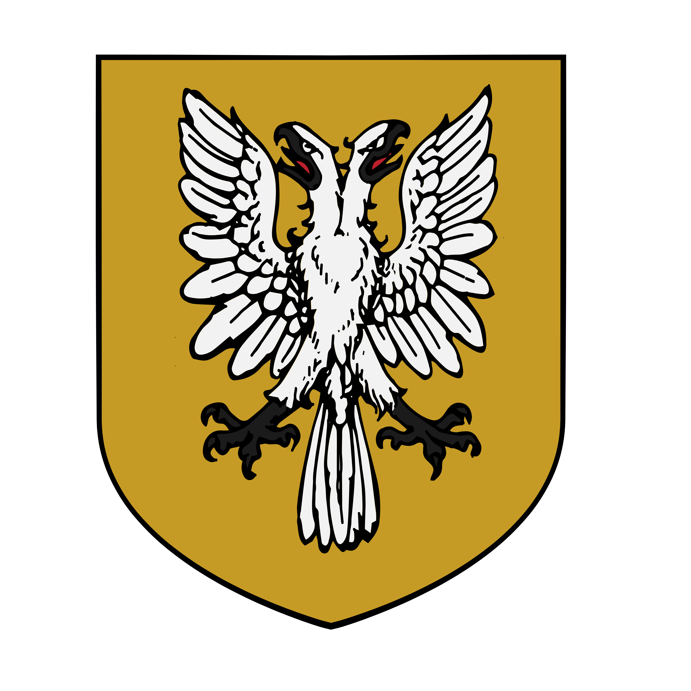

%%  
[[Zuhurism]]   
[[Gorat]]   
[[Zepria]]   
[[Bruša]]   
[[Ruginë]]   
[[Hastermon Temple]]   
[[Twintail Imperium]]   
[[Lakalism]]   
[[Kareli Hierarchy]]   
[[Velvet Caravan]]   
[[Veziva]]   
[[Nural]]   
%%  

  
 <h4 class="wiki-header">Kingdom of Amlija</h4>  
 
  
 <strong>Government</strong>  
 Feudal Monarchy of three Crowns  
 
  
 
  
 <strong>Head of State</strong>  
 Ubrut Ljiljana od Bran  
 
  
 
  
 <strong>Capital</strong>  
 Rashice  
 
  
 
  
 <strong>Heraldic Symbol</strong>  
 Double headed-White Eagle on Gold Ground  
 
  
 
  
 
  
 <strong>Primary Religion</strong>  
 <a href="Zuhurism" class="internal-link">Zuhurism</a>  
 
  
 
  
 <strong>Primary Culture</strong>  
 <a href="Gorati" class="internal-link">Buzinci</a> <a href="Human" class="internal-link">Human</a>  
 
  
 
  
 <strong>Official Language</strong>  
 Yezepri  
 
  
 
  
 
  
 <strong>Preceded by</strong>  
 <a href="Zepria" class="internal-link">Zeprian Empire</a>  
 
  
 
  
 <strong>Formed</strong>  
 767PA  
 
  
   

  

The Kingdom of Amlija is a Zuhuri kingdom of the Buzinci Gorati in the south of <a href="Gorat" class="internal-link">Gorat</a> that emerged after the fall of the <a href="Zepria" class="internal-link">Zeprian Empire</a>. The second most populous and the richest of the Gorati nations, it rivals the <a href="Plašato" class="internal-link">Kingdom of Plašato</a> for dominance in the region. It is ruled from Rashice, the largest city of Gorat, by the House od Bran, whose current Ubrut is Ljiljana, and is home to <a href="Hastermon Temple" class="internal-link">Hastermon Temple</a>, one of the great holy sites of <a href="Zuhurism" class="internal-link">Zuhurism</a>, which draws pilgrims from all over the Zuhuri world. As the eastern end of the Velvet Road Amlija is one of the most important trading hubs of Nirydia, and it is a close ally of the <a href="Twintail Imperium" class="internal-link">Twintail Imperium</a>.
  
<h2>Geography</h2>  

Amlija holds the south-eastern coast of Gorat on the Gorati Sea. Its heart is the coastal and lowland country around Rashice, where the Buzin River, coming down from the Limsul Peaks through the Velvet Valleys and the vineyards of the Buzin Vale, reaches the sea. The north of the kingdom, around the Pola River, holds Hastermon Mount, the Sunrise Mountains and the city of Meveti, while the south-west reaches towards the Sunset Mountains and the Velvet Road. The old imperial road, the Pur Imperia, runs north from Rashice through Plašato to Basnik.
  

Among the oldest sites of the kingdom are the Ruins of Drolom, a field of massive stone obelisks and among the most ancient places of human worship known. Folk tradition holds that they were raised by Zuhuri priests, but they are likely at least three thousand years old and are sometimes loosely connected to the worship of the <a href="Nural" class="internal-link">Nural</a>. They are largely left in peace, and the people of the region tell of spirits and fey that dance around the stones at certain hours of the night.
  
<h2>History</h2>  

The Buzinci lands were brought under the Zeprian Empire by Suzana the Cruel in the late 5th century PA, but they were among the first to slip from its grasp. In 724PA imperial tax collectors were slaughtered on the roads of the south, and when a delegation of imperial lawmen and mages came to find the culprits, Lord Branimir of Rashice had them arrested for four months, during which the imperial mage Hrado Mitel died in his dungeon. The Buzinci Delegation Incident was seen as an open declaration of the Empire's weakness, and by 758PA the Buzinci had all but abandoned imperial rule. After the fall of the Empire in 767PA the descendants of Branimir, the House od Bran, took the crown of the new kingdom, and they have ruled it ever since.
  

In 852PA the crown came into conflict with Hastermon Temple in the Days of Ire, when the Ubrut Uroš, shunned by the Arunča of the time, laid claim to Hastermon Mount and the taxation of its pilgrims. The temple denounced his rule and almost all his vassals refused him service until Uroš begged for forgiveness and willingly submitted to ritual blinding. In 873PA the Mandate of 873, largely ratified by the priests of Hastermon, allowed the Shirin of Amlija to gather in houses of worship of their own. In the 880s Amlija supported the independence movement of <a href="Bruša" class="internal-link">Bruša</a> against <a href="Dišela" class="internal-link">Dišela</a>, which won its freedom in 885PA.
  
<h2>Politics</h2>  

The Ubrut of Amlija holds three crowns: the Crown of Rashice, the Crown of Sibuza over the south-western regions, and the Crown of Polada over the north around the Pola River. They recall the realms of the Buzinci before the unification of Gorat under the Empire, and while no independent prince has worn them since, the od Bran have kept all three as an acknowledgement of the regional and historical differences within Amlija and the greater Buzinci culture.
  

Amlija contends with Plašato for dominance in Gorat and has sought the friendship of the Twintail Imperium as a counterweight to its northern rival. It is on poor terms with <a href="Ruginë" class="internal-link">Ruginë</a>, since it claims all the lands south of the Limsul Peaks for itself, lands where the great majority of the central and southern Opmani live, and the Opmani in turn are bitter enemies of the Buzinci. Amlija is also antagonistic towards Dišela, the other great Buzinci power of the region.
  
<h2>Economy</h2>  

Amlija is the richest of the Gorati nations. It connects the wider Nirydian world with the west through the Velvet Road, the caravan route to the <a href="Kareli Hierarchy" class="internal-link">Kareli Hierarchy</a> (see <a href="Velvet Caravan" class="internal-link">Velvet Caravan</a>), while some merchants risk the far more dubious shipping routes instead. The wines of the Buzin Vale, whose lords are known as the winelords, are traded far and wide, and the pilgrims of Hastermon bring further wealth. Slavery is common, Rashice being known for its galley slaves, and Amlija carries on a lively exchange of slaves with the Kareli Hierarchy. The Shirin of the kingdom bring much trade with them as well.
  
<h2>Society</h2>  

The Buzinci of Amlija are known as an open-minded and wealthy people, often seen by others as arrogant and self-absorbed. They are more tolerant towards the Bihra and the Mogyri than the other Gorati and more drawn to the pursuit of the arcane and of science, yet remain deeply religious, and because Hastermon lies in their lands some of them call themselves the first children of Zuhur.
  

Amlija has the second largest Shirin population of Gorat after Jateš, living mostly in the lowland valleys and the coastal central region of the kingdom. Their Lakalist faith (see <a href="Lakalism" class="internal-link">Lakalism</a>) is the only foreign religion recognised by the lords of Amlija, and since the Mandate of 873 the Shirin have been allowed to gather in houses of worship of their own. They live in walled quarters of their own within the cities, and while some persecute them for their worship, they are in truth treated relatively well.
  

The centre of magical study in Amlija is the Hall of Sunrise near Meveti, one of the two most renowned circles of masters of the <a href="Veziva" class="internal-link">Veziva</a>. It sits on a great rock cliff in the Gorati Sea that is joined to the shore by no bridge, and can be reached only by boat, or by those who know the runes that reveal a hidden bridge through the winds.
  
