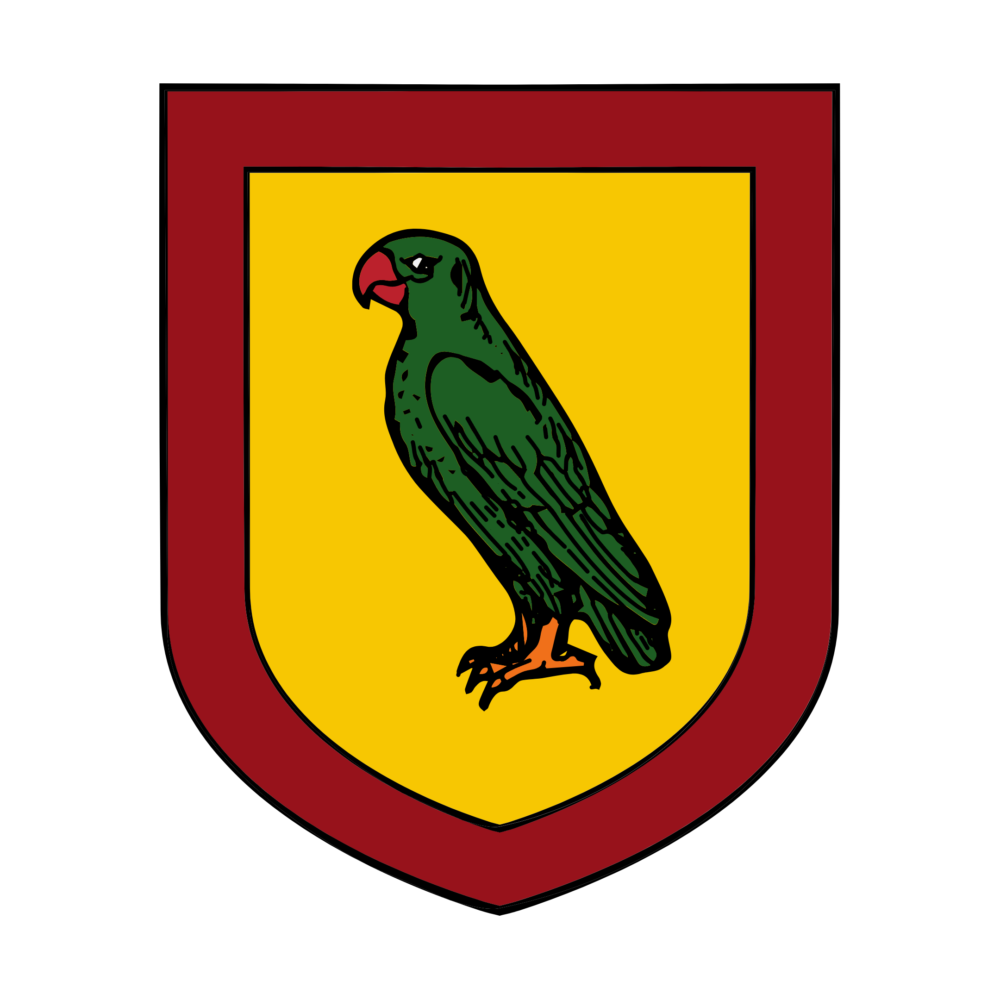

%%  
[[Zuhurism]]  
[[Dišela]]  
[[Zepria]]  
[[Amlija]]  
[[Gorat]]  
[[Gorati]]  
[[Opal Ring]]
[[Bihra]]  
[[Vanpur Pepper Trade]]  
[[Kamerzin]]  
[[Qalmyr]]  
%%  

  
 <h4 class="wiki-header">Republic of Bruša</h4>  
 
  
 <strong>Government</strong>  
 Oligarchic City State  
 
  
 
  
 <strong>Head of State</strong>  
 The Grandmaster (identity unknown)  
 
  
 
  
 <strong>Capital</strong>  
 Bruša  
 
  
 
  
 <strong>Heraldic Symbol</strong>  
 Green Parrot on Gold and Red  
 
  
 
  
 
  
 <strong>Primary Religion</strong>  
 <a href="Zuhurism" class="internal-link">Zuhurism</a>  
 
  
 
  
 <strong>Primary Culture</strong>  
 Gorati <a href="Human" class="internal-link">Human</a>  
 
  
 
  
 <strong>Official Language</strong>  
 Yezepri  
 
  
 
  
 
  
 <strong>Preceded by</strong>  
 <a href="Dišela" class="internal-link">Republic of Dišela</a>  
 
  
 
  
 <strong>Formed</strong>  
 885PA  
 
  
   

  

The Republic of Bruša is a city state on the northern shore of Sgar Isle in <a href="Gorat" class="internal-link">Gorat</a>, at the meeting of the Gorati Sea and the greater Vanpur Ocean. Founded in the time of the <a href="Zepria" class="internal-link">Zeprian Empire</a> by dissidents who rejected imperial rule, it later became a subject of the <a href="Dišela" class="internal-link">Republic of Dišela</a> and won its independence in the Bruša Emancipation of 885PA with the support of the <a href="Amlija" class="internal-link">Kingdom of Amlija</a>. Bruša is ruled by the Grandmaster, whose identity is kept secret from all outsiders, and is known throughout Gorat as the City of Masks and as the home of the guild of assassins called <a href="Opal Ring" class="internal-link">the Opal Ring</a>. It is a young and emerging state that has positioned itself as a central port between the Gorati Sea and the Vanpur Ocean, and its island, often called the Turmeric Island, grows a vast share of the world's turmeric.
  
<h2>Geography</h2>  

Sgar Isle lies south-east of Zelarvo, where the Gorati Sea opens into the Vanpur Ocean. The city of Bruša stands on its northern shore, and a second port city, Kirum, lies on its south-eastern coast. Small hamlets, many of them fishing villages, line the rest of the coast. The greater part of the island is owned by a small number of great landowners whose estates grow turmeric, while the centre of the island is contested by tribal <a href="Bihra" class="internal-link">Bihra</a> who have never submitted to the rule of the city.
  
<h2>History</h2>  
<h3>Founding</h3>  

Before the founding of Bruša, Sgar was a predominantly tribal Bihra island, and its only human settlements were fishing hamlets on its northern coast. In the 6th century PA anti-imperial dissidents and revolutionaries who had fled the rule of the Zeprian Empire settled on the northern shore and founded the town that grew into Bruša.
  
<h3>Diprije and the Bihra</h3>  

In the 8th century, during the decline of the Empire, the great merchant city of <a href="Diprije" class="internal-link">Diprije</a> on Zelarvo began to invest heavily in the island and in the emerging port of Bruša. Its merchants pacified many of the northern Bihra tribes and laid out the estates on which the turmeric of Sgar has been grown ever since. The wider Bihra communities of the island were forced to adapt, which meant that they were either enslaved or fled deep inland or to the south. When the Empire fell in 767PA the Republic of Dišela claimed Bruša as its own, and for more than a century the city served the Republic, which in that time was inarguably the richest of the successor states of the Empire and held the trade of the Gorati Sea in a dominant chokehold.
  
<h3>Emancipation</h3>  

In the 880s the lords of Bruša and the landowners of Sgar rose in revolt against Diprije, supported in all but name by Amlija. The revolt is remembered in Bruša as the Emancipation, a name that its enemies regard as a fancier word for rebellion. During the conflict five Duždi of Dišela were assassinated within a single year, a period known as the Bleeding of the Shark, before Bruša won its independence in 885PA. The loss of the city marked the beginning of the decline of Dišela.
  
<h2>Government</h2>  

Bruša is ruled by the Grandmaster, an enigmatic office whose holder is appointed, often for life, by the Parrots Council. No outsider knows who the Grandmaster is, and the office is closely connected with the Opal Ring. The love of the people of Bruša for masks, which are worn in the streets, at court and at the great festivals of the city, has given it the name of the City of Masks.
  
<h2>Economy</h2>  

Bruša commands the passage between the Gorati Sea and the Vanpur Ocean, and much of the <a href="Vanpur Pepper Trade" class="internal-link">Vanpur Pepper Trade</a> bound for Amlija and the Velvet Road passes through its harbour. Its greatest wealth, however, is the turmeric of Sgar, of which the island grows a vast share of the world's supply. The turmeric of the great estates has historically been farmed, harvested and processed by Bihra slaves.
  
<h2>Foreign Relations</h2>  

Bruša is more closely aligned with Amlija than many would wish. In population it is a very small country, and for the time being it relies on the Amlijan navy for its protection against Dišela, which has remained hostile since the Emancipation. There are rumours, however, of an agreement with the Orcish kingdom of <a href="Kamerzin" class="internal-link">Kamerzin</a>, which follows the <a href="Qalmyr" class="internal-link">Qalmyr</a> faith and holds the channel city of Kamerzin on Durennis, and with other Durenni powers, which may harbour ambitions on Sgar or seek to bind themselves more closely to Bruša as a willing stepping stone into Gorat.
  
