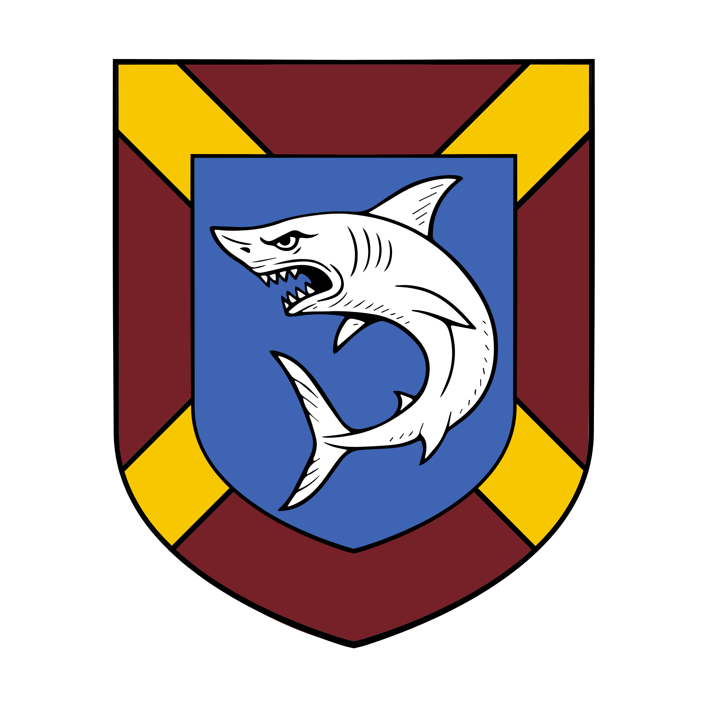

%%  
[[Zuhurism]]   
[[Gorat]]   
[[Zepria]]   
[[Amlija]]   
[[Plašato]]   
[[Bruša]]   
[[Twintail Imperium]]   
[[Igpuri Dominion]]   
[[Vanpur Pepper Trade]]   
[[Pepper Islands]]   
[[Diprije]]   
%%  

  
 <h4 class="wiki-header">Republic of Dišela</h4>  
 
  
 <strong>Government</strong>  
 Aristocratic Maritime Republic  
 
  
 
  
 <strong>Head of State</strong>  
 Dužd Ottavio Sanfelice  
 
  
 
  
 <strong>Capital</strong>  
 Diprije  
 
  
 
  
 <strong>Heraldic Symbol</strong>  
 Shark under Laurels on Blue Ground  
 
  
 
  
 
  
 <strong>Primary Religion</strong>  
 <a href="Zuhurism" class="internal-link">Zuhurism</a>  
 
  
 
  
 <strong>Primary Culture</strong>  
 <a href="Gorati" class="internal-link">Gorati</a> <a href="Human" class="internal-link">Human</a>  
 
  
 
  
 <strong>Official Language</strong>  
 Yezepri  
 
  
 
  
 
  
 <strong>Preceded by</strong>  
 <a href="Zepria" class="internal-link">Zeprian Empire</a>  
 
  
 
  
 <strong>Formed</strong>  
 767PA  
 
  
   

  

Dišela is an aristocratic maritime Republic centred on the city of <a href="Diprije" class="internal-link">Diprije</a> on the island of Zelarvo, in central <a href="Gorat" class="internal-link">Gorat</a>. Ruled by the Five Families, it controls the whole island as well as a number of coastal settlements and merchant towns in the Gavivag Bay and the Gorati Sea, and holdings on islands of the Vanpur Ocean and the <a href="Pepper Islands" class="internal-link">Pepper Islands</a>. With one of the largest navies in Nirydia it is the leading sea power of the region and one of the most commercially dominant states of the continent, and much of the <a href="Vanpur Pepper Trade" class="internal-link">Vanpur Pepper Trade</a> into and out of Gorat passes through its hands. The Republic has entered an era of decline since the Bruša Emancipation of 885PA.
  
<h2>Geography</h2>  

Almost all of the great towns and population centres of Dišela lie on Zelarvo, the island across the Strait of Zelarvo from the Gorati mainland. Besides the capital Diprije, the island holds the old port of Kroz, which together with Malvic on the mainland once formed the heart of the Malvic League. South-east of Zelarvo lies the small island of Itka, whose mine yields great amounts of tin for the Republic. Beyond these the Republic holds islands and trading posts throughout the Gavivag Bay, the Gorati Sea, the Vanpur Ocean and the Pepper Islands, which serve its fleets as harbours along the Pepper Road.
  
<h2>History</h2>  

Long before the Empire, the trade through the Strait of Zelarvo was controlled by the Malvic League, an alliance of merchant cities whose greatest members were Malvic on the mainland and Kroz on Zelarvo. In the 5th century PA the League was subjugated by King Morac of Zepria, the father of <a href="Suzana Dragović" class="internal-link">Suzana Dragović</a>, and its cities became part of the <a href="Zepria" class="internal-link">Zeprian Empire</a>, under which the merchants of Zelarvo grew rich on the trade of the bay.
  

When the Empire fell in 767PA the great merchant houses of Zelarvo took power over the island and founded the Republic. For more than a century Dišela kept itself apart from the rivalry of <a href="Amlija" class="internal-link">Amlija</a> and <a href="Plašato" class="internal-link">Plašato</a> and grew into the foremost sea power of Gorat. Its fortunes turned in the 880s, when the city of <a href="Bruša" class="internal-link">Bruša</a> on Sgar Isle, which had been founded by anti-imperial dissidents in the time of the Empire, had grown into a port on the investment of Diprije and had been claimed by the Republic in 767PA, rose against Diprije with the support of Amlija. During the revolt five Duždi were assassinated within a single year, a period known as the Bleeding of the Shark, and Bruša won its freedom in 885PA. The loss of Bruša, which commands the passage from the Gorati Sea to the Vanpur Ocean and the route by which spices reach Amlija and the Velvet Road, marked the beginning of the Republic's decline, and Dišela has held a firmly anti-Amlijan stance ever since.
  
<h2>Government</h2>  

Dišela is ruled by the Five Families, the patrician houses of Vranjić, Kaštelan, Sanfelice, Loscalzo and Gradić, together with a wider circle of lesser patrician families whose names are inscribed in the Golden Book of Diprije. All adult men of these houses sit in the Great Council, the sovereign body of the Republic, which elects the magistrates and votes on the laws. At the head of the state stands the Dužd, who is elected for life by the Great Council through a long sequence of ballots and drawings of lots meant to prevent any one family from buying the office. The Dužd presides over the councils and represents the Republic abroad, but is bound by an oath sworn on election that limits the powers of the office, and can do nothing without the Minor Council, in which each of the Five Families holds one seat. The security of the state lies with the Quiet Council, a small and secretive body elected from the Great Council that watches over conspiracies, foreign agents and the conduct of the patricians themselves.
  

The current Dužd is Ottavio Sanfelice. Although the Five Families share the rule of the Republic, they compete fiercely with one another for office, trade and the command of the fleet, and the loss of Bruša left a lasting rift between the houses over who was to blame.
  
<h2>Economy and Navy</h2>  

The wealth of Dišela rests on the sea. Its merchants are the main carriers of the Vanpur Pepper Trade into and out of Gorat, bringing the spices of the Pepper Islands through the Strait of Zelarvo to the markets of the Gavivag Bay, and its tin from Itka is sold throughout Nirydia. Diprije is also known for its pleasure houses, and slaves, among them many sold into those houses, are traded through its markets. To guard its trade the Republic maintains one of the largest navies in Nirydia.
  
<h2>Foreign Relations</h2>  

Dišela is one of the oldest and closest allies of the <a href="Twintail Imperium" class="internal-link">Twintail Imperium</a>, and among its greatest and oldest friends are the ports of northern Durennis. Its fiercest commercial rivals are the traders of the <a href="Igpuri Dominion" class="internal-link">Igpuri Dominion</a> of north-eastern Nirydia, with whom it competes for the trade of the bay and the Vanpur Ocean. Towards Amlija it has been openly hostile since the Bruša Emancipation, while it keeps a wary distance from Plašato.
  
<h2>Society</h2>  

The islanders of Zelarvo are close to the Buzinci of the mainland in language and custom, and are generally counted among them, but many regard themselves as a people apart, more at home on the sea than on the land.
  
