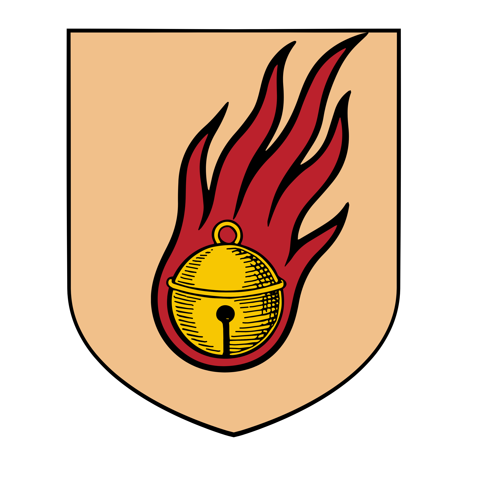

%%  
[[Zuhurism]]   
[[Gorat]]   
[[Zepria]]   
[[Sredit]]   
[[Twintail Imperium]]   
[[Veziva]]   
[[Rha-Gis]]   
[[Black Powder]]   
%%  

  
 <h4 class="wiki-header">Duchy of Jateš</h4>  
 
  
 <strong>Government</strong>  
 Feudal Monarchy  
 
  
 
  
 <strong>Head of State</strong>  
 Khir Dragan od Hajdarević  
 
  
 
  
 <strong>Capital</strong>  
 Basnik  
 
  
 
  
 <strong>Heraldic Symbol</strong>  
 Golden Bell-Comet  
 
  
 
  
 
  
 <strong>Primary Religion</strong>  
 <a href="Zuhurism" class="internal-link">Zuhurism</a>  
 
  
 
  
 <strong>Primary Culture</strong>  
 <a href="Gorati" class="internal-link">Gorati</a> <a href="Human" class="internal-link">Human</a>  
 
  
 
  
 <strong>Official Language</strong>  
 Yezepri  
 
  
 
  
 
  
 <strong>Preceded by</strong>  
 <a href="Zepria" class="internal-link">Zeprian Empire</a>  
 
  
 
  
 <strong>Formed</strong>  
 initial: 287PA,  current: 767PA   
 
  
   

  

The Duchy of Jateš is the northernmost nation of <a href="Gorat" class="internal-link">Gorat</a>, lying between the Kingdom of <a href="Plašato" class="internal-link">Plašato</a> to the south and the <a href="Twintail Imperium" class="internal-link">Twintail Imperium</a> to the north. Having been under the control of both the Shirin and the <a href="Zepria" class="internal-link">Zeprian Empire</a> several times throughout its history, it is fully independent in the modern day and is ruled from Basnik by the Khir, currently Dragan od Hajdarević. Jateš is the home of the Kraguvci and of many of the Mustari, two Gorati peoples who have been rivals since ancient times, and of the largest Shirin population of any Gorati nation. Caught between its two mighty neighbours, it has become adept at playing one against the other, and its desire to regain the Free City of <a href="Sredit" class="internal-link">Sredit</a>, lost in 880PA, is the greatest conflict of the region.
  
<h2>Geography</h2>  

Jateš holds the north of Gorat between the Limsul Peaks and the Gavivag Bay. The Mustar River divides the duchy into the Gorati Highlands to its north and the Mustar Peaks to its south, and flows east into the bay past Sredit, once the richest city of the duchy. South of the Mustar lies the Kragu Valley, the heartland of the Kraguvci and of Jateš itself. Basnik, the capital, marks the northern end of the Pur Imperia, the old imperial road that runs south through Plašato to Rashice.
  

In the western mountains stands the Lift of Telemon, a vast relic structure that joins Gorat to the passes of the Limsul Peaks and through them to the hidden lands of Yorvale, where <a href="Rha-Gis" class="internal-link">Rha-Gis</a> lies. The Lift can be worked only by those who carry the mysterious sealstone, and it is thought to have been made by mythical forces before the beginning of known history. Bihra of Yorvale sometimes descend by it to trade or to leave their valley, but no regular exchange or trade route has ever grown from it, and only a few isolated Kraguvci communities near the Lift have dealings with them.
  
<h2>History</h2>  

Jateš was founded in 287PA, making it one of the oldest Gorati realms, though unlike <a href="Ruginë" class="internal-link">Ruginë</a> it did not keep its independence through the centuries that followed. Its position on the border of the Shirin lands made it a prize for both its neighbours, and it passed between Zeprian and Shirin rule several times. Even under the Empire it kept its status as a duchy.
  

In the last years of the Empire the old feud between the Mustari house of Rizev and the Kraguvci house of Ohodrev broke out again in 764PA, and the Crown Prince Matjar, who came north in support of the Ohodrev, was met in battle by the Rizev and laughed off by his own allies. With the fall of the Empire in 767PA Jateš regained its independence from Gorati and Shirin overlords alike.
  

In 880PA the duchy lost Sredit, once known as the pearl of Jateš. Under the influence of Zeprian politicians at the court, the tobacco tax on Shirin merchants from the north had been raised yet again, and with the backing of the Twintail Imperium, which promised experimental Huling weapons, great ships and protection should Plašato support a reconquest, the patricians of Sredit renounced the overlordship of Jateš. The secession also drew on the rivalry of the Mustari of the city with the Kraguvci. In the early 10th century <a href="Black Powder" class="internal-link">black powder</a> weapons have begun to spread into Jateš from the north.
  
<h2>Politics</h2>  

The Khir of Jateš rules over a nobility of many major and minor houses, among them the counts of Rizev and Ohodrev, whose feud continues to divide the duchy along the old line between Mustari and Kraguvci. The current Khir is Dragan od Hajdarević.
  

Jateš has never claimed to be of equal rank with Plašato and has kept the ducal status it held under the Empire. It is allied to Plašato but pays no tribute and shows no other sign of fealty to Rivno. Neither Plašato nor the Twintail Imperium can march on the duchy without provoking an all-out defence of it by the other, and so both pursue their aims there through diplomacy and manipulation, while Jateš manoeuvres deftly between them. Above all else it seeks to regain Sredit, which is protected by the Twintail, and this desire is the greatest source of conflict in the region.
  
<h2>Economy</h2>  

The Kraguvci of Jateš are famed for spirits distilled from wine and for their metalwork and crafts, while the carpets and rugs woven along the Mustar are traded throughout Nirydia. The trade with the Shirin to the north, above all in tobacco, is an important source of revenue for the duchy, and the old imperial road carries its goods south into Plašato.
  
<h2>Society</h2>  

The Kraguvci regard themselves as the most refined of the <a href="Gorati" class="internal-link">Gorati</a> and mock the Mustari as rat lovers and tail lickers for their perceived submission to the Shirin, while the jovial and festive Mustari call the Kraguvci stonesmellers and kneelers for their submission to the Zepri of Plašato. Among the Kraguvci a sect of the <a href="Veziva" class="internal-link">Veziva</a> binds magic and commands into metal, not unlike the golems of the west.
  

Jateš has by far the largest Shirin population of any Gorati nation. Unlike the Shirin of Amlija they live largely freely, though almost entirely in the lowlands of the duchy.
  
