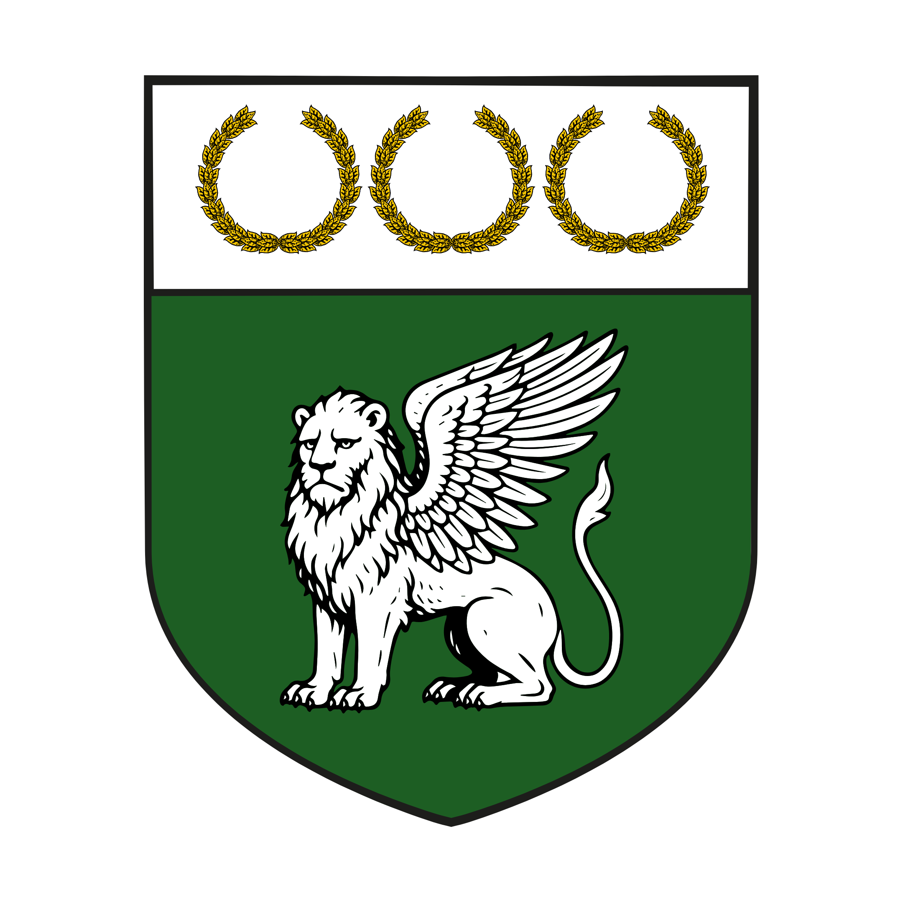

%%  
[[Zuhurism]]   
[[Cirinzel]]  
[[Zuhuri Holy Wars]]  
[[Zepria]]  
[[Gavivag Isle]]  
[[Eye of Zuhur]]  
[[Gorat]]  
[[Jateš]]  
[[Twintail Imperium]]  
[[Veziva]]  
[[Rian]]  
[[Sadizka Ovoletru]]  
%%  

  
 <h4 class="wiki-header">Kingdom of Plašato</h4>  
 
  
 <strong>Government</strong>  
 Feudal Monarchy  
 
  
 
  
 <strong>Head of State</strong>  
 Ubrut Lovro of House Nadrej  
 
  
 
  
 <strong>Capital</strong>  
 Rivno  
 
  
 
  
 <strong>Heraldic Symbol</strong>  
 Winged Lion  
 
  
 
  
 
  
 <strong>Primary Religion</strong>  
 <a href="Zuhurism" class="internal-link">Zuhurism</a>  
 
  
 
  
 <strong>Primary Culture</strong>  
 Gorati <a href="Human" class="internal-link">Human</a>  
 
  
 
  
 <strong>Official Language</strong>  
 Yezepri  
 
  
 
  
 
  
 <strong>Preceded by</strong>  
 <a href="Zepria" class="internal-link">Zeprian Empire</a>  
 
  
 
  
 <strong>Formed</strong>  
 767PA  
 
  
   

  

The Kingdom of Plašato is the largest and most populous of the nations of <a href="Gorat" class="internal-link">Gorat</a> and dominates the centre of the region. The homeland of the Zepri people and the heartland of the old <a href="Zepria" class="internal-link">Zeprian Empire</a>, it is ruled from Rivno by the Ubrut, the Gorati title for a king, of the House Nadrej, who style themselves the Marble Lords. Plašato regards itself as the rightful heir of the Empire and the true ruler of all Gorat, and it fields the largest armies of the region, but it is economically outshone by its neighbours to the south, the <a href="Amlija" class="internal-link">Kingdom of Amlija</a> and the <a href="Dišela" class="internal-link">Republic of Dišela</a>. Since the Gavivag War it has also held <a href="Gavivag Isle" class="internal-link">Gavivag Isle</a> and the <a href="Eye of Zuhur" class="internal-link">Eye of Zuhur</a> on the doorstep of <a href="Cirinzel" class="internal-link">Cirinzel</a>.
  
<h2>Geography</h2>  

Plašato holds the long central coast of Gorat on the Gavivag Bay, between the Kragu Valley and the Duchy of <a href="Jateš" class="internal-link">Jateš</a> to the north and the Kingdom of Amlija to the south, and reaches inland into the mountains whose marble, gold and silver mines are among the richest in Nirydia. Its capital, Rivno, is the largest city and commercial heart of the kingdom. The old imperial capital of Plavigrad remains its second city and is supplied with water by the great aqueduct from Lake Višine to its south, guarded by the fortress of Višine nad Plavigradom. The Pur Imperia, the old imperial road from Rashice to Basnik, still crosses the kingdom from south to north. South of the Jinara River lies the Orange Valley, a stretch of rich farmland known for its orange groves, between the lands of the Kupjin to the west and of the Marvi to the east.
  
<h2>History</h2>  

Under the Empire the House Nadrej were the Lords of Rivno, a city that by the last decades of the Empire had arguably grown into a larger and more important commercial hub than Plavigrad itself. When the imperial dynasty ended in 767PA with Radov the Silver's failed invocation in the palace of Plavigrad, the Nadrej took the royal title over the Zepri heartland and moved its seat and administration to their own city of Rivno, while Plavigrad kept its renown for its architecture and its masons and smiths.
  

As heir of Zepria, which had fought alongside the northern Pagri realms such as Cirinzel in the <a href="Zuhuri Holy Wars" class="internal-link">Zuhuri Holy Wars</a> up to the Fourth, Plašato long counted itself their ally, but it took no part in the Fifth Holy War, and the old alliance was not renewed. The Empire had lost Trilom and the Eye of Zuhur to Cirinzel in 667PA. From 872PA to 875PA Plašato fought the Gavivag War against Cirinzel and, in a surprise landing, seized Gavivag Isle and the Eye, which it has held ever since, and it points to this reconquest as proof of its claim to be the true heir of Zepria. In 880PA its influence at the court of Jateš played a part in the Sredit Incident, when Zeprian politicians pressed for yet another rise in the tobacco tax on Shirin merchants and the patricians of <a href="Sredit" class="internal-link">Sredit</a>, assured of the protection of the <a href="Twintail Imperium" class="internal-link">Twintail Imperium</a> should Plašato support a reconquest, renounced the overlordship of Jateš.
  
<h2>Politics</h2>  

The Ubrut of Plašato is currently Lovro of the House Nadrej. Beneath the crown the great houses of the Zepri, among them the Kupjin and the Marvi, have feuded with one another for generations under the oversight, and to the leisure, of the royal house. The bloodiest of these feuds is fought over the Orange Valley, where fathers have mourned their sons for generations and where the waystones that mark the ownership of the valley are notorious for being moved, or so each side accuses the other.
  

Plašato's relationship with Jateš is complicated. Jateš has never claimed to be of equal rank and has kept the status of a duchy that it held under the Empire, and while it is allied to Plašato it pays no tribute and shows no other sign of fealty to Rivno. Plašato projects great power over the duchy, but neither it nor the Twintail Imperium can march on Jateš without provoking an all-out defence of it by the other, and so both pursue their aims there through diplomacy and manipulation, as in the Sredit affair, while Jateš manoeuvres deftly between them. In the south Plašato contends with the wealthier Kingdom of Amlija for dominance in Gorat, and relations with Cirinzel have remained cold since the Gavivag War.
  
<h2>Economy</h2>  

The wealth of Plašato rests on its mines of marble, gold and silver, on the trade of Rivno and on the masonry and smithing of Plavigrad, while the Orange Valley and the other farmlands of the kingdom feed its large population. The roads built by the Empire still carry much of the trade of Gorat, and the <a href="Rian" class="internal-link">Rian</a>, first struck by the Zeprian Empire, remains the common coin of the kingdom and of much of Nirydia.
  
<h2>Culture</h2>  

The Zepri of Plašato are closely bound to royal and noble tradition and hold to the belief in Zuhur's lot, the place under the Sun Lord's gaze that is given to every person at birth and that each should follow. They are known as a militaristic people who raise large peasant armies, as great builders, and as renowned songwriters and singers, who express worship, love and sorrow in ballads and choirs (see <a href="Gorati" class="internal-link">Gorati</a>). Rivno is home to the Five Towers, one of the two most renowned circles of masters of the <a href="Veziva" class="internal-link">Veziva</a>, to which the Vezi <a href="Sadizka Ovoletru" class="internal-link">Sadizka Ovoletru</a> belongs.
  
a href="Zuhuri Holy Wars" class="internal-link">Zuhuri Holy Wars</a> up to the Fourth, Plašato long counted itself their ally, but it took no part in the Fifth Holy War and the old alliance has not been renewed. In the Gavivag War of the 870s Plašato seized <a href="Gavivag Isle" class="internal-link">Gavivag Isle</a> from Cirinzel in a surprise landing, and it now holds the island and its <a href="Eye of Zuhur" class="internal-link">Eye of Zuhur</a> at Cirinzel's doorstep.
