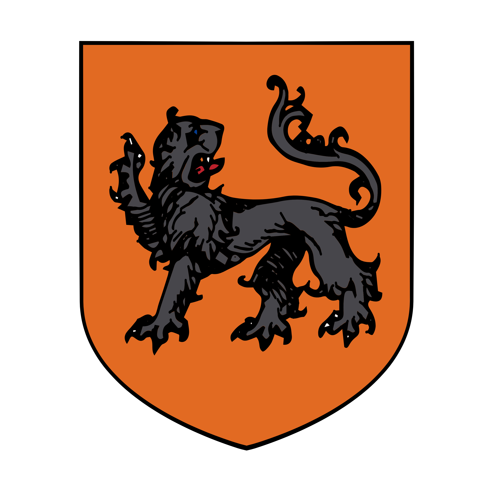

%%  
[[Zuhurism]]  
[[Velvet Caravan]]  
[[Kareli Hierarchy]]  
[[Ral]]  
[[Gorat]]  
[[Gorati]]  
[[Zepria]]  
[[Suzana Dragović]]  
[[Amlija]]  
[[Hastermon Temple]]  
[[Nural]]  
%%  

    <h4 class="wiki-header">Ruginë Principality</h4>
    

        <strong>Government</strong>
        Feudal Monarchy
    

    

        <strong>Head of State</strong>
        
    

    

        <strong>Capital</strong>
        Proske
    

    

        <strong>Heraldic Symbol</strong>
        Black Dire-Lion on Orange Ground
    

    

    

        <strong>Primary Religion</strong>
        <a href="Zuhurism" class="internal-link">Zuhurism</a>
    

    

        <strong>Primary Culture</strong>
        <a href="Gorati" class="internal-link">Opmani</a> <a href="Human" class="internal-link">Human</a>
    

    

        <strong>Official Language</strong>
        Firhë
    

    

    

        <strong>Preceded by</strong>
        Gorati Rock Lords
    

    

        <strong>Formed</strong>
        325PA
    

    

The Ruginë Principality is a landlocked mountain realm in the southern Limsul Peaks, in the west of <a href="Gorat" class="internal-link">Gorat</a>, and the homeland of the Northern Opmani, the most isolationist of the <a href="Gorati" class="internal-link">Gorati</a> peoples. It is a league of mountain valleys, each held by its own clans, whose banner-lords elect the ruler of the realm, the Prijës, from their own ranks. United in 325PA, Ruginë is older than any other Gorati realm that survives today, and it takes great pride in never having been truly conquered, even in the days of the <a href="Zepria" class="internal-link">Zeprian Empire</a>. Its strategic position on the southern ranges gives it great influence over the <a href="Velvet Caravan" class="internal-link">Velvet Road</a>, and its mercenaries, its herds and its cheese are known far beyond its borders.
  
<h2>Geography</h2>  

Ruginë lies in the high valleys of the southern Limsul Peaks, west of the Velvet Valleys and north of the Velvet Road. At its heart lies the central valley of the realm and Prosk Mountain, upon and within which stands the capital Proske. The valleys are linked by narrow passes, many of them guarded by old forts of the Rock Lords, and their slopes are given over to pastures and mountain farms. Beyond the peaks lie the Soki Valley and the Kolrog Highlands, home of the Soki, while the Bihra of the Limsul Peaks dwell in the higher ranges to the west.
  
<h3>Proske</h3>  

Proske, often called the Mistress, is an impregnable mountain fortress that winds through and over Prosk Mountain in the central valley of Ruginë. Its towers, walls and halls climb the slopes of the mountain and are carved deep into its rock, so that much of the city lies within the mountain itself. Construction of the Mistress was begun by Tar-Rugin in 325PA, and it has been extended by his successors ever since. No army has ever taken it, and it is said in Ruginë that the Mistress has many suitors but has never been won. Proske is also known for its vaults, in which foreign lords and merchants are said to keep their gold, far from the reach of their rivals and of their own subjects.
  
<h2>History</h2>  
<h3>The Rock Lords</h3>  

In the early centuries of <a href="Zuhurism" class="internal-link">Zuhurism</a> in Gorat, the chiefs of the mountains, later known as the Rock Lords, defeated the druidic cults of the <a href="Nural" class="internal-link">Nural</a> and took their place, gaining power over much of southern Gorat. In 325PA the greatest of them, Tar-Rugin, united many of the Northern Opmani under his rule and began the construction of Proske. He is regarded as the first ruler of the Opmani, and the realm takes its name from him.
  
<h3>Greater Ruginë</h3>  

In the centuries that followed, Ruginë grew into what the Opmani remember as Greater Ruginë, a realm that held the Velvet Road and the southern Sunset Mountains as well as the northern valleys. Its end came with the early conquests of <a href="Suzana Dragović" class="internal-link">Suzana Dragović</a>, who seized these outer lands and forced the Opmani living there into submission. Many Opmani still dream of the restoration of Greater Ruginë to this day.
  
<h3>Dritan and the Empire</h3>  

The heartland of Ruginë was never conquered. The Opmani hero Dritan defeated the armies of Suzana in the mountain valleys and passes of the realm, and later the armies of three further emperors, so that the valleys of Ruginë remained free throughout the history of the Empire. In the decline of the Empire the Southern Opmani also cast off imperial rule, and by 758PA they had all but abandoned it. After the fall of the Empire in 767PA the Kingdom of <a href="Amlija" class="internal-link">Amlija</a> claimed the lands south of the Limsul Peaks in which most of the central and southern Opmani live, a claim that Ruginë has never accepted.
  
<h2>Government</h2>  

Ruginë is a league of mountain valleys, each of which is held by its own clans under the leadership of a banner-lord. The banner-lords meet in assembly at Proske, where they elect the Prijës, the ruler of the realm, from their own ranks to rule for life. The current Prijës is Lekë Merkaj. The Prijës commands the Mistress and speaks for Ruginë abroad, but within their own valleys the clans govern themselves according to the Nadvok.
  
<h2>Society</h2>  

The Opmani of Ruginë live in close and communal families, and many of them in stone tower houses that can be defended against raiders and rival clans alike. Their lives are governed by the Nadvok, an unwritten code of customary law handed down through the generations. It upholds the blood feud between families, holds a sworn word of honour to be unbreakable and makes hospitality so sacred that a guest is protected even from the enemies of their host. To the Buzinci, who deeply hate the Opmani and are hated by them in turn, the Nadvok is little more than proof that the Opmani are lawless.
  

Most Opmani are devout followers of Pen Zuhur, but many of the valleys of Ruginë have also adopted the traditions of <a href="Noorism" class="internal-link">Noorism</a>, which is practised almost only in the valleys of the Limsul Peaks. The Soki of the highlands beyond the peaks, a people of <a href="Ral" class="internal-link">Ral</a> shifters said to turn themselves into owls and falcons, are sometimes associated with the realm, though they live largely outside its reach, and the hardiest of the Opmani communities are among the few Gorati who have regular dealings with the Bihra of the Limsul Peaks.
  
<h2>Military</h2>  

Ruginë keeps out of the wars of the lowland realms, but its mountain infantry is among the most sought after in Gorat, and companies of Opmani mercenaries serve across the region. Many of them make their living "protecting" the caravans of the Velvet Road that cannot afford protection of their own, and the less successful among them have turned the tables and become outright bandits, which has done much to earn the Opmani their reputation on the road. The most famous company of all is the Përjotshëm, who are made up only of Opmani and serve as the guard of <a href="Hastermon Temple" class="internal-link">Hastermon Temple</a>, the holiest site of the Gorati, which lies in the lands of their hated Buzinci neighbours.
  
<h2>Economy</h2>  

Ruginë draws its wealth from its hold over the Velvet Road, the caravan route to the <a href="Kareli Hierarchy" class="internal-link">Kareli Hierarchy</a>, whose passes and tolls it controls, and from the service of its mercenaries. The Velvet Caravan keeps chambers in the realm. The valleys are known for their mountain farming and above all for their herds of goats, sheep and cattle, and Opmani cheese is famous throughout much of the world. Mines in the mountains and the vaults of Proske add to the wealth of the realm.
  
<h2>Foreign Relations</h2>  

Ruginë is on poor terms with Amlija, whose claim to the lands of the central and southern Opmani stands against the Opmani dream of Greater Ruginë. Towards the other Gorati realms it holds itself apart and neutral, and it deals with them chiefly through the mercenaries and caravans that pass through its valleys.
