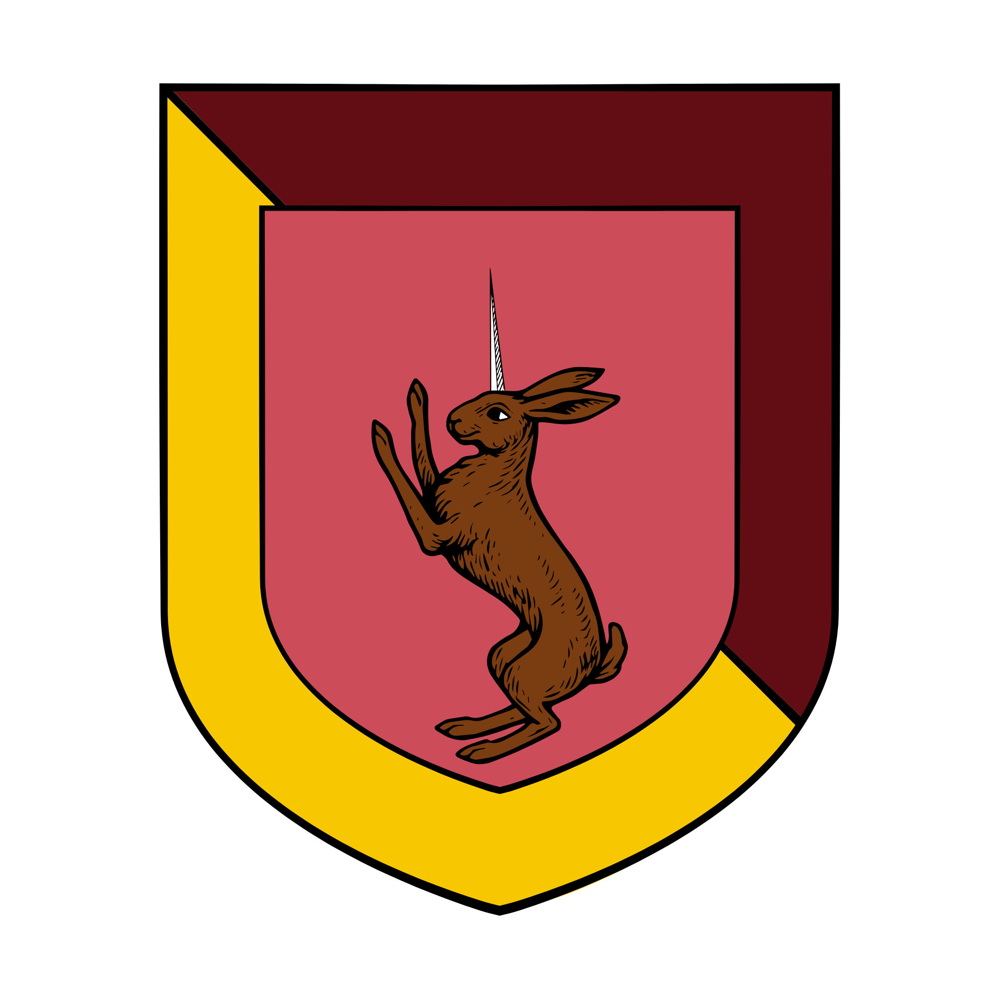

%%  
[[Zuhurism]]   
[[Gorat]]   
[[Jateš]]   
[[Plašato]]   
[[Twintail Imperium]]   
[[Black Powder]]   
[[Tucao Chuwen]]   
[[Kubil no Vang]]   
[[Liandar]]   
%%  

  
 <h4 class="wiki-header">City of Sredit</h4>  
 
  
 <strong>Government</strong>  
 Patrician Republic  
 
  
 
  
 <strong>Head of State</strong>  
 Princeps Dženana Pomili  
 
  
 
  
 <strong>Capital</strong>  
 Sredit  
 
  
 
  
 <strong>Heraldic Symbol</strong>  
 Zecorog on Red & Gold  
 
  
 
  
 
  
 <strong>Primary Religion</strong>  
 <a href="Zuhurism" class="internal-link">Zuhurism</a>  
 
  
 
  
 <strong>Primary Culture</strong>  
 <a href="Gorati" class="internal-link">Gorati</a> <a href="Human" class="internal-link">Human</a>  
 
  
 
  
 <strong>Official Language</strong>  
 Yezepri  
 
  
 
  
 
  
 <strong>Preceded by</strong>  
 <a href="Jateš" class="internal-link">Duchy of Jateš</a>  
 
  
 
  
 <strong>Formed</strong>  
 880PA  
 
  
   

  

The Free City of Sredit is a patrician republic at the mouth of the Mustar River on the Gavivag Bay, in the north of <a href="Gorat" class="internal-link">Gorat</a>. Once known as the pearl of <a href="Jateš" class="internal-link">Jateš</a>, it renounced the overlordship of the duchy in 880PA with the backing of the <a href="Twintail Imperium" class="internal-link">Twintail Imperium</a>, and it has remained independent under Shirin protection ever since. The city is famed for its great harbour and its lighthouse, the Dinaji Pillar, and is home to the Muri Banking Institute, the largest house of moneylenders in Gorat. Jateš has never accepted the loss of Sredit, and its desire to regain the city is the greatest source of conflict in the region.
  
<h2>Geography</h2>  

Sredit lies where the Mustar River, which divides the north of Gorat into the Gorati Highlands and the Mustar Peaks, flows into the Gavivag Bay. Its large harbour is the natural port for the trade of the Mustar valley and for Shirin merchants coming south from the Imperium, and its lighthouse, the Dinaji Pillar, shines brighter than any other on the bay. The country around the city, known as the Sredit Greenlands, is the frontier between the Free City and Jateš.
  
<h2>History</h2>  

For most of its history Sredit belonged to Jateš and was the richest city of the duchy. In the late 9th century the tobacco tax that Jateš levied on Shirin merchants coming from the north was raised again and again, driven by the influence of Zeprian politicians at the court of Jateš. The rich patricians of the city, who lived from that trade, found support in the Twintail Imperium, which promised them experimental Huling weapons, great ships and protection should <a href="Plašato" class="internal-link">Plašato</a> support Jateš in an attempt at reconquest. Confident of that guarantee, the patricians denounced the overlordship of Jateš in 880PA in what became known as the Sredit Incident. The secession also drew on the old rivalry of the Mustari, who make up most of the city, with the Kraguvci who dominate the duchy.
  

Since then the guarantee of the Imperium has kept Jateš from marching on the city. In recent years semi-official hirelings and warriors of Jateš and Sredit have fought open skirmishes in the Sredit Greenlands, but the Shirin have so far not ventured beyond the city itself, and the situation is widely seen as a powder keg waiting to explode.
  
<h2>Government</h2>  

Sredit is led by the Princeps of Sredit, who is elected for a term of five years and may never hold the office again. The Princeps is chosen by the Familia Srediti, the great council of the city, made up of its traders, guild members and wealthy citizens, whose merchant houses dominate the affairs of the republic. The current Princeps is Dženana Pomili of the Pomili family, the owners of the Pomili Kontor, who are among the most respected and powerful houses of the city and are investors and leading figures in the Muri Banking Institute.
  
<h2>The Twintail Presence</h2>  

The 2nd and 3rd Cohorts of the 5th Legion of the Twintail Imperium are currently stationed at Sredit, together with the Ting Fleet, under the local command of Admiral <a href="Tucao Chuwen" class="internal-link">Tucao Chuwen</a>, who arrived in late 926PA, a personal appointee and loyalist of <a href="Kubil no Vang" class="internal-link">Kubil no Vang</a>, the Commander of the Southern Legions. Tucao is formally a guest of the city and spends most of his time aboard his flagship, the Sixth Heaven, but his presence is the main reason Jateš has not retaken Sredit, and he is inarguably the most powerful person in the city, holding the balance of power in his claws.
  

The largest and heaviest galleons of the Ting Fleet carry Huling throwers, early cannons fired with <a href="Black Powder" class="internal-link">black powder</a>, though they are far less manoeuvrable near the rocky shores of Gorat than the Gorati galleys. It is rumoured that Tucao has also brought experimental weapons of war to the city, guarded by a contingent of alchemists of the <a href="Liandar" class="internal-link">Liandar</a> and possibly related to the Huling.
  
<h2>Economy and Society</h2>  

The wealth of Sredit comes from trade, above all the tobacco and other goods carried by Shirin merchants from the north, and the carpets and rugs woven by the Mustari along the river. The Muri Banking Institute, known as the MBI, is the largest group of moneylenders in Gorat. Although mercenary companies are less common in Nirydia than in Ilrakhan, various small bands of soldiers of fortune and adventurers for hire have been employed by the Institute, and through it by the city itself.
  

Most of the people of Sredit are Mustari, known among the <a href="Gorati" class="internal-link">Gorati</a> for their humour, their many feast days and their closeness to the Shirin, for which their Kraguvci rivals mock them as rat lovers and tail lickers. The Zecorog, the large horned hare on the arms of the city, is a common sight in the surrounding hills, and its horns are prized in alchemy.
  
