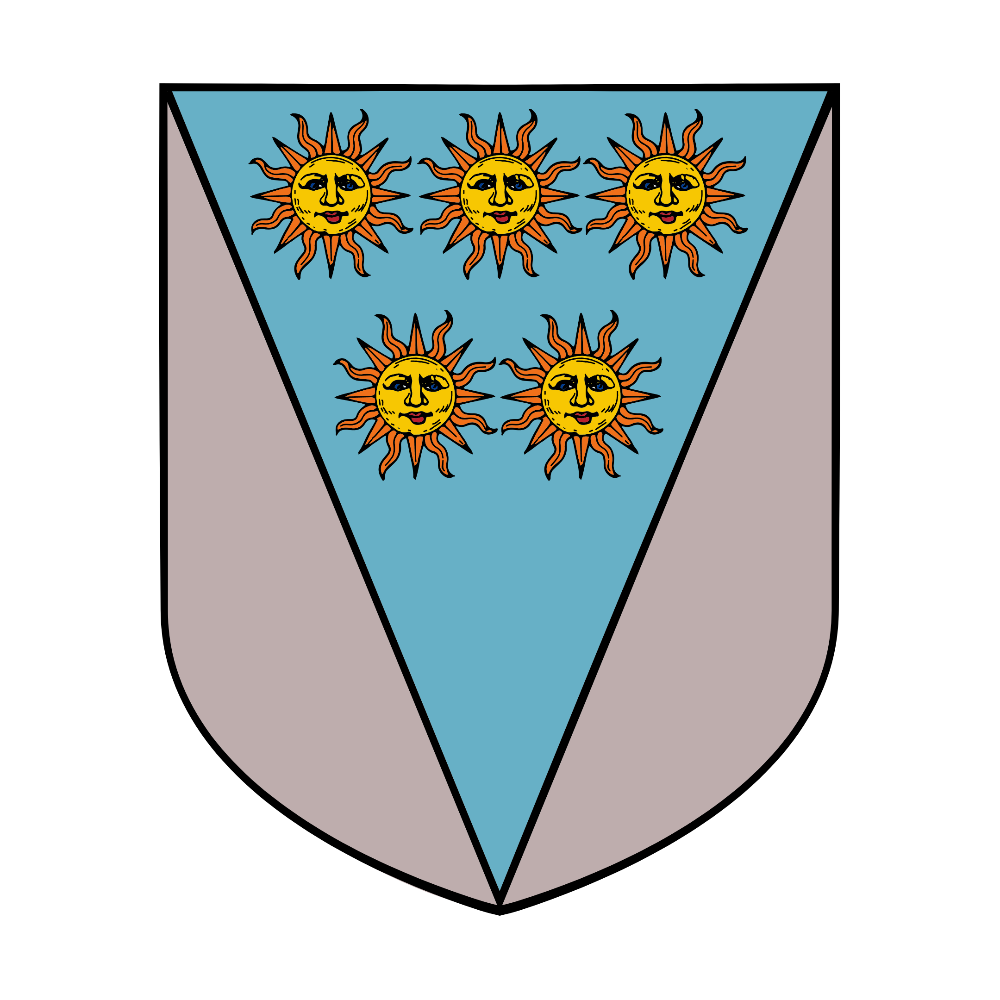

%%   
[[Zuhurism]]   
[[Zepria]]   
[[Gorat]]   
[[Gorati]]   
[[Plašato]]  
[[Ruginë]]  
[[Velvet Caravan]]  
[[Suzana Dragović]]  
%%   

  
 <h4 class="wiki-header">League of Tirata</h4>  
 
  
 <strong>Government</strong>  
 Canton  
 
  
 
  
 <strong>Head of State</strong>  
 N/A  
 
  
 
  
 <strong>Capital</strong>  
 N/A  
 
  
 
  
 <strong>Heraldic Symbol</strong>  
 5 Suns over a Valley  
 
  
 
  
 
  
 <strong>Primary Religion</strong>  
 <a href="Zuhurism" class="internal-link">Zuhurism</a>  
 
  
 
  
 <strong>Primary Culture</strong>  
 <a href="Gorati" class="internal-link">Zepri</a> & <a href="Gorati" class="internal-link">Opmani</a>  <a href="Human" class="internal-link">Human</a>  
 
  
 
  
 <strong>Official Language</strong>  
 Yezepri  
 
  
 
  
 
  
 <strong>Preceded by</strong>  
 <a href="Zepria" class="internal-link">Zeprian Empire</a>  
 
  
 
  
 <strong>Formed</strong>  
 618PA  
 
  
   

  

The League of Tirata is a confederation of cantons in the higher valleys of the Limsul Peaks in <a href="Gorat" class="internal-link">Gorat</a>, west and south-west of the Kingdom of <a href="Plašato" class="internal-link">Plašato</a> and north of the Principality of <a href="Ruginë" class="internal-link">Ruginë</a>. Its people are drawn from two of the Gorati peoples, the Zepri and the Opmani, who live side by side in its valleys. The League was born in a revolt against the <a href="Zepria" class="internal-link">Zeprian Empire</a> between 616PA and 618PA, during the rule of Emperor Zižka II, and it has kept its freedom ever since. It has neither a capital nor a single ruler, and its cantons govern themselves while sending envoys to a common assembly. Its five suns recall the five valleys that first swore to stand together against the Empire.
   
<h2>Geography</h2>   

Tirata lies in the high valleys of the Limsul Peaks between the mountain lands of Plašato to the east and the valleys of Ruginë to the south. Its cantons are mostly single valleys, divided from one another by high ridges and joined by passes that are closed by snow for much of the winter. The most important of these routes is the mountain road that runs from the Plašati highlands through the valleys of Tirata towards Ruginë and the Velvet Road. The eastern cantons are mostly Zepri and the southern cantons mostly Opmani, while the central valley of Tirata, which gave the League its name, is shared by both.
   
<h2>History</h2>   
<h3>Under the Empire</h3>   

The high valleys were settled by Zepri herders and miners from the lowlands and by Opmani from the south, and they came under Zeprian rule during the conquests of <a href="Suzana Dragović" class="internal-link">Suzana Dragović</a>. The Empire governed them through imperial reeves, who collected taxes and levies for Plavigrad but otherwise left the valleys largely to themselves. This changed after the end of the Golden Age. Under Emperor Jožek the terrible harvests and the Nighmilk Plague of 591PA to 594PA emptied the imperial treasury, and under his son Zižka II the reeves of the mountains raised the taxes and levies of the valleys again and again and ruled them with growing harshness.
   
<h3>The Revolt of the Valleys</h3>   

According to the tradition of the League, the revolt began in 616PA in the valley of Tirata, where the reeve Stanimir Lozić had the stag's head of the Empire raised on a pole in the market place and ordered every passer-by to bow before it. The hunter Ivo Tetivić, an archer famous throughout the valleys, refused. As punishment Lozić forced him to shoot an apple from the head of his own son with his crossbow, and when Ivo had made the shot and was asked why he had taken a second bolt from his quiver, he answered that it had been meant for the reeve had he missed. He was thrown into chains, escaped, and later killed Lozić from ambush on a narrow mountain road.
   

The killing of the reeve set the valleys alight. In the same year envoys of five valleys, Zepri and Opmani alike, met at dawn on the meadow of Zorište and swore to stand together against the Empire and to defend one another as brothers. The Oath of Zorište is regarded as the founding of the League, and according to legend it was sworn as the sun rose over the five peaks around the meadow, which became the five suns of its banner. In 617PA Zižka II sent an imperial army into the mountains to restore his rule, but in the Ledena Gorge the men of the valleys rolled rocks and tree trunks down upon the column and routed it. In 618PA, with the Empire weakened and the First <a href="Zuhuri Holy Wars" class="internal-link">Holy War</a> already looming, the Emperor withdrew his reeves and left the valleys to themselves, and the League of Tirata dates its freedom from that year.
   
<h3>After the Revolt</h3>   

The League was never brought back under imperial rule, and in the following decades further valleys joined the five founding cantons. Together with Ruginë, Tirata stood as proof that the armies of Plavigrad could be beaten in the mountains, and in the long decline of the Empire its example was not forgotten among the Opmani of the south. After the fall of the Empire in 767PA Plašato laid claim to the inheritance of Zepria, and with it to the valleys of Tirata, but no Ubrut of Plašato has ever tried to enforce this claim by force of arms.
   
<h2>Government</h2>   

Each canton of the League governs itself. Its free households gather once a year in an open-air assembly on the field of the canton, where they make its laws and elect its župan, who leads the canton for a fixed term. The cantons send envoys to the Sabor, the common assembly of the League, which decides on war and peace, the defence of the passes and the dealings of the League with foreign powers. The Sabor has no fixed seat and meets in turn in each of the cantons, and the League has neither a capital nor a single head of state. No noble house holds power in Tirata, as the imperial lords of the valleys were driven out during the revolt.
   
<h2>Society</h2>   

The Zepri and Opmani of Tirata share a strong sense of freedom and a deep distrust of lowland lords. Yezepri is the language of the Sabor and of the League as a whole, while many of the Opmani cantons speak Firhë at home and keep the customs of the Nadvok in their own valleys. Most of the people of the League are devout followers of <a href="Zuhurism" class="internal-link">Zuhurism</a>, and the dawn on which the Oath of Zorište was sworn is remembered in every canton as a sign that Pen Zuhur looked on the revolt with favour. Every free household keeps a crossbow in memory of Ivo Tetivić, and the shooting festivals held in his honour each year in the cantons are the greatest feasts of the League.
   

Tirata keeps no standing army, but every free household of the League is bound to send its men to defend the passes, and its crossbowmen are regarded as among the finest in Gorat. Like Ruginë, the League stays out of the wars of the lowland realms and holds to a strict neutrality, though companies of its crossbowmen often serve abroad as mercenaries.
   

The valleys of Tirata live from herding, dairy farming and timber, and from mines of silver and iron in the mountains. The League also profits from the mountain road through its valleys, by which goods from Plašato reach Ruginë and the <a href="Velvet Caravan" class="internal-link">Velvet Road</a> without passing through Amlija, and from the tolls and hospices along its passes. The crossbows of its workshops are sold throughout Gorat.
   

Tirata is on good terms with Ruginë, with whose Opmani many of its own people share kinship and whose defiance of the Empire it shares. Its relations with Plašato are uneasy. The Kingdom has never given up its claim to the valleys, but it depends on the road through Tirata for its trade with the Velvet Road, and the League in turn depends on the markets of Plašato for its silver, timber and cheese.
