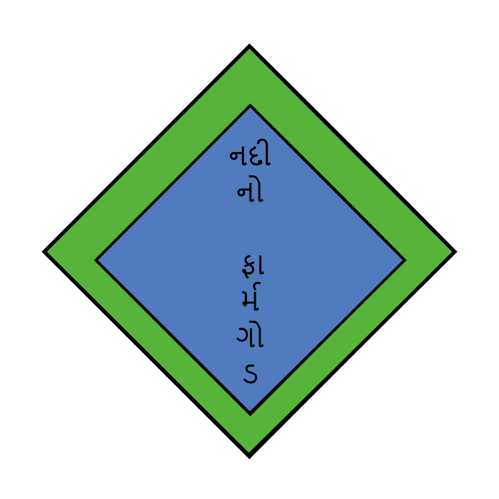

%%  
[[Bihra]] [[Bihra Shamanism]] [[Niryd Steppe]] [[Great Khaganates of the Steppe]]  
[[Jigallor Khaganate]] [[Duol Khaganate]] [[Kherova]]  
%%  

  
 <h4 class="wiki-header">Anatai Khaganate</h4>  
 
  
 <strong>Government</strong>  
 Bihra Khaganate  
 
  
 
  
 <strong>Head of State</strong>  
 Khan Tumbelek Anatai  
 
  
 
  
 <strong>Capital</strong>  
 Ebrekai  
 
  
 
  
 <strong>Heraldic Symbol</strong>  
 Rune of Anatai  
 
  
 
  
 
  
 <strong>Primary Religion</strong>  
 <a href="Bihra Shamanism" class="internal-link">Bihra Shamanism</a>  
 
  
 
  
 <strong>Primary Culture</strong>  
 Steppe <a href="Bihra" class="internal-link">Bihra</a>  
 
  
 
  
 <strong>Official Language</strong>  
 Lihbare  
 
  
 
  
 
  
 <strong>Preceded by</strong>  
 <a href="Jigallor Khaganate" class="internal-link">Jigallor Khaganate</a>  
 
  
 
  
 <strong>Formed</strong>  
 ca. 796PA  
 
  
   

  

The Anatai Khaganate is one of the four great Khaganates of the Steppe <a href="Bihra" class="internal-link">Bihra</a> and holds the western <a href="Niryd Steppe" class="internal-link">Niryd Steppe</a> and the shores of the Shavai Lakes in the north. More than any other Khaganate the Anatai are farmer and slaver lords, whose wealth rests on the great homesteads around the lakes and the slaves who work them. Its current ruler is Khan Tumbelek Anatai, said to be the richest slaver of the steppe.
  
<h2>Geography</h2>  

The Anatai hold the lands between the Shavai Lakes, the largest lakes of the northern steppe, and the wastes of Thamiras Rest in the west, where their riders contest the ground with Kherovan warrior bands and the lesser factions of the steppe. Around the lakes the Aspira gives way to fields and pastures, and here lie some of the largest homesteads of the steppe, worked by tributary farmers and slaves. Unlike most Khaganates the Anatai keep a fixed seat at Ebrekai, a stronghold on the lake shore, though the court of the Khan moves between the great estates through the year.
  
<h2>History</h2>  

The Anatai Khaganate was founded around 796PA, when the heirs of the <a href="Jigallor Khaganate" class="internal-link">Jigallor</a> divided the horde after the fall of the last Great Khan at Adsal two years earlier. In 851PA the Anatai Khan accepted the <a href="Duol Khaganate" class="internal-link">Duol</a> Khan as overlord, but during the 880s the Anatai refused the Duol service, and since then they have recognised no Khan above their own.
  
<h2>Economy and society</h2>  

The Anatai depend less on their herds than the other Khaganates. Their homesteads grow grain and keep vast herds of <a href="Auroch" class="internal-link">Aurochs</a>, and are worked by Zibihra, humans and goblins, most of them slaves taken in raids on the frontiers of <a href="Kherova" class="internal-link">Kherova</a> and the lesser tribes or bought from the other Khaganates. The great slaver families of the Anatai rank among the most powerful lords of the steppe, and the Khan himself owns more slaves than any other ruler of the Steppe Bihra. The Anatai still hold to <a href="Bihra Shamanism" class="internal-link">Bihra Shamanism</a> and the triumph of the physical, but other Steppe Bihra often mock them as half settled, lords of fields rather than of the open grass.
  
