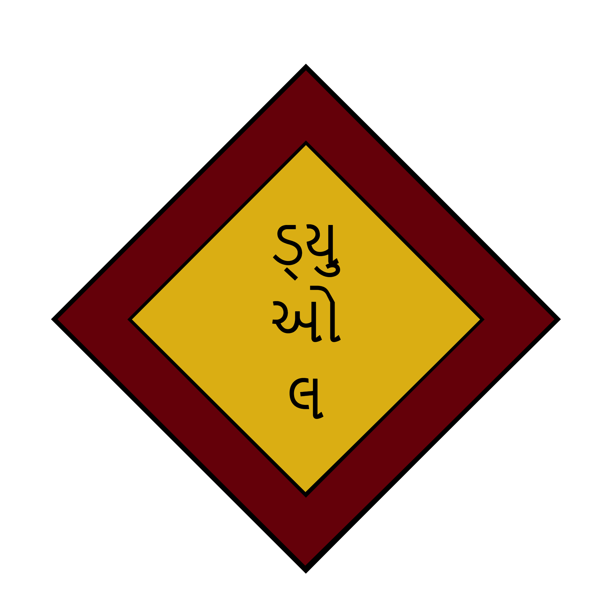

%%  
[[Bihra]] [[Bihra Shamanism]] [[Niryd Steppe]] [[Great Khaganates of the Steppe]]  
[[Jigallor Khaganate]] [[Orsogai Duol]]  
[[Kareli Hierarchy]] [[Kherova]] [[Roxeria]] [[Ganoa Valley]]  
%%  

  
 <h4 class="wiki-header">Duol Khaganate</h4>  
 
  
 <strong>Government</strong>  
 Bihra Khaganate  
 
  
 
  
 <strong>Head of State</strong>  
 Khan <a href="Orsogai Duol" class="internal-link">Orsogai Duol</a>  
 
  
 
  
 <strong>Capital</strong>  
 Duol Rabad  
 
  
 
  
 <strong>Heraldic Symbol</strong>  
 Rune of Duol  
 
  
 
  
 
  
 <strong>Primary Religion</strong>  
 <a href="Bihra Shamanism" class="internal-link">Bihra Shamanism</a>  
 
  
 
  
 <strong>Primary Culture</strong>  
 Steppe <a href="Bihra" class="internal-link">Bihra</a>  
 
  
 
  
 <strong>Official Language</strong>  
 Lihbare  
 
  
 
  
 
  
 <strong>Preceded by</strong>  
 <a href="Jigallor Khaganate" class="internal-link">Jigallor Khaganate</a>  
 
  
 
  
 <strong>Formed</strong>  
 851PA  
 
  
   

  

The Duol Khaganate is the largest and most powerful of the four great Khaganates of the Steppe <a href="Bihra" class="internal-link">Bihra</a> in the modern day, holding the southern and south-western <a href="Niryd Steppe" class="internal-link">Niryd Steppe</a> from its administrative centre, the massive encampment of Duol Rabad on the Cliffs of Rabad. Founded by heirs of the <a href="Jigallor Khaganate" class="internal-link">Jigallor</a>, it rose to primacy over the other Khaganates in 851PA, and although they have long since refused it service, its Khans still style themselves the Khan of Khans. The current Khan is <a href="Orsogai Duol" class="internal-link">Orsogai Duol</a>, called Ogujan, the Invincible.
  
<h2>Geography</h2>  

The lands of the Duol lie in the south of the steppe, where the grass begins to soften towards the Forbidden Lands. They reach from the lower course of the Agav River in the west to the hills above the Kolrog Highlands in the east, and in the south to the edge of the <a href="Blodrise Dark" class="internal-link">Blodrise Dark</a> and the approaches to <a href="Roxeria" class="internal-link">Roxeria</a> at Fort Mun. Duol Rabad stands on the Cliffs of Rabad in the south-western steppe and is the only permanent seat of the Khaganate. Around a core of standing camps the walking cities of the Duol gather there each year, carried on the backs of the oldest salamanders, so that its size swells and shrinks with the seasons.
  
<h2>History</h2>  

After the last Jigallor fell at the Battle of Adsal in 794PA his heirs divided the horde between them, and the line that would become the Duol took the southern steppe. In 851PA its Khan was acclaimed as overlord by the other great Bihra of the steppe, and for a time the Duol Khan was served by the Khans of the Anatai, Yadu and Gökol. This primacy was never proven in battle or single combat in the manner of the old Great Khans, and in the following decades the other Khaganates refused the Duol service one after another, until all four had become rivals.
  

Bands of Steppe Bihra from the Duol lands served as mercenaries on both sides of the war between Jink and Majir in the <a href="Ganoa Valley" class="internal-link">Ganoa Valley</a> between 893PA and 895PA, and many of them settled in Majir after the truce. In recent years, under Khan Orsogai, the Duol have once again consolidated their lesser Khans and renewed their raids on the <a href="Kareli Hierarchy" class="internal-link">Kareli Hierarchy</a>.
  
<h2>Politics</h2>  

The Duol Khan rules through the lesser Khans and chieftains of the southern steppe, who owe him service in war and a share of their herds and plunder. The title of Khan of Khans, claimed since 851PA, is recognised by no other Khaganate, but it remains the foundation of the Duol claim to the whole steppe. Like the other Khaganates the Duol hold tributaries of their own, among them river communities of the lower Agav, where Zibihra, humans and goblins, many of them slaves, farm rice for the Khans. Many of the Inive of the Forbidden Lands also pay tribute to the Duol.
  
<h2>Relations</h2>  

The Duol are the Khaganate that the southern realms of <a href="Nirydia" class="internal-link">Nirydia</a> know best. Their raids threaten the northern lands of the Kareli Hierarchy, and Roxeria refuses all trade with the Steppe Bihra and guards its northern approaches at Fort Mun. The cities of the Ganoa Valley trade with them openly by the Rainpath, the road through the valleys of the upper Tandi. In the west the Duol share the long enmity of all Steppe Bihra with <a href="Kherova" class="internal-link">Kherova</a>, while the Anatai, Yadu and Gökol are their rivals for the inheritance of the Jigallor.
  
