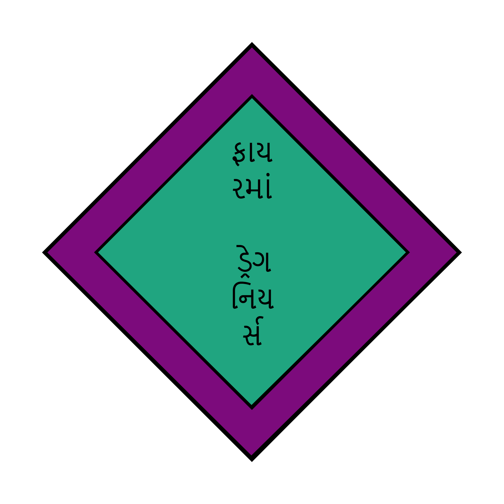

%%  
[[Bihra]] [[Bihra Shamanism]] [[Niryd Steppe]] [[Great Khaganates of the Steppe]]  
[[Jigallor Khaganate]] [[Duol Khaganate]] [[Tizin-Kol]] [[Pintrixaz]] [[Lugosch]] [[Jorvistan]]  
%%  

  
 <h4 class="wiki-header">Gökol Khaganate</h4>  
 
  
 <strong>Government</strong>  
 Bihra Khaganate  
 
  
 
  
 <strong>Head of State</strong>  
 Khan Tasgal Gökol  
 
  
 
  
 <strong>Capital</strong>  
 none  
 
  
 
  
 <strong>Heraldic Symbol</strong>  
 Rune of Gökol  
 
  
 
  
 
  
 <strong>Primary Religion</strong>  
 <a href="Bihra Shamanism" class="internal-link">Bihra Shamanism</a>  
 
  
 
  
 <strong>Primary Culture</strong>  
 Steppe <a href="Bihra" class="internal-link">Bihra</a>  
 
  
 
  
 <strong>Official Language</strong>  
 Lihbare  
 
  
 
  
 
  
 <strong>Preceded by</strong>  
 <a href="Jigallor Khaganate" class="internal-link">Jigallor Khaganate</a>  
 
  
 
  
 <strong>Formed</strong>  
 ca. 802PA  
 
  
   

  

The Gökol Khaganate is one of the four great Khaganates of the Steppe <a href="Bihra" class="internal-link">Bihra</a> and holds the north-western <a href="Niryd Steppe" class="internal-link">Niryd Steppe</a> between Mount Ithel and the foothills of the Mistspires. The Gökol are the most mercantile of the Khaganates, though no less warlike than the others, and have long been allied with the goblin caravans of <a href="Pintrixaz" class="internal-link">Pintrixaz</a> and the hobgoblins of the northern mountain slopes. They are at war with the dwarves of <a href="Tizin-Kol" class="internal-link">Tizin-Kol</a>. Their current ruler is Khan Tasgal Gökol.
  
<h2>Geography</h2>  

The Gökol hold the north-western grasslands, where the steppe rises towards Mount Ithel and the Mistspires. They keep no single seat. The Khan spends the summer in the camps around Mount Ithel and winters at the great trading camp where the caravans from Pintrixaz and the north come down onto the steppe. In the far west of their lands lies Zian Station, where the dwarves of Tizin-Kol have dammed the waters to harness their power and flooded the land into an artificial swamp that drowns the Aspira.
  
<h2>History</h2>  

The Gökol Khaganate was founded around 802PA by heirs of the <a href="Jigallor Khaganate" class="internal-link">Jigallor</a>. It accepted the overlordship of the <a href="Duol Khaganate" class="internal-link">Duol</a> in 851PA, but grown wealthy on the caravan trade it was the first of the great Khaganates to refuse the Duol service, in the 870s.
  

The currentbending dwarves of Tizin-Kol claim the surface lands above their holds, and their dam at Zian Station, begun in the 890s, flooded grazing land and caravan routes of the Gökol. Open war broke out around 910PA, and it has since settled into a long state of war, with Gökol raids on the dam works met by the defences of the dwarves.
  
<h2>Trade and alliances</h2>  

The wealth of the Gökol comes from the caravans that cross their lands. They have long been allied with the goblin caravans of Pintrixaz and with others from further afield, and north of <a href="Jorvistan" class="internal-link">Jorvistan</a> with the hobgoblins of the mountain slopes all the way up to <a href="Lugosch" class="internal-link">Lugosch</a>. Gökol riders guard the caravans across the steppe and take a share of their goods, and the trading camps of the Khaganate are among the few places where foreign merchants can meet the Steppe Bihra in safety. Steel, tools and goods from the north pass through Gökol hands to the rest of the steppe, and the Gökol use this wealth to arm their hosts as well as any Khaganate.
  
