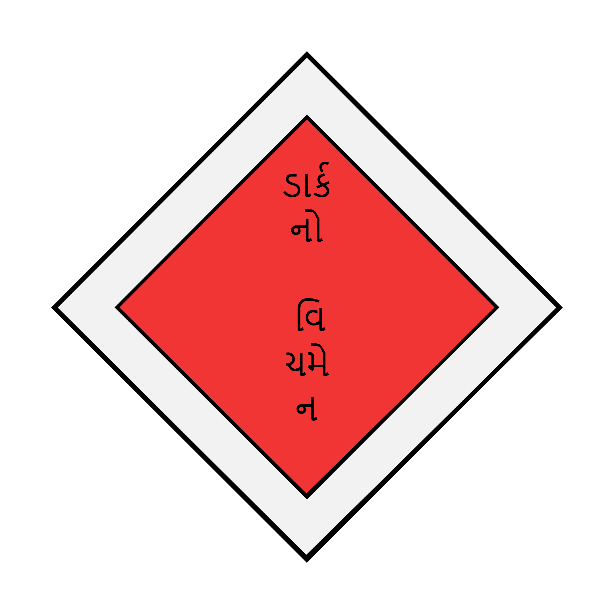

%%  
 [[Bihra Shamanism]] [[Niryd Steppe]] [[Great Khaganates of the Steppe]]  [[Steppe Bihra]]
[[Jigallor Khaganate]] [[Duol Khaganate]] [[Twintail Imperium]] [[Red Iron Towers]]  
%%  

  
 <h4 class="wiki-header">Yadu Khaganate</h4>  
 
  
 <strong>Government</strong>  
 Bihra Khaganate  
 
  
 
  
 <strong>Head of State</strong>  
 Khan Ulzana the Thrice-Headed  
 
  
 
  
 <strong>Capital</strong>  
 none  
 
  
 
  
 <strong>Heraldic Symbol</strong>  
 Rune of Yadu  
 
  
 
  
 
  
 <strong>Primary Religion</strong>  
 <a href="Bihra Shamanism" class="internal-link">Bihra Shamanism</a>  
 
  
 
  
 <strong>Primary Culture</strong>  
 <a href="Steppe Bihra" class="internal-link">Steppe Bihra</a>  
 
  
 
  
 <strong>Official Language</strong>  
 Lihbare  
 
  
 
  
 
  
 <strong>Preceded by</strong>  
 <a href="Jigallor Khaganate" class="internal-link">Jigallor Khaganate</a>  
 
  
 
  
 <strong>Formed</strong>  
 ca. 798PA  
 
  
   

  

The Yadu Khaganate is one of the four great Khaganates of the Steppe <a href="Bihra" class="internal-link">Bihra</a> and holds the central and northern <a href="Niryd Steppe" class="internal-link">Niryd Steppe</a> facing the <a href="Red Iron Towers" class="internal-link">Red Iron Towers</a>. The Yadu are the most warlike and the most shamanic of the Khaganates, famed for their witches and for the strength of their casters, and they are the eternal enemies of the <a href="Twintail Imperium" class="internal-link">Twintail Imperium</a>. Their current ruler is Khan Ulzana the Thrice-Headed, a witch who bears three heads.
  
<h2>Geography</h2>  

The lands of the Yadu stretch from the lakes and upper waters of the Agav River in the heart of the steppe north to the trench and towers of the Twintail. The Yadu keep no fixed seat. Their Khan travels with a moving court of shamans and walking cities, which gathers at the sacred sites of <a href="Bihra Shamanism" class="internal-link">Bihra Shamanism</a> along the lakes and rivers of the central steppe.
  
<h2>History</h2>  

The Yadu Khaganate was founded around 798PA, in the years after the heirs of the <a href="Jigallor Khaganate" class="internal-link">Jigallor</a> divided the horde. It accepted the overlordship of the <a href="Duol Khaganate" class="internal-link">Duol</a> in 851PA and was the last of the great Khaganates to refuse it service, around 896PA.
  

The Yadu have warred with the Twintail for as long as they have existed, and in the early 10th century their vassals bore the brunt of the fighting. In 912PA the Elek, vassals of the Yadu, took the mountains and hills between the steppe and the Gorati Highlands with large hosts, keeping to the high ground to avoid the Shirin legions and spilling into the lands of <a href="Jateš" class="internal-link">Jateš</a> and the Mustari. Two years later the Tuchewa, who had held a contested zone south of the Tower line for several decades, were destroyed by <a href="Kubil no Vang" class="internal-link">Kubil no Vang</a> at the Battle of the Amethyst Caverns in 914PA.
  
<h2>Society</h2>  

Among the Yadu the shamans hold greater power than in any other Khaganate, and the Khan is as much the first of the shamans as the first of the warriors. Their witches are feared across the steppe and beyond it for their weather rites, their spirit journeys and the curses they are said to lay on their enemies, and Yadu casters ride with every host that goes to war. Like all Steppe Bihra the Yadu honour the most mutated among them, and Ulzana, whose three heads are held to house three higher souls, is revered by her people as a living proof of the triumph of the physical.
  
