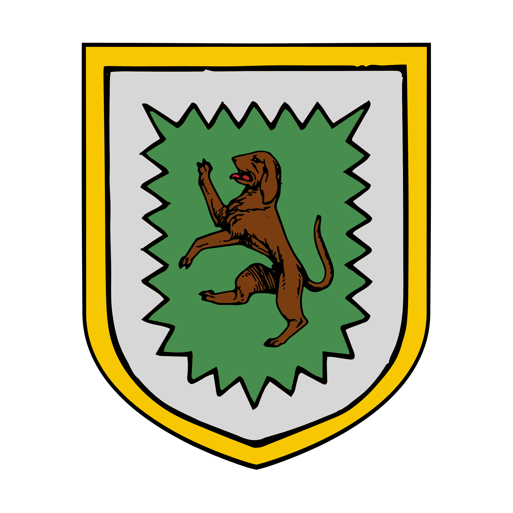
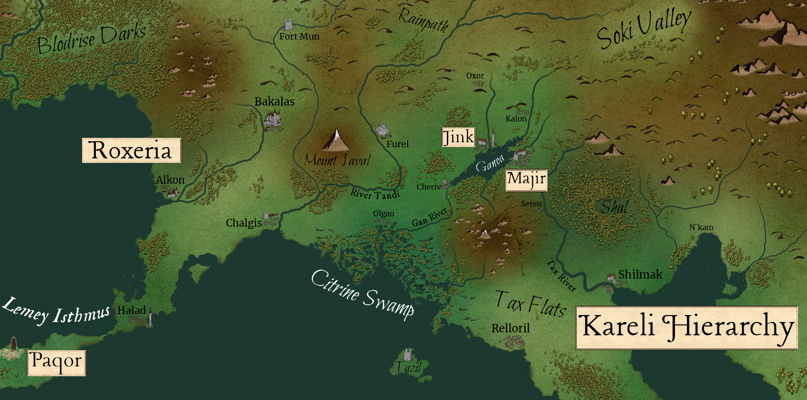

%%  
[[Kareli Hierarchy]]  
[[Paqor]]  
[[Duol Khaganate]]  
[[Revolution of Rox]]  
[[Azuvke]]  
[[Javalim]]  
[[Rox]]  
[[Fenhir]]  
[[Ganoan]]  
[[Roxerian Glass]]  
[[Ral]]  
[[Blodrise Dark]]  
[[Cinderstone Temple]]  
[[Ganoa Valley]]  
[[Vol]]  
[[Kherovan Inquisition]]  
[[Mystics Guild]]  
[[Karaluk]]  
%%  

  
 <h4 class="wiki-header">The Chosen Realm of Roxeria</h4>  
 
  
 <strong>Government</strong>  
 Divine Monarchy  
 
  
 
  
 <strong>Head of State</strong>  
 Lord Meadaz Rox II  
 
  
 
  
 <strong>Capital</strong>  
 Bakalas  
 
  
 
  
 <strong>Heraldic Symbol</strong>  
 Dog on Field  
 
  
 
  
 
  
 <strong>Primary Religion</strong>  
 <a href="Javalim" class="internal-link">Javalim</a>  
 
  
 
  
 <strong>Primary Culture</strong>  
 <a href="Kheri" class="internal-link">Roxanae</a> <a href="Human" class="internal-link">Human</a>, Kareli <a href="Bihra" class="internal-link">Bihra</a>, <a href="Ganoan" class="internal-link">Ganoan</a> <a href="Human" class="internal-link">Human</a>,  Qahorii <a href="Orc" class="internal-link">Orcs</a>  
 
  
 
  
 <strong>Official Language</strong>  
 Kheri  
 
  
 
  
 
  
 <strong>Preceded by</strong>  
 <a href="Azuvke" class="internal-link">Khatrym of Azuvke</a>  
 
  
 
  
 <strong>Formed</strong>  
 564PA  
 
  
   

  

Sitting on the eastern shores of the Bay of Azuvke is the chosen Realm of Roxeria, the successors of the <a href="Revolution of Rox" class="internal-link">Revolution of Rox</a> that led a religious revolt against their overlords in the <a href="Azuvke" class="internal-link">Khatrym of Azuvke</a> to the west. Over the course of three centuries Roxeria has grown into a power of its own, independent and industrious with a unique culture, clearly distinct from their kurini cousins from across the sea. The country is famed abroad for its <a href="Roxerian Glass" class="internal-link">glass</a>, whose Mirrormasters are sought after as far as the Elbae Sultanate.
  

These so called Roxanae are kheri that, while offering many changed facets otherwise, most distinctively differentiate themselves in their religious beliefs, infamously the cinder that set the Revolution on Fire as well. They believe in the <a href="Javalim" class="internal-link">Javalim</a> and the divinity of "the One", that they are his chosen people on this earth and ordained to safeguard his holy sites, such as the Pillar on Mount Javal or the Divine Tears within <a href="Cinderstone Temple" class="internal-link">Cinderstone Temple</a> on the isle of Tazil. The revolution of Rox came to be as the two siblings, <a href="Fenhir" class="internal-link">Fenhir</a> and <a href="Rox" class="internal-link">Rox</a>, emerged from the Sincali Moors, the older Fenhir as a prophet and seer of the future, the younger Rox as his chosen and divinely ordained hero. Together they led the foundations for what would later become Roxeria and are still viewed as the national heroes of the country today.
  
<h2>Geography</h2>  

Roxeria stretches along the eastern shore of the Bay of Azuv, from the edge of the <a href="Blodrise Dark" class="internal-link">Blodrise Dark</a> in the north-west down to the Lemey Isthmus in the south. The forest, feared across the south for its werewolves, lies north of Bakalas, and Roxeria claims its southern margins. The capital, Bakalas, lies inland on the Folok River, while the realm's sea trade runs through its two great ports, Alkon on the bay and Chalgis on the southern coast. Chalgis is the largest city of Roxeria and the commercial heart of the country. In the north Fort Mun guards the upper river valleys and the approaches from the steppe, and in the east Furel, the City of Spears, stands on the western bank of the Tandi River, which divides Roxeria from the <a href="Ganoa Valley" class="internal-link">Ganoa Valley</a>. Between Bakalas and Furel rises Mount Javal, on whose summit stands the Pillar of the One.
  

In the south the Lemey Isthmus runs out towards the free city of <a href="Paqor" class="internal-link">Paqor</a>. On it lies Halad, the old Uzra Vol, once the capital of the Bihra <a href="Vol" class="internal-link">Empire of Vol</a> and today home to most of Roxeria's Bihra. Near the city stands an old shrine to Pihal-biim, the Lord of Dreams of the <a href="Karaluk" class="internal-link">Karaluk</a>, which the Bihra of Halad have kept since long before the revolution and to which pilgrims come from across the south. It is the only place in Roxeria where one of the Greats is openly worshipped, and the temples of the One tolerate it as a relic older than the realm itself. Off the southern coast lies the isle of Tazil, whose <a href="Cinderstone Temple" class="internal-link">Cinderstone Temple</a> is unofficially counted as part of the realm. Some clans of <a href="Ral" class="internal-link">Ral</a> shifters live among the Roxanae as well, although they keep largely to themselves, and a minority of <a href="Ganoan" class="internal-link">Ganoans</a>, who have taken up the Javalim, lives mostly in the east around Furel.
  

    

<small><i>Map of the Ganoa Valley & Roxeria in the year 927PA</i></small>  
<h2>Government</h2>  

Roxeria is ruled by the Lords of the line of Rox, descended from Harax Rox I, the son of Rox the Chosen, who took his mother's name as his own. Each Lord carries the name of Rox, and the present Lord is Meadaz Rox II. In practice, however, the Lord has become largely a figurehead. The true power of the realm lies with the Great Seer, the holder of the office first held by Fenhir, who heads the faith of the Javalim and confirms every heir to the throne with a Seeing before the coronation. A Lord who is not seen is not crowned, and the Seer is commonly held to be the most powerful political figure in Roxeria.
  
<h2>Economy</h2>  

The wealth of Roxeria rests above all on its glass. The glasshouses of the realm burn vast amounts of wood and peat, and the potash for the glass comes from the ash of its forests. Some merchants still send crews of woodcutters and slaves into the margins of the Blodrise Dark, where the best timber grows, but the practice is unpopular and the deaths it costs are real. Slaves who escape into the forest are said to be taken by it, and to return to its edges as wolves with a hatred for Roxeria already in their hearts. The finest work of the glasshouses is that of the Mirrormasters, whose mirrors are among the most coveted goods of the Niryd Sea and whose shields of polished mirror are bought by the Spellbreaker Guard of the <a href="Kherovan Inquisition" class="internal-link">Kherovan Inquisition</a>.
  

Beyond the glass, Roxeria lives from the grain of the Tandi valley and the land around Furel, from the sheep and the great hounds bred on the Sincali Moors, and from the pilgrims who travel to Mount Javal, many of them followers of the <a href="Karaluk" class="internal-link">Karaluk</a> sect from the Ganoa Valley who revere the One as an unborn sixth Great. Chalgis and Alkon trade across the bay with Azuvke, despite the old wounds between the cousins, and along the coast with Paqor and the ports of the <a href="Kareli Hierarchy" class="internal-link">Kareli Hierarchy</a>. Unlike the cities of the lake, Roxeria refuses all trade with the Steppe Bihra whose caravans come down by the Rainpath, for the keepers of the One defended the Pillar against Bihra raiders for thousands of years before the revolution.
  

Like Azuvke, Roxeria practises slavery to a lesser extent than its eastern neighbours. Slaves are forbidden within the walls of its cities, but they row the galleys of Alkon and Chalgis and work the mines of the realm, and most of them are bought in Paqor. The Roxanae tend to see slavery through the fatalism of their faith, holding that the circumstances that led a person into bondage reflect on their own character, and that it was seen. A growing movement within the Javalim, known as the Highest Watch, rejects this view and denounces slavery as contrary to the core ideals of the faith, calling for its end altogether.
  
<h2>Religion and Culture</h2>  

Roxeria is almost entirely devoted to the <a href="Javalim" class="internal-link">Javalim</a>, and its people speak Kheri, with many words of the faith that their cousins across the bay would not recognise. Where the Kethric faith of their ancestors favours private vows, the Javalim teaches that the One foresaw all things, and Roxanae culture leans towards destiny. "It was seen" is the common answer to good and bad fortune alike, and a seer of the Javalim speaks a short Seeing over every newborn, a phrase that families keep and quote throughout the child's life. The old Kheri reverence for lasting craft lives on in glass. The temples of the One are lit through windows of coloured glass meant to recall the light of the Pillar, and many homes keep a small mirror shrine, before which one looks upon oneself as the One once saw.
  

The greatest festival of the realm is the Night of the Pyre, when Bakalas remembers the burning of Fenhir in 560PA. A pyre is raised in the square with a figure of the Prophet upon it, and the crowd breaks it apart before it can be lit, as Rox's crowd once did, keeping embers of the unlit pyre as luck for the year. Because the realm was won by a woman, the women of Roxeria bear arms more openly than in most of the south, and Furel still plants a spear on its walls for every defender who falls. Most households keep a dog, after the arms of the realm, as the keeper who watches the door as the Roxanae watch over the Pillar, and cruelty to dogs is counted a grave offence. Fenhir himself is remembered as a clean and divine seer, and the druidic powers that older tellings gave him survive only among the Guardians of the Pillar and in the villages of the Sincali Moors. The <a href="Mystics Guild" class="internal-link">Mystics Guild</a> keeps chambers in some Roxerian cities, but is tolerated rather than welcomed.
  
