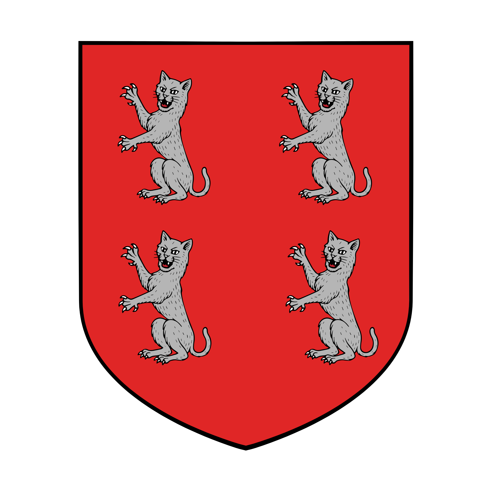

%%  
[[Ganoan]]  
[[Bihra]]  
[[Majir]]  
[[Ekkam]]  
[[Luchun Khaganate]]  
[[Gaden]]  
[[Kareli Hierarchy]]  
[[Roxeria]]  
[[Ganoan Dye]]
%%  

  
 <h4 class="wiki-header">City of Jink</h4>  
 
  
 <strong>Government</strong>  
 Guild Oligarchy  
 
  
 
  
 <strong>Head of State</strong>  
 Archon Izeter  
 
  
 
  
 <strong>Capital</strong>  
 Jink  
 
  
 
  
 <strong>Heraldic Symbol</strong>  
 Four Silver Cats on Red  
 
  
 
  
 
  
 <strong>Primary Religion</strong>  
   
 
  
 
  
 <strong>Primary Culture</strong>  
 <a href="Ganoan" class="internal-link">Ganoan</a> <a href="Human" class="internal-link">Human</a>, Ganoan <a href="Bihra" class="internal-link">Bihra</a>  
 
  
 
  
 <strong>Official Language</strong>  
   
 
  
 
  
 
  
 <strong>Preceded by</strong>  
 <a href="Luchun Khaganate" class="internal-link">Luchun Khaganate</a>  
 
  
 
  
 <strong>Formed</strong>  
 671PA  
 
  
   

  

Jink is a city state on the shore of Lake Ganoa in southern Nirydia, between the <a href="Kareli Hierarchy" class="internal-link">Kareli Hierarchy</a> to the south and <a href="Roxeria" class="internal-link">Roxeria</a> to the west. It was founded in 433PA by the <a href="Ekkam" class="internal-link">Omna of Ekkam</a> after Ekkam had retaken the Ganoa Valley from the Khatrym of Azuvke, and passed to the <a href="Luchun Khaganate" class="internal-link">Luchun Khaganate</a> when the Khans conquered Ekkam in 551PA. When Luchun fell to <a href="Gaden" class="internal-link">Gaden</a> of Drizan in 671PA, Jink kept its full independence and became the home of the Ganoans, the human and Bihra peoples of the lake valley who had served the Khans of the Steppe for over a century, and among whom humans have long been the larger part. Its wealthy guildlords long ran the ferry and trading post across the lake that grew into the city of <a href="Majir" class="internal-link">Majir</a>, and the profits Jink drew from the <a href="Ganoan Dye" class="internal-link">Ganoan Dye</a> of Majir's Parabol Domes became one of the causes of open war between the two cities in the 890s. Since the truce of 895PA the two cities have been bound together in a careful peace.

