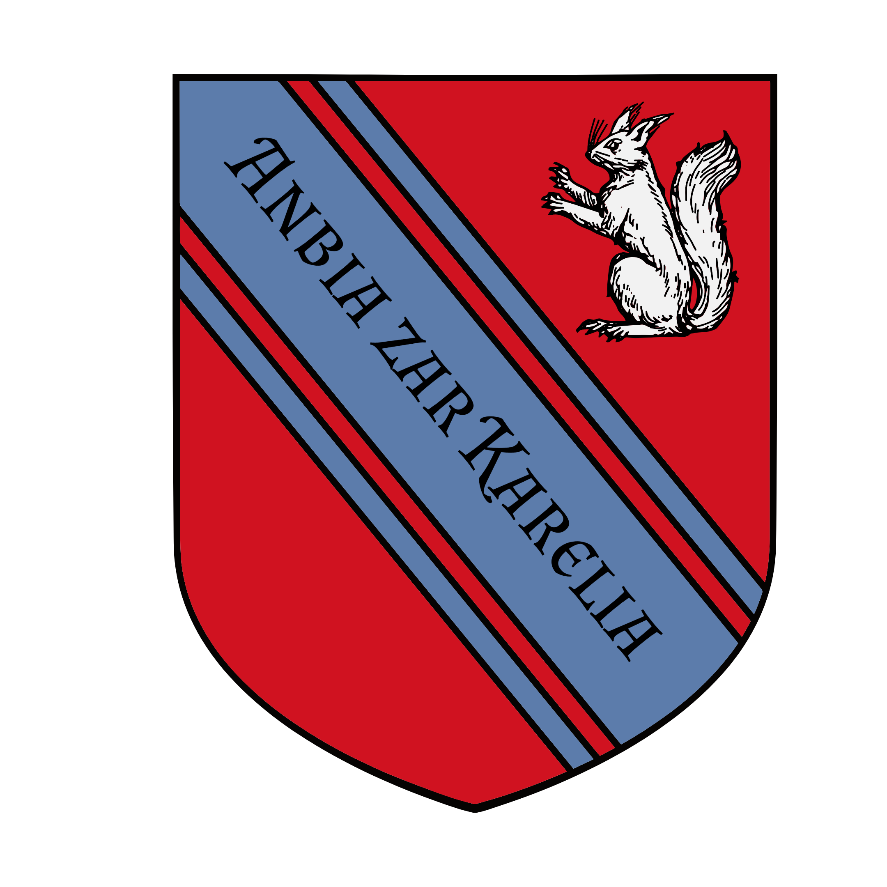

%%[[Orc]] [[Yl-Lhatsi]] [[Gaden]][[Karaluk]][[Az]][[Ekkam]][[Ganoan]] [[Nine Great Guilds]] [[Mystics Guild]]
%%

    <h4 class="wiki-header">Kareli Hierarchy</h4>
    

        <strong>Government</strong>
        Federal Council Republic
    

    

        <strong>Head of State</strong>
        Hierarch Lazai
    

    

        <strong>Capital</strong>
        Aznyr
    

    

        <strong>Heraldic Symbol</strong>
        White Squirrel on Red & Blue
    

    

    

        <strong>Primary Religion</strong>
        <a href="Karaluk" class="internal-link">Karaluk</a>
    

    

        <strong>Primary Culture</strong>
        Kareli <a href="Bihra" class="internal-link">Bihra</a>, Qahori <a href="Orc" class="internal-link">Orcs</a>, <a href="Ganoan" class="internal-link">Ganoan</a> <a href="Human" class="internal-link">Human</a>
    

    

        <strong>Official Language</strong>
        Lihbare
    

    

    

        <strong>Preceded by</strong>
        <a href="Luchun Khaganate" class="internal-link">Luchun Khaganate</a>, Protectorate of Gaden
    

    

        <strong>Formed</strong>
        752PA
    

    

The Hierarchy formed a few years after the death of the legendary <a href="Mogyr" class="internal-link">mogyri</a> Conqueror <a href="Gaden" class="internal-link">Gaden</a>, who broke Khaganate reign over the people of the southern ports at the Battle of Verivale in 671PA and ruled them as a protectorate, but was unable to guarantee real lasting rule beyond his own lifetime in the region. Its founding declaration, the Grand Principle, was signed by the <a href="Nine Great Guilds" class="internal-link">Nine Great Guilds</a> of the southern ports, among them the <a href="Mystics Guild" class="internal-link">Mystics Guild</a>. A progressive and rich country, orcish, bihra and human majorities all call the Hierarchy their home in equal share, the humans among them largely <a href="Ganoan" class="internal-link">Ganoans</a>, with the free port of Aznyr, once the capital of the <a href="Az" class="internal-link">Omna of Az</a>, thriving as one of the most multi-cultural and prosperous cities in the known world, acting as the western gate between Ilrakhan and Nirydia on the other end of the <a href="Velvet Caravan" class="internal-link">Velvet Road</a>.

In recent years the Hierarchy has begun facing a once again consolidated threat by the raiders of the Duol Khaganate, while seeing itself forced to expulse the prospering City of Paqor from its Union due to mounting diplomatic pressure and rising ideological tensions within the Hierarchy. It is still closely allied to the Mogyr of the Drizan although how much they could be relied upon as a united force in times of need remains questionable considering a shifting attitude to foreign exchange with their new Mycomother. The Kareli remain committed to  retain their independence, fostering their own cultural traditions as well as engage in new ventures, being a premier sponsor of the Third Moon Fleet that is set to sail out to Sirenna within a year.
