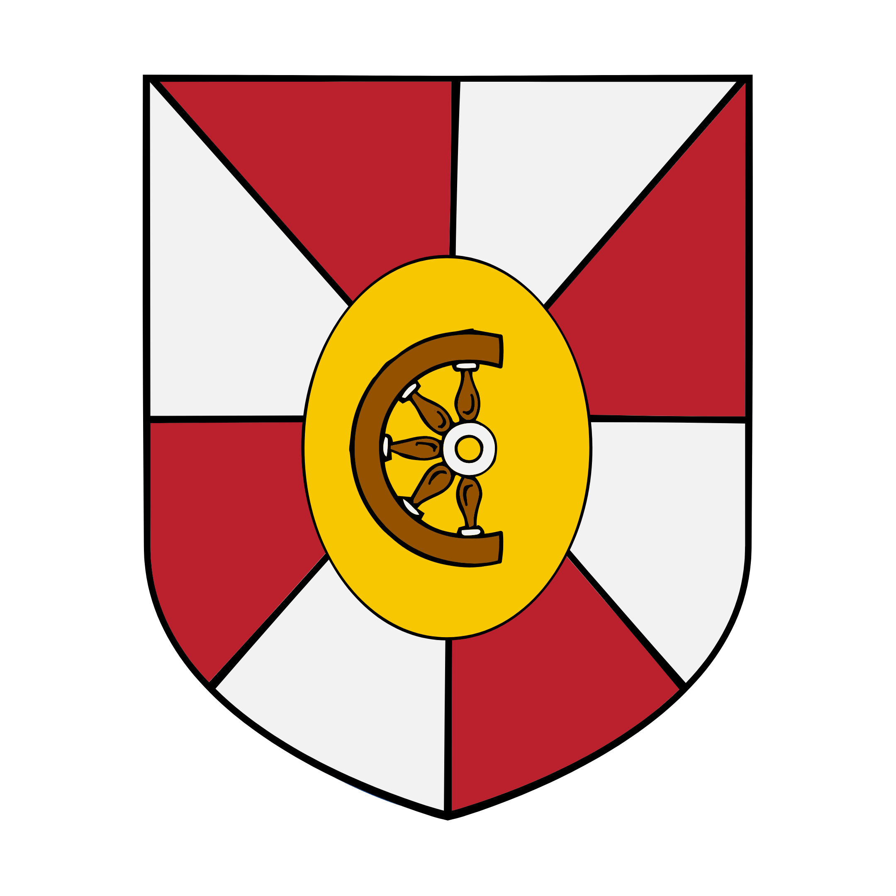

%%  
[[Ganoan Dye]]  
[[Para]]  
[[Azbihra]]
[[Jink]]  
[[Kareli Hierarchy]]  
[[Roxeria]]  
[[Karaluk]]  
[[Mystics Guild]]  
[[Ganoa Valley]]  
[[Parabol Domes]]  
[[Long Breath]]  
[[Serilla Yan]]  
[[Sar Damok]]  
[[Gaal]]
%%  

  
 <h4 class="wiki-header">City of Majir</h4>  
 
  
 <strong>Government</strong>  
 Free City  
 
  
 
  
 <strong>Head of State</strong>  
 1st Consul <a href="Serilla Yan" class="internal-link">Serilla Yan</a>, 2nd Consul <a href="Sar Damok" class="internal-link">Sar Damok</a>  
 
  
 
  
 <strong>Capital</strong>  
 Majir  
 
  
 
  
 <strong>Heraldic Symbol</strong>  
 Wheel on Gold, upon Red &amp; White  
 
  
 
  
 
  
 <strong>Primary Religion</strong>  
 <a href="Karaluk" class="internal-link">Karaluk</a> (Mupat)  
 
  
 
  
 <strong>Primary Culture</strong>  
 <a href="Ganoan" class="internal-link">Ganoan</a> <a href="Human" class="internal-link">Human</a>, Ganoan <a href="Azbihra" class="internal-link">Azbihra</a>  
 
  
 
  
 <strong>Official Language</strong>  
 Ganoan Lihbare  
 
  
 
  
 
  
 <strong>Preceded by</strong>  
 <a href="Jink" class="internal-link">City of Jink</a>  
 
  
 
  
 <strong>Formed</strong>  
 895PA  
 
  
   

  

Majir is a free city on the southern shore of Lake Ganoa, across the water from <a href="Jink" class="internal-link">Jink</a>, in the <a href="Ganoa Valley" class="internal-link">Ganoa Valley</a> of southern Nirydia. It grew out of a fishing and trading post connected to Jink by ferries and was for most of its history run by the families of Jink. In the early 820s Majir grew to considerable size around the <a href="Parabol Domes" class="internal-link">Parabol Domes</a> for which it is known today, where the precious <a href="Ganoan Dye" class="internal-link">Ganoan Dye</a> is made from the flowers of the lake and which release great amounts of toxic smoke as well as the hallucinogenic residue known as <a href="Para" class="internal-link">Para</a>, while much of the wealth they produced flowed to the elites of Jink. Class conflict and other tensions between the two cities turned into open war in 893PA, which ended in 895PA with a careful truce that has bound Majir and Jink together ever since, and left Majir in control of the southern side of the valley. With around 60,000 inhabitants it is as large as Jink today. Like Jink, the city is home to both Ganoan humans and Ganoan Bihra, with humans making up the larger share of its people.
  
<h2>History</h2>  

Majir was for centuries a small village on the southern shore, where the ferries of Jink landed and the fishers of the far shore lived. When the Parabol Domes were first raised in 822PA, the Masters of Jink chose the village as the site of the new industry, as they had no wish to bring the fumes of the Domes into their own city. The village became the housing ground of the dome works, and within a few decades it had grown into a city of workers, ruled from the Tower of Relativity by a Domelord appointed by the Council of Jink.
  

The uprising began with riots in the summer of 893PA, in one of which Ulissa Verzo, a prominent member of the <a href="Mystics Guild" class="internal-link">Mystics Guild</a>, was killed. By winter mercenaries had gathered around the lake and the valley was at war, and the last Domelord fled across the lake. The workers of the Domes shut down the valves and stopped the dye, and the valve wheel became the symbol of the uprising and later of the city's arms. During the war the rebels burned the Hall of Ginyaka, the chief house of worship of Jink's goddess on the southern shore, and seized many of the mines of the valley owned by the families of Jink, among them the great Silverpit further downstream on the River Gan, which remains a point of contention and hurt between the cities to this day.
  

The Mystics Guild fought on the side of Jink, but after the truce of 895PA argued that it had only fought for its own survival after the death of Ulissa Verzo. The leaders of the revolution carefully allowed the Mystics back into the city, a decision that many in Majir would still like to see reversed. The shift militias that had fought the war never fully disbanded, and in the years after the truce they grew into the gangs that rule the city today, while many of the Steppe Bihra mercenaries hired by both sides settled on the eastern edge of the city. Between 902PA and 914PA the Consul Aatal, a Bihra moderate, signed a treaty with Jink promising that Majir would turn away slaves who fled across the lake, to the fury of his opponents.
  
<h2>Geography</h2>  

Majir climbs from the shore of Lake Ganoa up the slope towards the foothills of the Ganoan Mountains. For most of the year the wind of the valley blows down from the north, carrying the smoke of the Domes south over the city and into the mountains, which is why the Masters of Jink built their industry on the southern shore and why Jink itself has stayed clean. Only in a few weeks of winter does the wind turn, and the people of Jink call it the Black Wind when the smoke reaches their terraces.
  

The city was never planned for its people, only for the Domes, and its streets bend around pipe runs, cisterns and heaps of ash. It falls broadly into three parts. On the shore lie the old ferry village and its piers, on the rise above it the quarter the Jinkish overseers built to run the industry, with the Tower of Relativity at its centre, and above them the Dome belt, where the eight Parabol Domes stand among the tenements, warehouses and shrines of their workers. The Tower of Relativity was built in the 820s as the office in which every batch of dye was measured, priced and sealed before it crossed to Jink. Banners of Ganoan Dye hang from its upper gallery and tell the hour by their colour, and its name is taken from the old Jinkish saying that the colour of the dye is relative to the hour.
  
<h2>Districts</h2>  

The Landing is the old ferry village on the shore and the oldest part of the city. The ferries of Jink land at its piers by day and the night ferries of Majir leave them after dark, and it is home to the ferrymen, the fishers and many of the flower divers of the southern shore.
  

Spire Quay is a spit of land reaching into the lake, on which stands the Majiri tower of the Twin Spires, the chamber of the Mystics Guild in the valley, facing its twin on the northern shore. It is watched day and night by consular guards.
  

Tower Ward is the heart of the city, the quarter built by the Jinkish overseers around the Tower of Relativity. It holds the seat of the Consuls, the Wheel Market and the Watchhouse of the Peacekeepers, and its stone houses, many of which still bear the cats of Jink carved above their doors, are home to the wealthiest Majiri and to the bosses of the gangs.
  

Ashhall surrounds the burned shell of the Hall of Ginyaka. It is the quietest quarter of the city, home to the few old families of Majir who kept their faith in the Mother, and visitors from Jink still lay flowers at the ruins, which many Majiri resent.
  

Kurin Lane is the kethric quarter, named after the Kurini Kheri who settled the valley after the <a href="Revolution of Rox" class="internal-link">Revolution of Rox</a>. It is home to craftsmen and moneylenders, to the chapel of the Bishop of Ganoa and to the houses of care of the <a href="White Sister" class="internal-link">White Sister</a>, which draw more dome workers every year.
  

The Lungs is the name the Majiri give to the Dome belt, the largest part of the city. Each of the eight Domes stands in its own yard among the tenements of its shifts, and Mask Row, the lane of shrines to Mupat, runs below the Dome known as Mupat's Mouth. Most of the city's dome workers live here, among them many orcs and half-orcs and the freed and escaped slaves of the northern shore.
  

The Waxworks lies beside the Dome known as the Widow, a quarter of scraping sheds and cutting rooms where Para is prepared and sold, with stairs leading down to the lake that are used by smugglers.
  

Cinderside lies on the eastern edge of the city beside the Dome known as the Cinder, around the camps of the caravans on the roads to Seren and the Tax. It holds the steppe market and the animal pens, and is home to most of the Steppe Bihra of Majir, as well as to goblin and hobgoblin caravaneers, Shirin traders and the odd Mogyri.
  
<h2>Government</h2>  

Majir is governed by two Consuls, elected in cycles for terms of six years, who sit in the Tower of Relativity, from which the Domelords of Jink once ruled the city. The First Consul has the final say in matters of war and receives emergency powers in wartime, while in all other matters the two decide together, and should the First Consul die in office the Second takes their place. In principle everyone born in the city may vote, but criminal gangs control much of the city's underbelly, steer its elections and sell off whole streets to the highest bidder. The present First Consul is <a href="Serilla Yan" class="internal-link">Serilla Yan</a>, who represents the once dominant moderate establishment, while the Second Consul, <a href="Sar Damok" class="internal-link">Sar Damok</a>, a blue-scaled Bihra, speaks for an ever growing number of antagonistic and war-hungry radicals, who have been steadily gaining ground on the moderates.
  

Under the Charter of Majir slavery is technically outlawed in the city, and in the past Majir took in slaves who had fled Jink and defended their freedom within its borders. Aatal's treaty ended this practice and has fed the anger of the radicals ever since. The guilds hold far less power in Majir than in Jink, and many Majiri suspect any guild of serving Jink or the Kareli Hierarchy. Only the Mystics Guild, whose chamber in the valley is known as the Twin Spires, is relied upon, for it is the Mystics who keep the Domes stable when they inevitably begin to leak, and many in the city accuse them of secretly working for Jink.
  
<h3>The Gangs</h3>  

The true power in Majir lies with four great gangs, which grew out of the shift militias of the war and are now as rich and as ruthless as any of the Masters of Jink. Between them they control most of the Domes, supplying their shifts, taking a share of their wages and owning the Para scraped from their vents, while the city still carries the cost of the Domes and the debts that come with them. They buy the votes of whole streets, and no Consul has been elected without the backing of at least one of them.
  

The Valvers are the oldest of the gangs, descended from the dome workers who shut the valves in 893PA, and hold the Red Eye, the Kettle and the Landing. Their votes have long carried the moderates, and they are led by Hask Ombari, one of the men who turned the valve wheel in the uprising. The Greenhands, named after the stain the dye leaves on the hands of the scrapers, hold the Grandmother, the Widow and the Waxworks and run most of the trade in Para, which they smuggle to Jink, to the Mystics and far beyond the valley. They are led by Ama Zhurel, a half-orc who fled slavery in Jink. The Masks are the youngest and most violent of the gangs, dome workers who wear their masks in the street as a sign of their devotion to Mupat. They hold Mupat's Mouth and in practice the Wheelhouse, carry Sar Damok and the radicals, and want the Mystics driven from the city, and are led by a Bihra known only as Kesh the Breathless. Rainpath, named after the road by which the caravans of the steppe enter the valley, is the gang of the Steppe Bihra of Cinderside, many of them the sons of mercenaries who came in the war. They hold the Cinder and the caravan camps, sell their swords and protection to anyone who pays, and are led by Burut Ka, who styles himself the Khan of the Cinder.
  
<h3>The Peacekeepers</h3>  

The Peacekeepers are the police of Majir, raised after the truce of 895PA to replace the Jinkish dome wardens and led by a Warden-Commander appointed by the Consuls, at present Oren Saltu, a former mercenary captain. From the Watchhouse in Tower Ward some four hundred Peacekeepers keep a watch over the city that is known throughout the valley as incredibly corrupt, as each of their posts is paid both by the city and by the gang that holds its district, and arrests and blind eyes alike can be bought. They make use of artificery and of a handful of golems bought from the artificers of Aznyr, called Ashmen in the streets, to the displeasure of the Mystics Guild, and they are known above all for their Yeollum shackles, brought up the Velvet Road from <a href="Gaal" class="internal-link">Gaal</a> at great cost, in which magically gifted criminals are led through the Wheel Market for all to see.
  
<h2>Economy</h2>  

Every one of the Parabol Domes stands on the southern shore, and with them Majir holds the making of Ganoan Dye and the trade in Para, much of which passes through the hands of the city's gangs. The Domes dominate both the skyline and the life of the city, whose shift bells ring day and night, and the lives of the dome workers are short and rough. Majir also works the mines it seized in the war. Its weakness is its dependence on the north. Much of the city's debt, from the dome works to its treasury, is owed to the lenders of the northern shore, above all to <a href="Goash Mab" class="internal-link">Goash Mab</a>. The flowers from which the dye is made are harvested under Jinkish rights, the vast majority of the valley's farmsteads lie on Jink's side, and Jink holds a monopoly over medicine and many science-based industries, which Majir desperately needs against the fumes and smoke of its Domes. Jink is enormously richer than its neighbour, and many believe it could win a second war if it prepared for one and was provoked.
  
<h2>Religion</h2>  

Like Jink, Majir follows the <a href="Karaluk" class="internal-link">Karaluk</a>, but where Jink honours Ginyaka the Mother, Majir has made Mupat of the Deathwind its own. For most of its history the far shore worshipped as Jink did, and its chief house of worship was the Hall of Ginyaka, built in the years when Jink ran the town. As the Parabol Domes grew in the 820s their poisonous fumes came to be called the breath of Mupat, and the dome workers who breathed them turned to him as their patron. A worker who dies of the fumes is said to have been breathed, and masks nailed above doorways serve as small shrines to the god. In the war Mupat became the symbol of the uprising against Jink, and since the truce his worship has been the faith of the free city. His holiest place in the city is the Dome known as Mupat's Mouth, where the high priest known as the First Breath blesses each new shift before it first enters the Domes.
  

Majir nonetheless shares Jink's tolerance of other faiths. Followers of other sects of the Karaluk and of other schools of the <a href="Vas Ira" class="internal-link">Vas Ira</a> live in the city alongside adherents of the <a href="Javalim" class="internal-link">Javalim</a>, <a href="Zuhurism" class="internal-link">Zuhurism</a> and <a href="Kethricism" class="internal-link">Kethricism</a>, the last largely descended from the kethric Kheri who fled Roxeria after the <a href="Revolution of Rox" class="internal-link">Revolution of Rox</a>. The kethric missionary known as the <a href="White Sister" class="internal-link">White Sister</a> has preached in Majir as in the rest of the valley for almost a decade, and her warnings against unchecked magic and the power of the Mystics Guild have found a ready audience among its dome workers.
  
<h2>Culture</h2>  

The Majiri speak Ganoan Lihbare like the people of Jink, but with words of their own, for example to them the Domes are the Lungs, Para is simply known as wax, and the war of 893PA is often referred to as the Turning of the Wheel. They are known as blunt, quick to laugh and to fight, suspicious of titles and fiercely loyal to their shift and their street. Many dome workers wear cloth masks and bear hands stained green by the dye, their positions are not envied but working the domes is the quickest way for a wretch of the streets to earn coin and bread. Newcomers arrive constantly to take the places of the dead, so that besides its Ganoan majority the city is home to orcs and half-orcs, Shirin, Steppe Bihra, a few elves and half-elves, goblins and hobgoblins of the caravans and the odd Mogyri. The Steppe Bihra in particular are looked down upon on both shores, and are called kobolds, scaledogs, khanspawn and worse, especially in Jink, where many still regard them as animals.
  

The greatest festival of the year is the <a href="Long Breath" class="internal-link">Long Breath</a>, as the Majiri call the autumn festival known in Jink as the Hunger. For three days at the end of autumn the Domes are cooled, the shift bells fall silent and the air over the city clears, the only time in the year that Majir rests.
  
<h2>People of Interest</h2>  

<a href="Serilla Yan" class="internal-link">Serilla Yan</a>, First Consul of Majir <a href="Sar Damok" class="internal-link">Sar Damok</a>, Second Consul of Majir Aatal, Consul from 902PA to 914PA Ulissa Verzo, Mystic, killed in the riots of 893PA Oren Saltu, Warden-Commander of the Peacekeepers Hask Ombari, leader of the Valvers Ama Zhurel, leader of the Greenhands Kesh the Breathless, leader of the Masks Burut Ka, leader of Rainpath The First Breath, high priest of Mupat The <a href="White Sister" class="internal-link">White Sister</a>, kethric missionary
  
