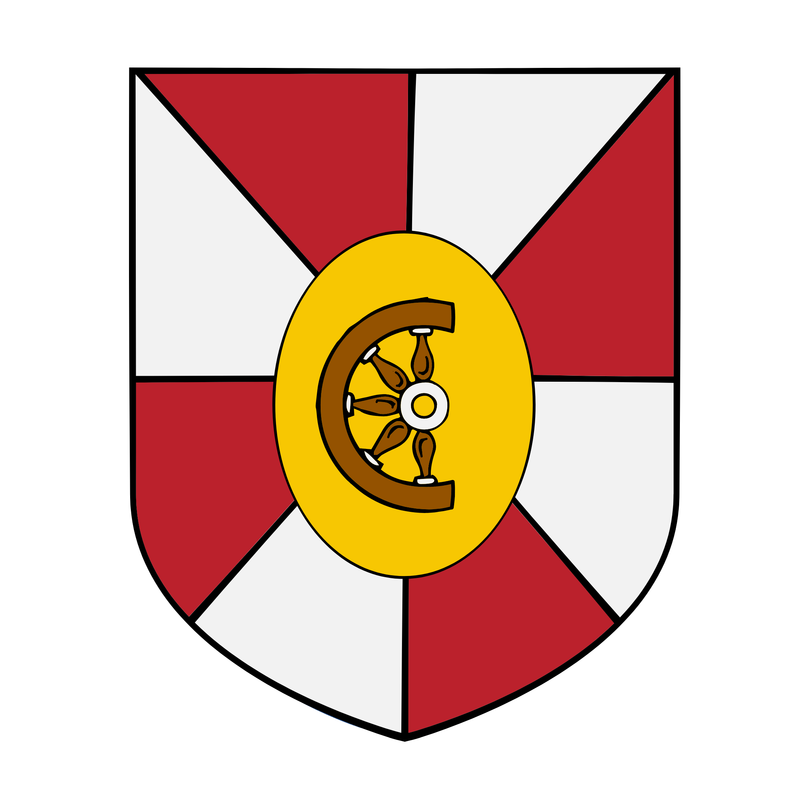

%%  
[[Jink]]  
[[Kareli Hierarchy]]  
[[Roxeria]]  
[[Bihra]]
%%  

  
 <h4 class="wiki-header">City of Majir</h4>  
 
  
 <strong>Government</strong>  
 Free City  
 
  
 
  
 <strong>Head of State</strong>  
   
 
  
 
  
 <strong>Capital</strong>  
 Majir  
 
  
 
  
 <strong>Heraldic Symbol</strong>  
 Wheel on Gold, upon Red &amp; White  
 
  
 
  
 
  
 <strong>Primary Religion</strong>  
   
 
  
 
  
 <strong>Primary Culture</strong>  
 Ganoan <a href="Bihra" class="internal-link">Bihra</a>  
 
  
 
  
 <strong>Official Language</strong>  
   
 
  
 
  
 
  
 <strong>Preceded by</strong>  
 <a href="Jink" class="internal-link">City of Jink</a>  
 
  
 
  
 <strong>Formed</strong>  
 895PA  
 
  
   

  

Majir is a city on the far shore of Lake Ganoa from <a href="Jink" class="internal-link">Jink</a>, in the Ganoa Valley of southern Nirydia. It grew out of a fishing and trading post connected to Jink by ferries and was for most of its history run by the guildlords of Jink. In the early 820s Majir grew to considerable size around the Parabol Domes for which it is known today, and which release great amounts of toxic gases and fumes, while much of the wealth they produced flowed to the elites of Jink. Class conflict and other tensions between the two cities turned into open war in the Ganoa Valley in the 890s, which ended in 895PA with a careful truce that has bound Majir and Jink together ever since.

