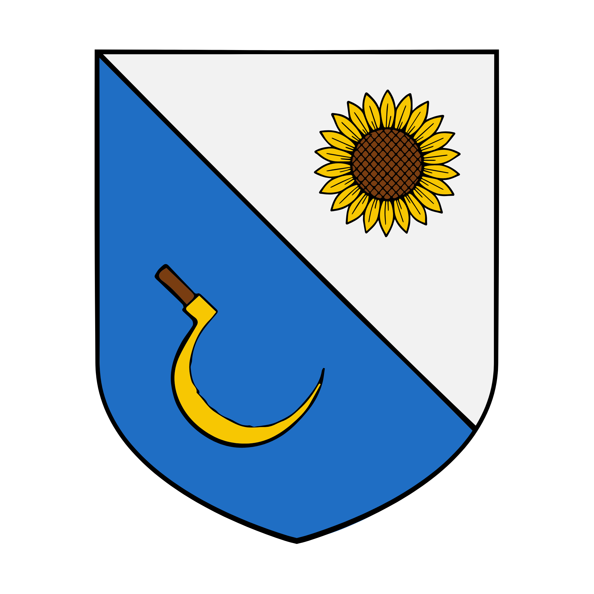

%%  
[[Kareli Hierarchy]]  
[[Bihra]]  
[[Karaluk]]  
[[Orc]]  
[[Para]]  
[[Zondust]]  
[[Roxeria]]  
%%  

  
 <h4 class="wiki-header">City of Paqor</h4>  
 
  
 <strong>Government</strong>  
 Noble Republic  
 
  
 
  
 <strong>Head of State</strong>  
 Lord Pishr I  
 
  
 
  
 <strong>Capital</strong>  
 Paqor  
 
  
 
  
 <strong>Heraldic Symbol</strong>  
 Sunflower & Sickle on Blue & White  
 
  
 
  
 
  
 <strong>Primary Religion</strong>  
 <a href="Karaluk" class="internal-link">Karaluk</a>  
 
  
 
  
 <strong>Primary Culture</strong>  
 Paqori <a href="Bihra" class="internal-link">Bihra</a>,  Qahori <a href="Orc" class="internal-link">Orcs</a>,  Kheri <a href="Human" class="internal-link">Human</a>  
 
  
 
  
 <strong>Official Language</strong>  
 Lihbare  
 
  
 
  
 
  
 <strong>Preceded by</strong>  
 <a href="Kareli Hierarchy" class="internal-link">Kareli Hierarchy</a>  
 
  
 
  
 <strong>Formed</strong>  
 897PA  
 
  
   

  

Paqor, officially the Noble Republic of Paqor, is a small country in southern Nirydia on the western tip of the Lemey Isthmus. The City used to belong to various maritime powers projecting influence across the niryd sea and had been an influential port since its foundation in the 4th century as the Emporium of Sarang, then a simple <a href="Orc" class="internal-link">Qari</a> trading post. Following greater ideological differences between the controlling <a href="Kareli Hierarchy" class="internal-link">Hierarchy</a> and <a href="Roxeria" class="internal-link">Roxeria</a> to the immediate north, overshadowed by mounting pressure from the <a href="Elbae" class="internal-link">Elbae Sultanate</a> the City of Paqor was officially expulsed from the greater Hierarchy and became a sovereign and independent country of its own, arguably against its personal wishes. Today Paqor is enjoying a greater and greater influx of commerce and prosperity as one of the premier ports of the Niryd Sea, it is home to a growing population of over 60000 citizens of Bihra, Orcish and Kheri heritage.
  

While some hail the city as a place of possibility, untapped potential and new horizon for southern Nirydia, many criticise it as a hub for the southern drug trade in <a href="Para" class="internal-link">Para</a> and <a href="Zondust" class="internal-link">Zondust</a>, a port of slavers and a shadow state of greater powers seeking a place to wash their hands of dirty business.
  
<h2>History</h2>  

Paqor began as Sarang, a trading post of the Qari on the end of the isthmus, and passed through the hands of the maritime powers of the south over the following centuries before it became one of the port cities of the Kareli Hierarchy. Within the Hierarchy it was always an outlier. It lies cut off from the rest of the Kareli lands, which can only be reached by sea or by the road through Roxeria to the north, and unlike the other cities of the Hierarchy, where the Bihra form the largest share of the people, Paqor has long been a city of humans and orcs.
  

In the late 9th century these differences became a burden the Hierarchy was no longer willing to carry. Paqor sits where the coastal sea lane from Aznyr to the west turns the corner of the isthmus, and its position made it a natural target in any war between the Hierarchy and the Elbae Sultanate, a war many in the Hierarchy came to see as inevitable. The council in Aznyr judged that it could not hope to defend an isolated city against the power of the Sultanate, and that holding it would draw the Hierarchy into that war on the Sultanate's terms. Under pressure from the Sultanate and amid rising tensions with Roxeria, the Hierarchy agreed in the Treaty of Paqor of 897PA to release the city as an autonomous state. The people of Paqor did not ask for their independence, and many regarded it as abandonment.
  
<h2>Government</h2>  

Paqor is a Noble Republic, governed by a closed circle of old merchant houses. The heads of these houses elect the Lord of Paqor from among themselves, and the Lord holds office for life. The present Lord is Pishr I.
  
<h2>Economy</h2>  

Paqor lives by its harbour. Every coasting ship that sails between Aznyr and the west, past <a href="Azuvke" class="internal-link">Azuvke</a> towards Kherova and the Pilvian Gulf, rounds the end of the isthmus, and most of them stop at Paqor to take on water, trade or wait out the weather. Harbour dues and pilot fees are the city's oldest income, and its yards, run largely by Qahori orcs, build and refit ships for anyone who pays. The farmland behind the city grows grain and sunflowers, the flowers of the city's arms, and Paqori sunflower oil is sold for lamps and kitchens across the Niryd Sea.
  

Since its independence Paqor has prospered on what the Hierarchy would not or could not allow. Any ship may sail under the city's flag for a fee and so escape the rules of the Hierarchy's guilds and the terms of the Grand Ziflis Company, and it is said that half the ships flying the sunflower have never seen the city. Its counting houses keep deposits without asking whose they are and answer to no foreign court, and guild masters of the Hierarchy, lords of Azuvke and wealthy men of the <a href="Ganoa Valley" class="internal-link">Ganoa Valley</a> are all rumoured to keep money there. Para from the Domes of <a href="Majir" class="internal-link">Majir</a> and Zondust from the Velvet Road meet in its markets, where the trade in both is legal and taxed, and its slave market, fed by ships from as far as the Gavivag Sea, is the largest of the south, supplying the plantations of the Hierarchy and of <a href="Jink" class="internal-link">Jink</a> and the galleys and mines of Roxeria. Business ties with the Hierarchy remain close, and Roxeria, Paqor's nearest neighbour, is among its best customers.
  
<h2>Culture</h2>  

Thirty years after the Treaty of Paqor, many Paqori still feel themselves to belong to the Hierarchy, and keep its feast days, although that feeling is slowly fading. The Kareli themselves do not look upon Paqor in the same light, and in Aznyr it is regarded as a trading partner rather than a lost city. The people of Paqor are known as traders first and believers second. Its great temple, the Fivefold House, honours all five Greats of the <a href="Karaluk" class="internal-link">Karaluk</a> under one roof, so that every sailor finds his own god at the harbour, and the Paqori half jokingly call money the sixth Great. The proverb that the sunflower follows the sun is the city's own answer to those who accuse it of serving whoever pays best.
  

The oldest quarter of the city, around the first harbour, is still called Sarang, and its street names and an old market law are remembered as a legacy of the Qari. The Bihra of the city keep most of its counting houses, the Qahori orcs its yards and docks, and the Kheri much of its shipping to the west, each with a quarter and a quay of their own. In the markets of the drug and slave trade much business is done through agents in plain grey hoods, so that no buyer's face is ever seen, and the grey hood has become a symbol of the city's discretion and, to its critics, of its shame.
  
