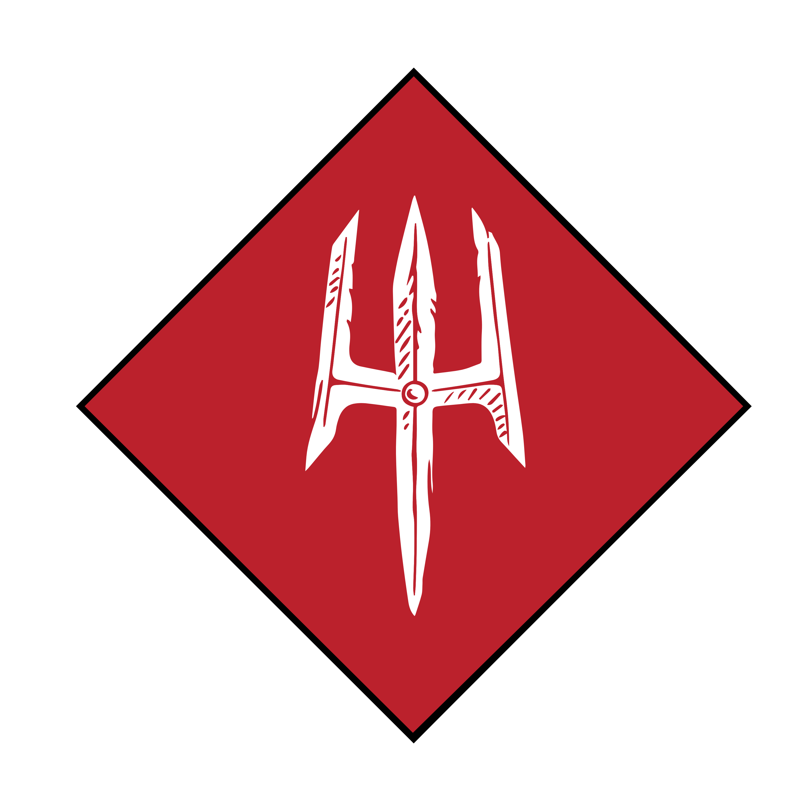

%%
[[Ott]]
[[Artificery]]
[[Garmogol Ilwik]]
[[Black Powder]]
[[Muglig Ruv]]
[[The Alchemists Guild]]
[[Xerental]]
%%

  
<small><i>Rune of the Syndicate</i></small>

The Ottian Syndicate is the guild of graduates of the Ottian Schools and a more or less official branch of the government of <a href="Ott" class="internal-link">Ott</a>. It oversees the practice and trade of <a href="Artificery" class="internal-link">Artificery</a>, the three schools of magical research related to artefacts, Maintenance, Modulation and Creation, and nobody can deny the gnomes of Ott their superiority in this field. While Maintenance is common enough knowledge to be found elsewhere, Modulation is a much more complex subject to tackle, and Creation is a school so occult that it is taught and practiced to any large extent only within the Twin City itself.

<h2>Organization</h2>

The Syndicate is headed by the Board of Directive, formed of the three Major Chairs, the Annod, Kinnod and Pronnod, who each handle a different aspect of the Syndicate's operations. The Annod is in charge of business directives, international relations and the Syndicate's outposts across the continent. The current Annod is the gnome <a href="Garmogol Ilwik" class="internal-link">Garmogol Ilwik</a>.

A graduate of the Ottian Schools receives a mark of trade and is offered membership in the Syndicate should they choose to leave the Twin City behind, which many do, joining the court of a noble lord or setting up shop in a lucrative location to offer their services for coin. The Syndicate as an institution offers its members safe communication and access to research and resources, while its treaties with many cities and governments benefit its members as well.

<h2>The Ottian Codex</h2>

In 769PA the Syndicate published the Ottian Codex, a grading manual for artefacts according to the principles of Prosum. The Ottian Grading it set out, from the Uzd or first rank to the Nal or fifth rank, has since become the most widely used standard for the classification of artefacts on the subcontinent, far beyond academic circles. Members of the Syndicate may service or sell artefacts up to the Kheled or third rank without special protocols, while anything above it requires notification of the Ottian headquarters. Control over the grading, repair and creation of artefacts has long been the foundation of the Syndicate's commercial power.

<h2>The Syndicate and Black Powder</h2>

The rise of <a href="Black Powder" class="internal-link">black powder</a> has posed the greatest challenge to the Syndicate's position in its history. The substance was developed in Ott not by the orthodox Prosum but by the Nabat, the "School of Dust", a more decentralized and unorthodox body that embraced non magical research and was never bound by the Syndicate's protocols in the way that artificers were. Although the Syndicate and the Twin Kingdoms Council sought to keep the methods of refining powder and building firearms within Ott, the profit seeking of individual gnomes and the collaboration of Ottian engineers with the hold of <a href="Xer-Kol" class="internal-link">Xer-Kol</a> allowed the knowledge to spread, and by the 920s the Syndicate has been unable to contain it. Ottian firearms nonetheless still depend on artefact igniters and alchemical refinement, which leaves the Syndicate with considerable influence over the supply and maintenance of the weapons that bear Ott's name. As a broad and varied organisation with members across the continent, the Syndicate has found various means to commercialize firearms through the artificery that Ottian craft mixes into nearly everything it produces, even as its hold over black powder itself has weakened.

<h2>Rivals</h2>

Politically the Syndicate has long been at odds with the Buteran Excavators Guild, who see the creation of artefacts as a massive threat to their business, which is based on the excavation of Rakhian resources to the same ends. As the Syndicate is closely tied to the Kingdom of <a href="Meadrath" class="internal-link">Meadrath</a>, however, any actual conflict between the two organisations usually takes place in backrooms, offices or in the wilderness. An unofficial rivalry also exists with <a href="The Alchemists Guild" class="internal-link">The Alchemists Guild</a> of Trazlov, mostly on an economic level, as the two institutions occupy a similar niche in the trade of arcane supplies. The firearms of Xer-Kol, sold through the <a href="Xerental" class="internal-link">Xerental</a> and made with as little magic as possible, are the newest competitor to Ottian craft.

