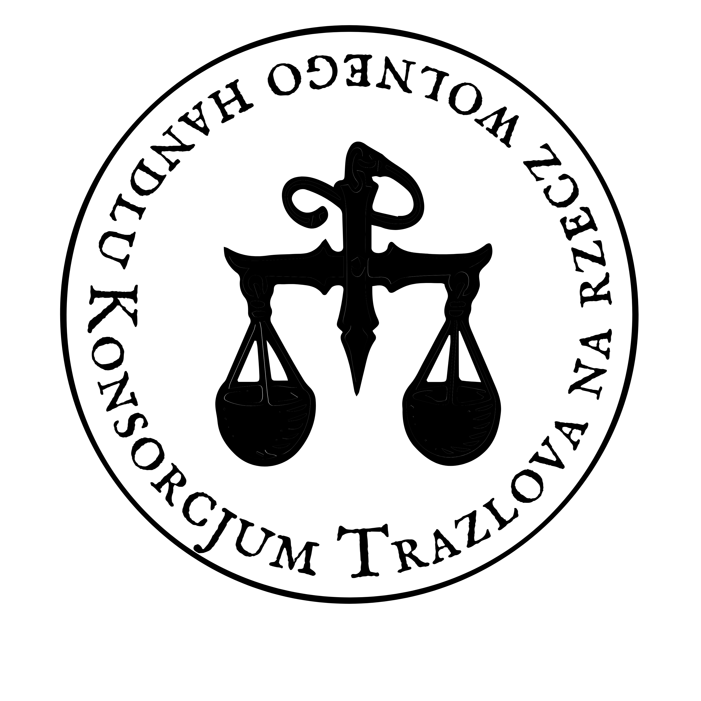

%%  
[[Trazlova]]  
[[Uhl]]  
[[Vihr]]  
[[Xerental]]  
[[Vrieman Bank of Uhl]]  
[[Blijgrat]]  
[[Grachy]]  
[[Ukiolla]]  
[[Trykkerog]]  
[[Marosz Kirelli]]  
[[The Alchemists Guild]]  
[[Vaergriff]]  
[[Iron Hole]]  
[[Torry]]  
%%  

    
<small><i>Trazlov Consortium Seal</i></small>  

  

The Trazlov Consortium for Free Trade, commonly just called the Consortium, is a commercial and defensive network of merchant houses, guilds and trading ventures in the Torn Sea that grew from <a href="Trazlova" class="internal-link">Trazlov</a> in the 7th century PA. It was founded in 639PA as the Table of Trazlov, a council of the nineteen richest merchants of the city, and took its present name in 717PA. No single person rules it. The Table sits above all, and to those who deal with it the Consortium has no face, only a seal, a ledger and a long memory.
  

In the centuries since its founding the Consortium has spread across more than a dozen cities and become the dominant mercantile power in the eastern Torn Sea, rivalling <a href="Uhl" class="internal-link">Uhl</a> and Schipwig and all but owning Sallesand. Its major Kontors outside of Trazlov are in <a href="Jallbreg" class="internal-link">Jallbreg</a>, Tversby, Alsebyn, Nykmaes and Voblag. The fleet of the Consortium makes its unofficial home at Sydrow town, on Sydrow Isle north of Trazlov Bay. Inland trade in all of <a href="Vihr" class="internal-link">Vihr</a> is largely dominated or influenced by Consortium guilds as well, with outposts in Tlokyemy, Fairriver and even Kisnau in the modern day. The Consortium holds no charter for distant lands and no colonies across the sea, as the chartered companies of the Meadi and the Weadi do. It is something older and harder to see, the silent exchange upon which the Vihri economy is built.
  

The Consortium has vehemently tried to remain apolitical in conflicts such as the <a href="Great Eastern War" class="internal-link">Great Eastern War</a>, and it employs agents known as Fingers to protect its interests. In 927PA the Headman of the Consortium is Jan Pisudski, the owner of the Pisudski shipping company based in Trazlov itself.
  
<h2>History</h2>  
<h3>The Table of the 19</h3>  

The 7th century was a time of great growth in Vihr. The spinning wheel and the mechanised fulling mill turned the wool of the Expanse into cloth faster than ever before and drew people from the countryside into the towns, while the rotation of crops and the new fields of peas and beans fed more mouths than the realm had ever had to feed. With the people came wealth, and with the wealth came crime, and nowhere more than in Trazlov, where a rich burgher class rose on the trade of the harbour and the river.
  

The Var of Trazlova did not try to tax that wealth into his coffers. In 639PA he instead instructed the richest burghers of the city to form a council of their own, the Table of the 19, at which the nineteen wealthiest merchants of Trazlov sat together to govern their common affairs. The Var took the high twentieth seat at the head of the Table for himself, and with it a personal share of five parts in a hundred of all the profits of its members. The arrangement served both sides. The merchants gained a voice and the protection of their lord, and over the following century the Var of Trazlova grew incredibly rich.
  
<h3>The Twentieth Seat</h3>  

When Miskomir of House Ralpia, the Var of Trazlova, was elected Ras in 692PA, the twentieth seat went with him, and his house kept it as a personal holding even after the Vadcy passed to a cadet line of the Ralpia around 710PA. In 716PA Ras Vormil I "Seaborn" gave it up. For an exorbitant sum and the cancellation of all the personal debts of the crown to the Table, he renounced his seat and granted the Table special rights and freedoms within Vihr that hold even before the laws of the local Vadcy. It was one of the first grants of the crown ever to reach across the borders of the Vadcy, and it is the root of the Consortium's standing in the realm to this day. The twentieth chair has stood empty ever since.
  

Vormil spent the money on the sea. He built the White Fleet, the royal fleet that lies at <a href="Torry" class="internal-link">Torring</a> to this day, and with it he broke the Dead Shark, a pirate who had held the island of Iffelin, called the White Finger, and terrorised the eastern Torn Sea for nearly forty years. In 717PA the Table of Trazlov was officially renamed the Trazlov Consortium.
  
<h3>Growth</h3>  

Freed of the Var and protected by the crown, the Consortium spread along the coasts of the eastern Torn Sea in the 8th and 9th centuries, and its cogs came to carry most of the trade between Vihr, <a href="Grachy" class="internal-link">Grachy</a> and the ports of <a href="Trykkerog" class="internal-link">Trykkerog</a>. Its guilds followed the rivers and roads inland until there was hardly a market in Vihr that did not deal with them. The fall of the Kingdom of <a href="Halgrach" class="internal-link">Halgrach</a> in 835PA and the rise of the burghers of Grachy opened the Grachi ports to it still further, and the Wolfsplague of the early 910s, which thinned the peasantry and gave new strength to the towns, made the merchants of Trazlov stronger than they had ever been.
  
<h2>Organisation</h2>  
<h3>The Table</h3>  

The Consortium is governed by the Table of Trazlov, the nineteen seats held by its greatest merchant houses. The Table sits above everything the Consortium does, and its decisions are made together and sealed with the seal of the Consortium, not with the names of the men and women who made them. To outsiders it appears almost as a single nondescript body, and even the houses that hold its seats rarely speak for it alone. The Headman, at present Jan Pisudski, speaks for the Table to the crown, the Vadcy and foreign powers, and presides over it, but he holds only one of its nineteen seats and does not rule it.
  
<h3>The Great Houses</h3>  

The Great Houses of the Consortium are the merchant families and companies of Trazlov whose wealth stands behind the Table. Beside their trade they lend money and act as banks, to merchants, to lords and to the Vadcy themselves, though their banking reaches far less widely than that of the <a href="Vrieman Bank of Uhl" class="internal-link">Vrieman Bank</a>. They deal above all in grain and in the agricultural trade of the Expanse, hold large stakes in the mining companies of the east and the west, work for <a href="The Alchemists Guild" class="internal-link">the Alchemists Guild</a>, and are contracted by the Vadcy to carry supplies and conduct their trades.
  
<h3>The Fingers</h3>  

The agents of the Consortium are known as Fingers. Many of them are contractors who work for it for a time and move on, and some are long term employees of the Great Houses. They guard cargoes and warehouses, collect debts, settle quarrels and see to whatever else the Table needs done. The strength of the Consortium lies in this fluidity. Its houses, guilds, contractors and partners shift and overlap so freely that its legal and illegal operations are almost impossible to separate. It smuggles, it has ties to cartels such as the Kirelli Cartel of <a href="Marosz Kirelli" class="internal-link">Marosz Kirelli</a>, and it rarely leaves a trace that leads back to the Table.
  
<h2>Trade and Reach</h2>  

The Torn Sea is divided between two great mercantile powers. The west belongs to the Weadi merchants of the <a href="Blijgrat" class="internal-link">Blijgrat League</a> and their partners, and the east to the cogs of the Consortium. From Trazlov Bay its routes run north to Sydrow, to Jallbreg and the Hagshorn, to Tversby and Malksbay, and to Melmers Bay and Sallesand in southern Trykkerog, and east to Voblag and Durilsk in Grachy and to Hakkepenki in <a href="Ukiolla" class="internal-link">Ukiolla</a>. The Consortium trades as evenly with Grachy at Voblag as with Ukiolla, Grachy's old enemy, at Hakkepenki, and takes no side between them.
  

Sallesand, one of the "three great Ports" of the Torn Sea, is more a Consortium company town than the city of its Jarl. The houses of the Consortium own much of its harbour, its warehouses and its debts, and there are movements in the city that seek to end their control.
  

Inland the Consortium reaches every part of Vihr. Its guilds hold the wharves of Zavlech and the barges of the Lehva and the Tryd, and it keeps stations far beyond the borders of the Rascy, in <a href="Dalniz" class="internal-link">Dalniz</a>, <a href="Kherova" class="internal-link">Kherova</a>, <a href="Azuvke" class="internal-link">Azuvke</a>, <a href="Reanport" class="internal-link">Reanport</a>, Thulmouth and <a href="Grevenna" class="internal-link">Grevenna</a>. It has not had its way everywhere. The free city of <a href="Pretko" class="internal-link">Pretko</a> has kept its staple right against it for two centuries, and the crown has never let it cart the silver of the <a href="Silver Towns of Gleamig" class="internal-link">Silver Towns</a>.
  
<h2>Rivals</h2>  

The Consortium has true rivals only among those who share its space. The <a href="Xerental" class="internal-link">Xerental</a>, the trade arm of Xer-Kol, competes with it in Vihr and at times works beside it. The Vrieman Bank of Uhl outweighs it in banking and coin. On the Torn Sea it competes fiercely with the Blijgrat League, with Uhl and with others for the carrying trade, and in every town it deals with there are local and regional troublemakers who would gladly see it weakened.
  
<h2>Politics</h2>  

The Consortium is deeply ingrained in the life of Vihr and stands removed from the authority of any local ruler. Its rights come from the crown and hold before the laws of the Vadcy, and in Trazlov itself the Var has long had to govern alongside it. It tries to keep out of wars and quarrels, but it is not without friends at court. The <a href="Vaergriff" class="internal-link">Vaergriff</a> makes use of its network, and members of the Consortium are among those who back the reforms of the Kisras <a href="Waśko Ralpia" class="internal-link">Waśko</a> in the <a href="Garmish Succession Crisis" class="internal-link">Garmish Succession Crisis</a>.
  
<h2>People of Interest</h2>  

Jan Pisudski, Headman of the Trazlov Consortium and owner of the Pisudski shipping company Vormil I "Seaborn", Ras of Vihr, who renounced the twentieth seat in 716PA The Dead Shark, pirate of Iffelin, broken by the White Fleet

